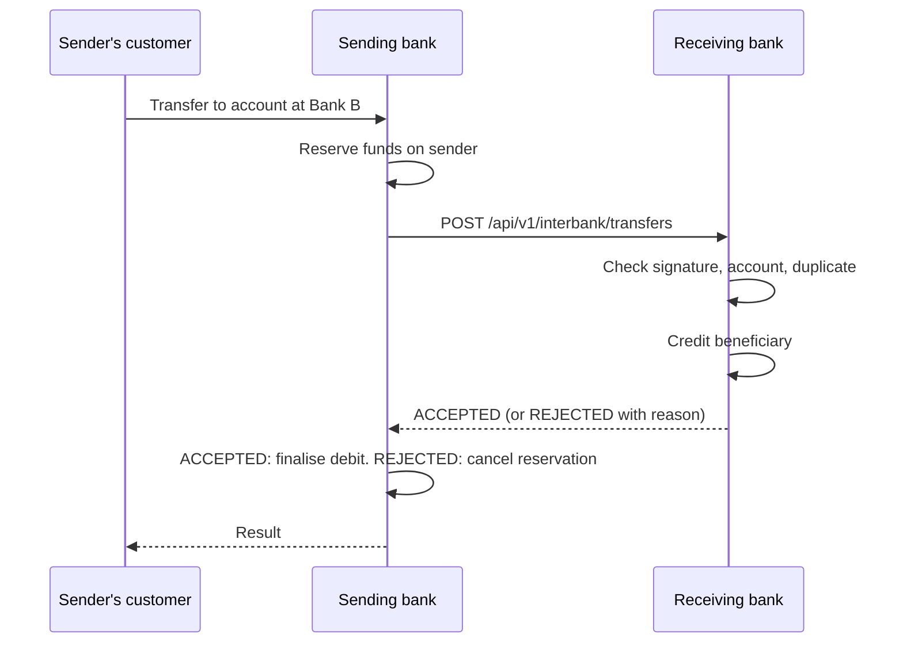

# Inter-Bank Transfer Proposal

**From:** Group 2 (CooBS)  
**To:** partner capstone groups  
**Version:** 0.9 draft for discussion  
**Goal:** let a customer of one group's bank send money to an account at another group's bank, with one small API that each side exposes.

This is a proposal. If your group already has an endpoint, tell us its shape using the sheet in section 9 and we will adapt to it on our side.

---

## 1. The idea in one paragraph

Each bank exposes **one webhook that accepts an incoming credit** and **one endpoint that reports its status**. The sending bank reserves the money on its own customer first, calls the receiving bank, and finalises or cancels based on the answer. No real money moves between groups: each bank keeps a settlement account per partner, and the two totals should match at the end of the demo.



---

## 2. What each bank exposes

| # | Method and path | Required | Purpose |
| --- | --- | --- | --- |
| 1 | `POST /api/v1/interbank/transfers` | Yes | Receive a credit for one of your accounts |
| 2 | `GET /api/v1/interbank/transfers/{messageId}` | Yes | Report what happened to a transfer you received |
| 3 | `GET /api/v1/interbank/accounts/{accountNumber}` | Optional | Confirm an account exists and return a masked name |

All bodies are JSON in UTF-8. The base URL is whatever each group shares, for example `https://<host>/` or `http://<ip>:8080/`.

---

## 3. Conventions

| Item | Rule | Example |
| --- | --- | --- |
| Bank code | 4 to 8 upper-case letters, chosen by each group, unique in the class | `COOBS` |
| Account number | String, as your bank formats it | `ACC_10000002` |
| Amount | **String** with exactly two decimals. Never a floating-point number | `"2500.00"` |
| Currency | ISO code. PHP only for now | `"PHP"` |
| Time | ISO-8601 in UTC with `Z` | `"2026-10-03T11:40:00Z"` |
| `messageId` | UUID created by the sending bank; unique for ever; also the idempotency key | `"0b6c2f6e-6d1a-4d5c-9d1f-0f3a5e7b9c21"` |

---

## 4. Security

Each pair of banks agrees one **shared secret**, exchanged in person or by private message, never committed to a repository.

Every request carries three headers:

| Header | Value |
| --- | --- |
| `X-Bank-Code` | The sender's bank code |
| `X-Timestamp` | Current time in ISO-8601 UTC |
| `X-Signature` | Hex of HMAC-SHA256 over `<X-Timestamp>.<raw request body>` using the shared secret |

For a `GET`, the raw body is the empty string, so the signed text is `<X-Timestamp>.`

The receiver rejects the request when:

- the bank code is unknown,
- the timestamp is more than five minutes from its own clock,
- the signature does not match.

**Signature, in pseudo-code**

```
signedText = timestamp + "." + rawBody
signature  = hex( HMAC_SHA256( key = sharedSecret, message = signedText ) )
```

**Simpler profile, if a group cannot do signatures in time:** one header `X-Api-Key: <shared secret>` together with `X-Bank-Code`. Both sides must agree to use it; the signed profile is preferred.

---

## 5. Endpoint 1: receive a transfer

`POST /api/v1/interbank/transfers`

**Request**

```json
{
  "messageId": "0b6c2f6e-6d1a-4d5c-9d1f-0f3a5e7b9c21",
  "sourceBankCode": "COOBS",
  "destinationBankCode": "BANKB",
  "sender": {
    "accountNumber": "ACC_10000001",
    "name": "John Doe"
  },
  "beneficiary": {
    "accountNumber": "1000-2000-3000",
    "name": "Juan Dela Cruz"
  },
  "amount": "2500.00",
  "currency": "PHP",
  "purpose": "Payment for services",
  "senderReference": "TX-20261003-8F3A21C0",
  "createdAt": "2026-10-03T11:40:00Z"
}
```

| Field | Required | Notes |
| --- | --- | --- |
| `messageId` | Yes | Same value on every retry of the same transfer |
| `sourceBankCode` | Yes | Must equal `X-Bank-Code` |
| `destinationBankCode` | Yes | Must be the receiver's own code |
| `sender.accountNumber`, `sender.name` | Yes | Shown to the beneficiary |
| `beneficiary.accountNumber` | Yes | |
| `beneficiary.name` | No | If sent, the receiver may compare it but should not reject on a mismatch |
| `amount`, `currency` | Yes | Greater than zero |
| `purpose` | No | At most 140 characters |
| `senderReference` | Yes | The sender's own reference, for support |
| `createdAt` | Yes | |

**Response when credited, HTTP 200**

```json
{
  "messageId": "0b6c2f6e-6d1a-4d5c-9d1f-0f3a5e7b9c21",
  "status": "ACCEPTED",
  "receiverReference": "IB-20261003-000045",
  "beneficiaryName": "J*** D*** C***",
  "creditedAt": "2026-10-03T11:40:01Z"
}
```

**Response when refused, HTTP 422**

```json
{
  "messageId": "0b6c2f6e-6d1a-4d5c-9d1f-0f3a5e7b9c21",
  "status": "REJECTED",
  "reasonCode": "ACCOUNT_NOT_FOUND",
  "reasonMessage": "No account with that number.",
  "rejectedAt": "2026-10-03T11:40:01Z"
}
```

**Rules**

- The receiver answers only after it has credited or refused. There is no "pending" answer.
- **Duplicate `messageId`:** return the first response again with the same HTTP code. Never credit twice.
- The receiver should answer within **5 seconds**.

**Reason codes**

| `reasonCode` | HTTP | Meaning |
| --- | --- | --- |
| `ACCOUNT_NOT_FOUND` | 422 | No such beneficiary account |
| `ACCOUNT_NOT_ACTIVE` | 422 | Frozen, dormant or closed |
| `CURRENCY_NOT_SUPPORTED` | 422 | Not PHP |
| `INVALID_AMOUNT` | 422 | Zero, negative, or not two decimals |
| `LIMIT_EXCEEDED` | 422 | Above the receiver's limit for one transfer |
| `WRONG_DESTINATION_BANK` | 422 | `destinationBankCode` is not the receiver |
| `INVALID_REQUEST` | 400 | A required field is missing or malformed |
| `UNKNOWN_BANK` | 401 | `X-Bank-Code` not recognised |
| `INVALID_SIGNATURE` | 401 | Signature or API key wrong |
| `TIMESTAMP_EXPIRED` | 401 | Timestamp outside the five-minute window |
| `RECEIVER_ERROR` | 500 | The receiver failed; the sender should check status before retrying |

---

## 6. Endpoint 2: transfer status

`GET /api/v1/interbank/transfers/{messageId}`

**Response, HTTP 200:** exactly the body the receiver returned (or would return) for that `messageId`, `ACCEPTED` or `REJECTED`.

**Response when the receiver never saw it, HTTP 404**

```json
{ "messageId": "0b6c2f6e-6d1a-4d5c-9d1f-0f3a5e7b9c21", "status": "NOT_FOUND" }
```

This endpoint is what makes timeouts safe: see section 8.

---

## 7. Endpoint 3: account check (optional)

`GET /api/v1/interbank/accounts/{accountNumber}`

**Response, HTTP 200**

```json
{ "accountNumber": "1000-2000-3000", "exists": true, "active": true, "maskedName": "J*** D*** C***", "currency": "PHP" }
```

**Response, HTTP 404:** `{ "accountNumber": "1000-2000-3000", "exists": false }`

Return a masked name only. Never return a balance or any other detail.

---

## 8. What the sending bank must do

| Situation | Action |
| --- | --- |
| Before calling | Reserve the amount on the sender's account |
| `ACCEPTED` | Finalise the debit; record the amount against the partner's settlement account |
| `REJECTED` | Cancel the reservation; show the customer a plain message |
| No answer within 5 s, or HTTP 5xx | Call the status endpoint. Retry it up to three times, a few seconds apart |
| Status says `ACCEPTED` or `REJECTED` | Act as above |
| Status says `NOT_FOUND` | Safe to send the original request again with the **same** `messageId` |
| Still no answer | Keep the reservation and flag the transfer for staff. **Never cancel on a timeout alone**, or the customer keeps money the other bank has already credited |

---

## 9. Settlement and reconciliation

- Each bank keeps one internal settlement account per partner.
- Outgoing transfers add to "we owe them"; incoming transfers add to "they owe us".
- Before the demo ends, both sides compare totals per partner: count and sum of `ACCEPTED` transfers in each direction. They should match exactly.

No money is actually exchanged between groups.

---

## 10. What we need from each partner group

Please send us this sheet, and we will send ours:

| Item | Your answer |
| --- | --- |
| Bank code | |
| Base URL reachable from our machines | |
| Do you accept this proposal as written? If not, your endpoint path and a sample request and response | |
| Security: signed profile, API key profile, or your own | |
| Account number format, with two test account numbers and names | |
| Amount format, if not a two-decimal string | |
| Do you treat a repeated `messageId` as a duplicate? | |
| Do you offer a status endpoint? | |
| Largest amount you accept in one transfer | |
| Contact person for integration | |

**Our values**

| Item | Value |
| --- | --- |
| Bank code | `COOBS` |
| Paths | As in section 2 |
| Security | Signed profile; API key profile on request |
| Account number format | `ACC_` followed by eight digits, for example `ACC_10000002` |
| Test accounts | To be shared with the secret |
| Largest single transfer | To be confirmed on Day 1 |

---

## 11. Test plan with a partner

| # | Test | Expected |
| --- | --- | --- |
| 1 | Send to a valid account | `ACCEPTED`; beneficiary balance rises by the amount |
| 2 | Send the same `messageId` again | Same response; balance does not change |
| 3 | Send to an unknown account | `REJECTED`, `ACCOUNT_NOT_FOUND`; sender's reservation cancelled |
| 4 | Send with a wrong signature | HTTP 401, `INVALID_SIGNATURE` |
| 5 | Send with an old timestamp | HTTP 401, `TIMESTAMP_EXPIRED` |
| 6 | Status of a known `messageId` | The original response |
| 7 | Status of an unknown `messageId` | HTTP 404, `NOT_FOUND` |
| 8 | Receiver switched off, then on | Sender keeps the reservation, finds the result by status, then finalises or resends |
| 9 | Compare settlement totals | Equal on both sides |

**Example call**

```bash
curl -X POST "https://<partner-host>/api/v1/interbank/transfers" \
  -H "Content-Type: application/json" \
  -H "X-Bank-Code: COOBS" \
  -H "X-Timestamp: 2026-10-03T11:40:00Z" \
  -H "X-Signature: <hex hmac>" \
  -d '{"messageId":"0b6c2f6e-6d1a-4d5c-9d1f-0f3a5e7b9c21","sourceBankCode":"COOBS","destinationBankCode":"BANKB","sender":{"accountNumber":"ACC_10000001","name":"John Doe"},"beneficiary":{"accountNumber":"1000-2000-3000","name":"Juan Dela Cruz"},"amount":"2500.00","currency":"PHP","purpose":"Payment for services","senderReference":"TX-20261003-8F3A21C0","createdAt":"2026-10-03T11:40:00Z"}'
```
