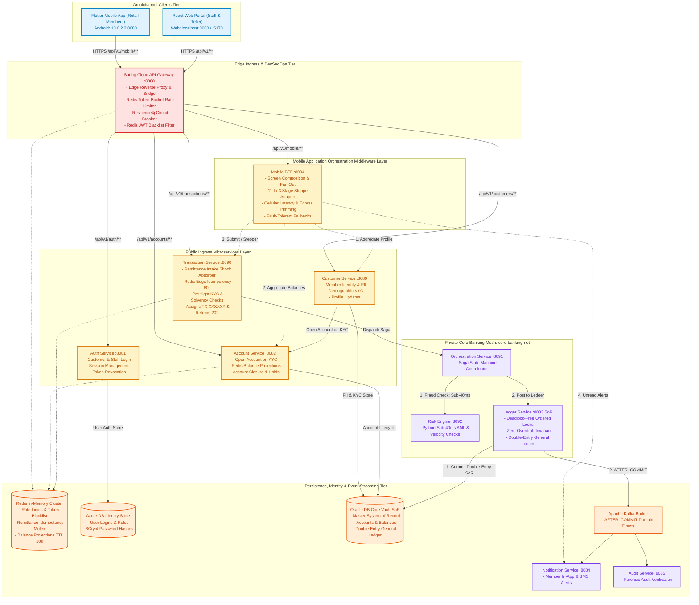
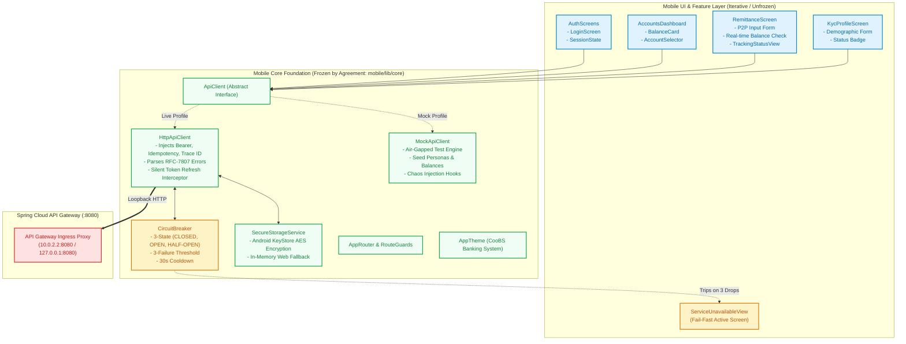

# CooBS Platform — Unified Remittance API & Omnichannel Mobile Contract Specification (CONTRACTS.md)

**Project:** Capstone 2: Omnichannel Real-Time Remittance & Fraud Screening  
**Document Version:** 2.4.0 (Streamlined Decomposed Architecture & Mobile Foundation)  
**Document Type:** Unified Contract Agreement across Mobile Applications (Neo), Core Backend (Ravi), and Edge DevSecOps  
**Milestone:** Day 1 Deliverable — *Domain Definition, Unified Contracts & Mobile Foundation* (`int.pdf` §1.B, §2, §3)  
**Enforcement:** Zero Breaking Changes across Client-Server Boundary  
**Base Architecture Documents:**  
* `docs/CooBS_Core_Remittance_Architecture.md` (Streamlined Services Breakdown)  
* `docs/COOBS_REMITTANCE_API_DESIGN_SPECIFICATION.md` (REST API Design Specification)  
* `docs/FLUTTER_FOUNDATION_ARCHITECTURE.md` (Mobile Clean Architecture & Resilience)

---

## 1. Executive Summary & Streamlined System Architecture

This contract document formalizes the planned **CooBS Core Remittance Architecture** (Capstone 2). It provides the definitive cross-track specification binding the **Cross-Platform Flutter Mobile Client** (Android & Web), the **Edge Security Gateway**, and the **Decomposed Microservices Banking Core**.



### 1.1 Architectural Decomposition Highlights

1. **Member Identity & PII Isolation (`customer-service` :8089):**  
   Autonomous service holding customer personal records, contact details, and KYC demographic submissions/update requests. Isolates Personally Identifiable Information (PII) under strict data privacy compliance (DPA/GDPR). Calls `account-service` internally to open initial deposit accounts upon verified KYC.
2. **Deposit Account Lifecycles & Direct Balance Projections (`account-service` :8082):**  
   Manages deposit account lifecycles (`ACTIVE`, `FROZEN`, `CLOSED`), administrative holds/flags, and account closure lifecycles with zero-balance enforcement. Serves high-speed balance projections directly from Redis (`TTL=10s`), shielding the ledger database from read spikes (e.g. payday traffic).
3. **Remittance Intake & Shock Absorber (`transaction-service` :8090):**  
   Direct client intake gateway. Enforces edge idempotency via Redis `SETNX`, executes pre-flight solvency and KYC status checks, writes initial intent records (`PENDING`) to `transaction_db`, assigns public tracking references (`TX-XXXXXX`), and dispatches to the Saga orchestrator. Returns **`202 Accepted` immediately** so the mobile app never freezes waiting on downstream systems.
4. **Private Banking Mesh (`orchestration-service` :8091, `risk-engine` :8092, `ledger-service` :8083):**  
   Shielded behind the Docker/Kubernetes internal network perimeter (`core-banking-net`). Direct external HTTP calls are strictly blocked by the Spring Cloud Gateway.
5. **Omnichannel Applications Layer (React Web & Flutter Mobile):**  
   * **React Web Frontend (`http://localhost:3000` / `:5173`):** Staff and Branch Teller/Admin portal running in modern browsers, utilizing Spring Cloud Gateway CORS policies for seamless secured interactions.
   * **Flutter Mobile App (`app/` — Android `10.0.2.2:8080`):** Retail Member application targeting native Android (and optional web dev on `:8088`), featuring dual-mode mock/live execution with fixtures (`app/assets/fixtures/`), hardware-backed credential encryption (Android KeyStore AES), and a client-side fail-fast circuit breaker routing to an active `ServiceUnavailableView` on infrastructure degradation. Native Android sockets bypass browser Same-Origin Policy (zero CORS friction).
6. **Mobile Backend-for-Frontend (BFF) Application Middleware (`mobile-bff` :8094):**  
   Dedicated application orchestration middleware sitting behind the API Gateway on the private cloud network (`core-banking-net`). Optimizes the retail mobile experience over high-latency cellular networks by providing screen-specific composition (e.g. single-trip `GET /api/v1/mobile/dashboard`), adapting the backend's 11-stage saga into the 3-stage customer progress view, trimming payloads to minimize cloud egress and device battery drain, and providing fault isolation with fallback defaults.

---

## 2. Global Ingress, Network Addressing & Header Standards

### 2.1 Network Addressing & Gateway Ingress Topology

All external client traffic enters strictly via the **Spring Cloud Gateway Reverse Proxy** on port `8080`.

| Platform / Caller | Host Address & URL | Gateway Target |
| :--- | :--- | :--- |
| **Flutter Android (Emulator)** | `http://10.0.2.2:8080` | Maps to Gateway host loopback |
| **Flutter Web / Desktop / iOS** | `http://127.0.0.1:8080` or `http://localhost:8080` | Localhost gateway binding |
| **Production / Cloud Ingress** | `https://api.coobs.local` | SSL Termination at Edge Ingress |
| **Internal Microservices Mesh** | Blocked for direct external access | Private network `core-banking-net` |

### 2.2 Ingress Port & Route Catalog

| Service | Container Port | Gateway Base Route | Ingress Type | Primary Domain Responsibility |
| :--- | :---: | :--- | :--- | :--- |
| **`api-gateway`** | `8080` | `/api/v1/**` | Public Edge | SSL Termination, Rate Limiting, Route Forwarding |
| **`mobile-bff`** | `8093` | `/api/v1/mobile/**` | Secured Edge | Mobile App Orchestration Middleware, Screen Aggregation & 3-Stage Stepper Adapter |
| **`auth-service`** | `8081` | `/api/v1/auth/**` | Public / Edge | JWT Authentication, Key Distribution, Session Revocation |
| **`customer-service`**| `8089` | `/api/v1/customers/**` | Secured Edge | Member Profile, Demographic KYC Submissions & Updates |
| **`account-service`** | `8082` | `/api/v1/accounts/**` | Secured Edge | Account Lifecycle, Flags, Cached Balance Lookups |
| **`transaction-service`**| `8090` | `/api/v1/transactions/**`| Secured Edge | Remittance Intake, Ingress Idempotency, Solvency & KYC Checks |
| **`orchestration-service`**| `8091` | `/api/v1/internal/saga/**`| Internal Mesh | Saga Coordination, Risk/Ledger Hand-off, Compensations |
| **`risk-engine`** | `8092` | `/api/v1/internal/risk/**`| Internal Mesh | Sub-40ms Algorithmic AML & Fraud Velocity Screening |
| **`ledger-service`** | `8083` | `/api/v1/internal/ledger/**`| Internal Mesh | Double-Entry SoR, Ordered Row Locks, Immutable Journal |
| **`notification-service`**| `8084` | `/api/v1/notifications/**`| Secured Edge | Member In-App & SMS Alerts via Kafka Consumer |
| **`audit-service`** | `8085` | `/api/v1/audit/**` | Staff / Auditor | Forensic Audit Verification & Ledger Journal Query |

### 2.3 Mandatory HTTP Request Headers

| Header Name | Format | Required On | Description & Behavior |
| :--- | :--- | :--- | :--- |
| `Authorization` | `Bearer <RSA256_JWT>` | All secured endpoints | Standard Bearer JWT containing claims: `sub`, `userId`, `roles`, `jti`. |
| `X-Correlation-ID` | `UUIDv4` | **All requests** | Distributed trace ID generated by client if omitted; propagated across Gateway, Ledger, Risk Engine, and Kafka. |
| `Idempotency-Key` | `UUIDv4` | Mutating requests (`POST`, `PUT`) | Mandatory on `/api/v1/transactions/remittance` and `/api/v1/accounts/**`. Prevents double charges during rapid mobile re-taps. |
| `Content-Type` | String | Requests with body | `application/json; charset=UTF-8` |
| `Accept` | String | All requests | `application/json` or `application/problem+json` |

### 2.4 Data Types & Numeric Precision Invariants

* **Monetary Values:** Fixed-point numeric string or `BigDecimal` strictly constrained to `scale: 4` with `RoundingMode.HALF_UP` (e.g., `"5000.0000"` or `5000.0000`). Binary floating points (`float`, `double`) are strictly prohibited across client and server.
* **Currency:** Philippine Peso (`PHP`), ISO-4217 standard.
* **Timestamps:** ISO-8601 UTC string format: `YYYY-MM-DDTHH:mm:ss.sssZ` (e.g. `2026-10-02T14:30:00.000Z`).
* **Identifiers:**
  * Account Numbers: `ACC_` followed by 8 numeric digits (e.g., `ACC_10000001`).
  * Tracking Reference: `TX-` followed by 8 alphanumeric characters (e.g., `TX-88392101`).
  * Core Ledger Reference: `TRF-` followed by tracking ID or sequence (e.g., `TRF-TX88392101`).

---

## 3. Standard Error Envelope (RFC-7807) & Domain Error Catalog

All 4xx and 5xx error responses emitted by the Spring Cloud Gateway, microservices, and client interceptors adhere strictly to RFC-7807 `application/problem+json`:

```json
{
  "type": "https://api.coobs.local/errors/INSUFFICIENT_FUNDS",
  "title": "Insufficient Funds",
  "status": 422,
  "detail": "Account ACC_10000005 has available balance ₱49,625.00, requested transfer amount ₱50,000.00 exceeds balance.",
  "instance": "/api/v1/transactions/remittance",
  "errorCode": "INSUFFICIENT_FUNDS",
  "timestamp": "2026-10-02T14:30:00.000Z",
  "invalidParams": [
    {
      "name": "amount",
      "reason": "Requested transfer amount exceeds available account balance."
    }
  ]
}
```

### 3.1 Domain Error Codes Catalog & Client UI Handling Rules

| Error Code | HTTP Status | Originating Service | Description & Client Handling Rule |
| :--- | :---: | :--- | :--- |
| `INVALID_CREDENTIALS` | `401` | `auth-service` | Username/password mismatch. Show error banner on login screen. |
| `AUTH_TOKEN_EXPIRED` | `401` | Gateway / Auth | Access token expired. Trigger silent `POST /api/v1/auth/token/refresh` flow; replay original request without user interruption. |
| `AUTH_TOKEN_REVOKED` | `401` | Gateway (Redis) | Session terminated by staff or user logout. Clear KeyStore credentials and navigate to `/login`. |
| `ACCOUNT_NOT_FOUND` | `404` | `account-service` | Target or source account does not exist. Highlight input field in red. |
| `ACCOUNT_FROZEN` | `422` | `account-service` | Target or source account has active administrative freeze. Display compliance alert modal. |
| `ACCOUNT_CLOSED` | `422` | `account-service` | Account terminated. Block selection in account picker. |
| `ACCOUNT_NON_ZERO_BALANCE` | `422` | `account-service` | Closure request rejected because balance $> 0.0000$. Prompt customer to transfer remaining funds. |
| `INSUFFICIENT_FUNDS` | `422` | `transaction-service` / Ledger | Solvency floor violated ($B_{\text{rem}} = B_{\text{curr}} - \text{Amount} < 0$). Form shows error banner; disables submit button. |
| `CONCURRENT_TRANSACTION_IN_FLIGHT` | `409` | `transaction-service` | Duplicate submission with same `Idempotency-Key` while request is pending. UI displays "Transaction Processing" spinner. |
| `TRANSFER_REJECTED_RISK_SCORE` | `422` | `risk-engine` / Saga | Fraud risk score $> 0.85$ (`int.pdf` §1.C). Transfer aborted immediately. Prompt user to contact branch support. |
| `RATE_LIMIT_EXCEEDED` | `429` | Gateway (Redis) | Client fired $> 10\text{ req/s}$ (Auth) or $> 20\text{ req/s}$ (Transactions). UI displays countdown wait timer. |
| `SERVICE_UNAVAILABLE` | `503` | Gateway / Breaker | 3 consecutive drops or timeouts trip client Circuit Breaker. Immediate reroute to `ServiceUnavailableView`. |

---

## 4. Public Microservice API Contracts (Gateway Ingress)

### 4.1 Authentication & Session Lifecycle (`/api/v1/auth/**` — Port 8081)

#### A. Customer Login (`POST /api/v1/auth/customers/login`)
* **Access:** Public
* **Request:**
```json
{
  "username": "john_doe",
  "password": "Password123!"
}
```
* **Response Body (`200 OK`):**
```json
{
  "accessToken": "eyJhbGciOiJSUzI1NiIsIn...",
  "refreshToken": "7b4c9e8a-e912-4011-80a2-11b22c33d44e",
  "tokenType": "Bearer",
  "expiresIn": 3600,
  "userId": 1,
  "username": "john_doe",
  "roles": ["ROLE_CUSTOMER"],
  "userType": "CUSTOMER"
}
```

#### B. Rotate Session Token (`POST /api/v1/auth/token/refresh`)
* **Request:**
```json
{
  "refreshToken": "7b4c9e8a-e912-4011-80a2-11b22c33d44e"
}
```
* **Response (200 OK):** Returns new `AuthResponseDto` with fresh access & refresh tokens.

#### C. Revoke Token / Logout (`POST /api/v1/auth/token/revoke`)
* **Headers:** `Authorization: Bearer <JWT>`
* **Behavior:** Blacklists JWT token ID (`jti`) in Redis with remaining TTL.
* **Response (200 OK):** `{"message": "Session revoked successfully."}`

---

### 4.2 Member Identity & KYC Service (`/api/v1/customers/**` — Port 8089)

#### A. Fetch Authenticated Member Profile (`GET /api/v1/customers/me`)
* **Access:** `ROLE_CUSTOMER`
* **Response Body (`200 OK`):**
```json
{
  "customerId": 101,
  "username": "john_doe",
  "email": "john.doe@coobs.local",
  "kycStatus": "VERIFIED",
  "kyc": {
    "kycId": 201,
    "firstName": "John",
    "middleInitial": "A",
    "lastName": "Doe",
    "address": "Barangay San Isidro, Nueva Ecija",
    "mobileNumber": "+639171234567",
    "civilStatus": "MARRIED",
    "occupation": "Agricultural Producer",
    "status": "VERIFIED",
    "createdAt": "2026-09-15T08:00:00.000Z"
  },
  "createdAt": "2026-09-15T08:00:00.000Z"
}
```

#### B. Submit Initial Demographic KYC (`POST /api/v1/customers/kyc/submit`)
* **Access:** `ROLE_CUSTOMER`
* **Request Body (`KycSubmitRequest`):**
```json
{
  "firstName": "John",
  "middleInitial": "A",
  "lastName": "Doe",
  "address": "Barangay San Isidro, Nueva Ecija",
  "civilStatus": "MARRIED",
  "occupation": "Agricultural Producer",
  "mobileNumber": "+639171234567"
}
```
* **Response Body (`201 Created` — `KycRequestResponse`):**
```json
{
  "kycId": 201,
  "customerId": 101,
  "status": "VERIFIED",
  "message": "Initial KYC demographic details submitted successfully."
}
```

#### C. Staged KYC Update Request (`POST /api/v1/customers/kyc/update-request`)
* **Access:** `ROLE_CUSTOMER`
* **Request Body (`KycUpdateRequestDto`):**
```json
{
  "newFirstName": "John",
  "newMiddleInitial": "A",
  "newLastName": "Doe",
  "newAddress": "Poblacion, Cabanatuan City, Nueva Ecija",
  "newMobileNumber": "+639189998888",
  "newCivilStatus": "MARRIED",
  "newOccupation": "Agricultural Cooperative Manager"
}
```
* **Response Body (`202 Accepted` — `KycRequestResponse`):**
```json
{
  "kycRequestId": 302,
  "customerId": 101,
  "status": "PENDING",
  "requestedAt": "2026-10-02T14:35:00.000Z",
  "message": "KYC update request submitted for staff review."
}
```

---

### 4.3 Deposit Accounts & Balance Projections (`/api/v1/accounts/**` — Port 8082)

#### A. Fetch Customer Accounts (`GET /api/v1/accounts/my-accounts`)
* **Access:** `ROLE_CUSTOMER`
* **Response Body (`200 OK`):**
```json
[
  {
    "accountId": 501,
    "customerId": 101,
    "accountNumber": "ACC_10000005",
    "accountType": "SAVINGS",
    "currency": "PHP",
    "status": "ACTIVE",
    "availableBalance": 50000.0000,
    "hasActiveFlags": false
  }
]
```

#### B. Read-Optimized Real-Time Balance Query (`GET /api/v1/accounts/{accountId}/balance`)
* **Access:** `ROLE_CUSTOMER`, `ROLE_TELLER`
* **Cache Architecture:** Served from Redis (`account:balance:{id}`, TTL=10s). Cache misses fall back to Azure DB read projections.
* **Response Body (`200 OK`):**
```json
{
  "accountId": 501,
  "accountNumber": "ACC_10000005",
  "currency": "PHP",
  "availableBalance": 50000.0000,
  "asOfTimestamp": "2026-10-02T14:55:00.000Z",
  "isCached": true
}
```

#### C. Account Closure Lifecycle (`POST /api/v1/accounts/{accountId}/closure-request`)
* **Access:** `ROLE_CUSTOMER`
* **Headers:** `Idempotency-Key: <UUID>`
* **Rule:** Rejects with `422 Unprocessable Entity` (`ACCOUNT_NON_ZERO_BALANCE`) if `availableBalance > 0.0000`.
* **Request Body:**
```json
{
  "reason": "Transferring all savings to cooperative share capital account."
}
```
* **Response Body (`202 Accepted`):**
```json
{
  "closureRequestId": 12,
  "accountId": 501,
  "accountNumber": "ACC_10000005",
  "status": "PENDING_APPROVAL",
  "requestedAt": "2026-10-02T15:00:00.000Z",
  "message": "Account closure request submitted for branch manager review."
}
```

---

### 4.4 Remittance Intake & Shock Absorber (`/api/v1/transactions/**` — Port 8090)

The **Transaction Service** is the client-facing intake shock absorber. It terminates client calls immediately after acquiring an edge idempotency lock and validating pre-flight solvency, preventing database thread exhaustion.

#### A. Remittance Submission (`POST /api/v1/transactions/remittance`)
* **Access:** `ROLE_CUSTOMER`, `ROLE_TELLER`
* **Mandatory Headers:**
  * `Authorization: Bearer <JWT>`
  * `Idempotency-Key: c9b1d6f2-87a4-4f01-b582-73a11b98a001` (UUIDv4)
  * `X-Correlation-ID: 41fa2143-6df2-4ce0-9831-419b4cf00122` (UUIDv4)
* **Lifecycle Rules:**
  1. **Edge Idempotency Lock:** Redis `SETNX` on `idempotency:remittance:{key}` with 60s TTL. Duplicate in-flight calls return `409 Conflict`.
  2. **Pre-Flight Solvency & KYC Check:** Verifies customer's KYC status is `VERIFIED` and source account holds sufficient available balance ($B_{\text{rem}} \ge 0.0000$).
  3. **Tracking Receipt:** Persists `PENDING` state to `transaction_db`, assigns public tracking reference `TX-88392101`.
  4. **Async Saga Trigger:** Hands off payload to `orchestration-service` (Port 8091).
  5. **Immediate Client Return:** Returns `202 Accepted` immediately so mobile UI never stalls.

* **Request Payload:**
```json
{
  "sourceAccountId": 501,
  "destinationAccountId": 502,
  "amount": 5000.0000,
  "currency": "PHP",
  "remarks": "Payment for agricultural tools"
}
```

* **Response Body (`202 Accepted` — Initial Ingress):**
```json
{
  "trackingReference": "TX-88392101",
  "sourceAccountId": 501,
  "destinationAccountId": 502,
  "amount": 5000.0000,
  "currency": "PHP",
  "status": "PENDING",
  "submittedAt": "2026-10-02T15:20:00.000Z",
  "message": "Remittance request accepted for processing. Tracking reference assigned."
}
```

* **Error Response (`422 Unprocessable Entity` — Insufficient Funds):**
```json
{
  "type": "https://api.coobs.local/errors/INSUFFICIENT_FUNDS",
  "title": "Insufficient Funds",
  "status": 422,
  "detail": "Account ACC_10000005 has available balance ₱4,000.0000, requested transfer amount ₱5,000.0000 exceeds available funds.",
  "errorCode": "INSUFFICIENT_FUNDS",
  "timestamp": "2026-10-02T15:20:00.000Z"
}
```

* **Error Response (`409 Conflict` — In-Flight Duplicate):**
```json
{
  "type": "https://api.coobs.local/errors/CONCURRENT_TRANSACTION_IN_FLIGHT",
  "title": "Transaction Already In Progress",
  "status": 409,
  "detail": "A transaction with this Idempotency-Key is currently being processed. Duplicate submission blocked.",
  "errorCode": "CONCURRENT_TRANSACTION_IN_FLIGHT",
  "timestamp": "2026-10-02T15:20:01.000Z"
}
```

#### B. Poll Remittance Status (`GET /api/v1/transactions/{trackingReference}`)
* **Access:** `ROLE_CUSTOMER`, `ROLE_TELLER`
* **Response Body (`200 OK` — Processing):**
```json
{
  "trackingReference": "TX-88392101",
  "sourceAccountId": 501,
  "destinationAccountId": 502,
  "amount": 5000.0000,
  "currency": "PHP",
  "status": "IN_ORCHESTRATION",
  "currentStep": "RISK_EVALUATION",
  "submittedAt": "2026-10-02T15:20:00.000Z",
  "completedAt": null
}
```
* **Response Body (`200 OK` — Completed & Committed):**
```json
{
  "trackingReference": "TX-88392101",
  "sourceAccountId": 501,
  "destinationAccountId": 502,
  "amount": 5000.0000,
  "currency": "PHP",
  "status": "COMPLETED",
  "currentStep": "POSTED_TO_LEDGER",
  "ledgerJournalReference": "TRF-TX88392101",
  "submittedAt": "2026-10-02T15:20:00.000Z",
  "completedAt": "2026-10-02T15:20:01.250Z"
}
```

#### C. Remittance Lifecycle Timeline & Stepper (T3: `GET /api/v1/transactions/{trackingReference}/timeline`)
* **Access:** `ROLE_CUSTOMER`, `ROLE_TELLER`, `ROLE_ADMIN`
* **Query Parameters:** `view=customer` | `view=staff` (Optional; defaults based on authenticated caller: `ROLE_CUSTOMER` defaults to `customer`, while `ROLE_TELLER` and `ROLE_ADMIN` default to `staff`).
* **Stage Partitioning Invariant (`TEAM_STATUS.md` §3.6):**
  * **Stages 1 to 3** are published by `transaction-service`.
  * **Stages 4 to 11** are published by `orchestration-service`.
  * `risk-engine` and `ledger-service` publish zero direct stage events.

##### 1. 11-Stage Staff / Internal Stepper Breakdown (`?view=staff` — React Teller & Ops Portal)
Used by branch staff and administrators for granular forensic audit of in-flight and completed remittances across microservice hops.

| Stage # | Stage Key | Emitting Service | Label in Stepper | Typical Latency | Status Values |
| :-: | :--- | :--- | :--- | :-: | :--- |
| **1** | `INGRESS_ACCEPTED` | `transaction-service` | Ingress & Edge Mutex Acquired | $< 10\text{ms}$ | `COMPLETED` |
| **2** | `PREFLIGHT_VALIDATED` | `transaction-service` | Solvency Invariant ($B_{\text{rem}} \ge 0$) Verified | $< 15\text{ms}$ | `COMPLETED` |
| **3** | `DISPATCHED_TO_ORCHESTRATOR` | `transaction-service` | Dispatched to Saga Engine | $< 20\text{ms}$ | `COMPLETED` |
| **4** | `SAGA_INITIALIZED` | `orchestration-service` | Saga Coordinator Initialized | $< 25\text{ms}$ | `COMPLETED` |
| **5** | `RISK_EVALUATION_REQUESTED` | `orchestration-service` | Risk Scoring Dispatched | $< 30\text{ms}$ | `COMPLETED` |
| **6** | `RISK_EVALUATION_COMPLETED` | `orchestration-service` | AML & Velocity Screened ($\le 0.85$) | $< 40\text{ms}$ | `COMPLETED`, `REJECTED` |
| **7** | `LEDGER_HOLD_RESERVED` | `orchestration-service` | Source Balance Hold Reserved | $< 60\text{ms}$ | `COMPLETED` |
| **8** | `LEDGER_POSTED` | `orchestration-service` | Double-Entry SoR Journal Committed | $< 100\text{ms}$ | `COMPLETED` |
| **9** | `EVENT_EMITTED` | `orchestration-service` | `ledger.transfer.completed.v1` Emitted | $< 120\text{ms}$ | `COMPLETED` |
| **10** | `NOTIFICATIONS_DISPATCHED` | `orchestration-service` | Member SMS / In-App Dispatched | $< 150\text{ms}$ | `COMPLETED` |
| **11** | `COMPLETED` | `orchestration-service` | Saga Reconciled & Terminal Completed | $< 160\text{ms}$ | `COMPLETED` |

* **Staff Response Body (`200 OK` — `T3-timeline-staff.response.json`):**
```json
{
  "trackingReference": "TX-88392101",
  "view": "STAFF",
  "currentStage": 11,
  "totalStages": 11,
  "overallStatus": "COMPLETED",
  "stages": [
    { "stageNumber": 1, "stageKey": "INGRESS_ACCEPTED", "title": "Ingress Accepted", "service": "transaction-service", "status": "COMPLETED", "timestamp": "2026-10-02T15:20:00.050Z" },
    { "stageNumber": 2, "stageKey": "PREFLIGHT_VALIDATED", "title": "Pre-flight Solvency Checked", "service": "transaction-service", "status": "COMPLETED", "timestamp": "2026-10-02T15:20:00.120Z" },
    { "stageNumber": 3, "stageKey": "DISPATCHED_TO_ORCHESTRATOR", "title": "Dispatched to Orchestrator", "service": "transaction-service", "status": "COMPLETED", "timestamp": "2026-10-02T15:20:00.180Z" },
    { "stageNumber": 4, "stageKey": "SAGA_INITIALIZED", "title": "Saga State Machine Initialized", "service": "orchestration-service", "status": "COMPLETED", "timestamp": "2026-10-02T15:20:00.220Z" },
    { "stageNumber": 5, "stageKey": "RISK_EVALUATION_REQUESTED", "title": "Risk Evaluation Requested", "service": "orchestration-service", "status": "COMPLETED", "timestamp": "2026-10-02T15:20:00.250Z" },
    { "stageNumber": 6, "stageKey": "RISK_EVALUATION_COMPLETED", "title": "Risk Screening Passed", "service": "orchestration-service", "status": "COMPLETED", "timestamp": "2026-10-02T15:20:00.290Z", "details": "Score: 0.12 (Low Risk)" },
    { "stageNumber": 7, "stageKey": "LEDGER_HOLD_RESERVED", "title": "Ledger Balance Hold Reserved", "service": "orchestration-service", "status": "COMPLETED", "timestamp": "2026-10-02T15:20:00.340Z" },
    { "stageNumber": 8, "stageKey": "LEDGER_POSTED", "title": "Double-Entry SoR Committed", "service": "orchestration-service", "status": "COMPLETED", "timestamp": "2026-10-02T15:20:00.580Z", "details": "Journal Ref: TRF-TX88392101" },
    { "stageNumber": 9, "stageKey": "EVENT_EMITTED", "title": "Domain Event Emitted", "service": "orchestration-service", "status": "COMPLETED", "timestamp": "2026-10-02T15:20:00.620Z", "details": "Topic: ledger.transfer.completed.v1" },
    { "stageNumber": 10, "stageKey": "NOTIFICATIONS_DISPATCHED", "title": "Member Notifications Sent", "service": "orchestration-service", "status": "COMPLETED", "timestamp": "2026-10-02T15:20:00.700Z" },
    { "stageNumber": 11, "stageKey": "COMPLETED", "title": "Saga Fully Reconciled", "service": "orchestration-service", "status": "COMPLETED", "timestamp": "2026-10-02T15:20:00.750Z" }
  ]
}
```

##### 2. 3-Stage Customer Progress View (`?view=customer` — Flutter Mobile Member App)
Aggregates technical backend saga stages into three clear member milestones:

| Step # | Step Key | Title in Mobile UI | Subtitle / Explanatory Text | Underneath Microservice Stages |
| :-: | :--- | :--- | :--- | :--- |
| **1** | `SUBMITTED` | Transfer Submitted | We have received your transfer and verified available funds. | Stages 1–3 |
| **2** | `IN_REVIEW` | Security & Clearance | Automated security screening and cooperative network clearing. | Stages 4–6 |
| **3** | `COMPLETED` | Transfer Completed | Funds deposited into recipient account successfully. | Stages 7–11 |

* **Customer Response Body (`200 OK` — `T3-timeline-customer.response.json`):**
```json
{
  "trackingReference": "TX-88392101",
  "view": "CUSTOMER",
  "currentStage": 3,
  "totalStages": 3,
  "overallStatus": "COMPLETED",
  "stages": [
    { "stageNumber": 1, "stageKey": "SUBMITTED", "title": "Transfer Submitted", "subtitle": "Your transfer request has been received and verified.", "status": "COMPLETED", "timestamp": "2026-10-02T15:20:00.180Z" },
    { "stageNumber": 2, "stageKey": "IN_REVIEW", "title": "Security & Clearing", "subtitle": "Automated security screening and bank network clearing.", "status": "COMPLETED", "timestamp": "2026-10-02T15:20:00.290Z" },
    { "stageNumber": 3, "stageKey": "COMPLETED", "title": "Transfer Completed", "subtitle": "Funds have been successfully deposited into the recipient's account.", "status": "COMPLETED", "timestamp": "2026-10-02T15:20:00.750Z" }
  ]
}
```

#### D. Customer Transaction History (T8: `GET /api/v1/transactions/my-transactions`)
* **Access:** `ROLE_CUSTOMER`
* **Query Parameters:** `page=0`, `size=20`, `status=COMPLETED` (optional)
* **Description:** Retrieves paginated transaction records belonging to the authenticated customer from `transaction_db`.

#### E. Staff Transaction History & Global Search (T9: `GET /api/v1/transactions/staff/search`)
* **Access:** `ROLE_TELLER`, `ROLE_ADMIN`
* **Query Parameters:** `query=<search_term>`, `status=IN_ORCHESTRATION`, `page=0`, `size=50`
* **Description:** Cross-account administrative lookup for audit, reconciliation, and customer service inquiries.

---

### 4.5 Mobile Backend-for-Frontend (BFF) Application Middleware Contracts (`/api/v1/mobile/**` — Port 8094)

The **Mobile BFF** is an application-level orchestration middleware deployed on the cloud private virtual network (`core-banking-net`). It sits between the Spring Cloud Gateway (:8080) and the core microservices, explicitly designed to eliminate high-latency cellular round-trips, trim cloud egress bandwidth, and adapt complex microservice states for the Flutter mobile client.

```
Flutter Mobile (4G/5G) ──► Gateway (:8080) ──► mobile-bff (:8094)
                                                     │
                             ┌───────────────────────┼───────────────────────┬───────────────────────┐
                             ▼ (1ms internal)        ▼ (1ms internal)        ▼ (1ms internal)        ▼ (1ms internal)
                      customer-service:8089   account-service:8082    transaction-service:8090 notification-service:8084
```

#### A. Mobile Composite Dashboard (`GET /api/v1/mobile/dashboard`)
* **Access:** `ROLE_CUSTOMER`
* **Network SLA:** Solves cellular round-trip chattiness. Executes 4 downstream calls in parallel over the cloud internal network, returning in $< 150\text{ms}$ over 4G/5G.
* **Downstream Fan-Out Calls:**
  1. `customer-service:8089/api/v1/customers/me` (Profile & KYC status)
  2. `account-service:8082/api/v1/accounts/my-accounts` (Accounts list & balances)
  3. `notification-service:8084/api/v1/notifications/unread-count` (Unread badge)
  4. `transaction-service:8090/api/v1/transactions/my-transactions?size=3` (Recent activity)
* **Fault-Tolerant Fallback Guarantee:** If `notification-service` degrades or times out, the BFF catches the exception, defaults `unreadNotifications = 0`, and successfully renders the dashboard rather than failing the mobile view.
* **Response Body (`200 OK` — `MobileDashboardResponse`):**
```json
{
  "member": {
    "customerId": 101,
    "displayName": "Juan Dela Cruz",
    "email": "juan.delacruz@coobs.local",
    "kycStatus": "VERIFIED"
  },
  "primaryAccount": {
    "accountId": 501,
    "accountNumber": "ACC_10000005",
    "accountType": "SAVINGS",
    "currency": "PHP",
    "availableBalance": 50000.0000,
    "formattedBalance": "₱50,000.00",
    "status": "ACTIVE"
  },
  "unreadNotifications": 2,
  "recentTransactions": [
    {
      "trackingReference": "TX-88392101",
      "amount": 5000.0000,
      "formattedAmount": "-₱5,000.00",
      "currency": "PHP",
      "status": "COMPLETED",
      "remarks": "Payment for agricultural tools",
      "submittedAt": "2026-10-02T15:20:00.000Z"
    }
  ]
}
```

#### B. Mobile 3-Stage Remittance Timeline Adapter (`GET /api/v1/mobile/transactions/{trackingReference}/timeline`)
* **Access:** `ROLE_CUSTOMER`
* **Middleware Adapter Pattern:** Calls downstream `transaction-service:8090/api/v1/transactions/{trackingReference}/timeline?view=staff` (11 stages) and translates/collapses the internal saga into the Flutter 3-stage user-friendly timeline (`SUBMITTED` $\to$ `IN_REVIEW` $\to$ `COMPLETED`).
* **Response Body (`200 OK` — `T3-timeline-customer.response.json`):**
```json
{
  "trackingReference": "TX-88392101",
  "view": "CUSTOMER",
  "currentStage": 3,
  "totalStages": 3,
  "overallStatus": "COMPLETED",
  "stages": [
    { "stageNumber": 1, "stageKey": "SUBMITTED", "title": "Transfer Submitted", "subtitle": "Your transfer request has been received and verified.", "status": "COMPLETED", "timestamp": "2026-10-02T15:20:00.180Z" },
    { "stageNumber": 2, "stageKey": "IN_REVIEW", "title": "Security & Clearing", "subtitle": "Automated security screening and bank network clearing.", "status": "COMPLETED", "timestamp": "2026-10-02T15:20:00.290Z" },
    { "stageNumber": 3, "stageKey": "COMPLETED", "title": "Transfer Completed", "subtitle": "Funds have been successfully deposited into the recipient's account.", "status": "COMPLETED", "timestamp": "2026-10-02T15:20:00.750Z" }
  ]
}
```

#### C. Mobile Remittance Ingress Dispatch (`POST /api/v1/mobile/transactions/remittance`)
* **Access:** `ROLE_CUSTOMER`
* **Mandatory Headers:** `Authorization: Bearer <token>`, `Idempotency-Key: <UUID>`, `X-Correlation-ID: <UUID>`
* **Behavior:** Validates payload format and delegates directly to `transaction-service:8090/api/v1/transactions/remittance`, propagating headers and returning the `202 Accepted` tracking receipt (`TX-XXXXXX`) immediately.

---

## 5. Internal Private Banking Mesh Contracts

These endpoints are strictly internal to the private service mesh (`core-banking-net`). External calls through the gateway are blocked.

### 5.1 Orchestration Service (`POST /api/v1/internal/saga/remittance` — Port 8091)
* **Caller:** `transaction-service`
* **Coordinates State Machine:**
  $$\text{PENDING\_RISK} \longrightarrow \text{RISK\_APPROVED} \longrightarrow \text{CORE\_PROCESSING} \longrightarrow \text{COMPLETED / REJECTED}$$
* **Payload:**
```json
{
  "trackingReference": "TX-88392101",
  "sourceAccountId": 501,
  "destinationAccountId": 502,
  "amount": 5000.0000,
  "currency": "PHP",
  "sourceCustomerId": 101,
  "clientIp": "192.168.1.100",
  "deviceId": "dev-and-99214-a"
}
```
* **Response Body (`200 OK`):**
```json
{
  "sagaId": "saga_49204-99124-ab",
  "trackingReference": "TX-88392101",
  "sagaStatus": "COMPLETED",
  "riskEvaluation": "APPROVED",
  "ledgerPosting": "COMMITTED"
}
```

### 5.2 Algorithmic Risk Engine (`POST /api/v1/internal/risk/evaluate` — Port 8092)
* **Caller:** `orchestration-service`
* **Performance Guarantee:** Evaluates velocity, geo-IP anomalies, and AML sanction lists in $< 40\text{ms}$.
* **Payload:**
```json
{
  "trackingReference": "TX-88392101",
  "customerId": 101,
  "sourceAccountId": 501,
  "amount": 5000.0000,
  "currency": "PHP",
  "clientIp": "192.168.1.100",
  "timestamp": "2026-10-02T15:20:00.100Z"
}
```
* **Response (`200 OK`):**
```json
{
  "riskScore": 0.12,
  "decision": "APPROVED",
  "reason": "Normal velocity; domestic mobile client IP; no sanction list hits.",
  "latencyMs": 28
}
```

### 5.3 Core Ledger Double-Entry Engine (`POST /api/v1/internal/ledger/post-transfer` — Port 8083)
* **Caller:** `orchestration-service` (Invoked strictly after risk approval).
* **Guarantees & Invariants:**
  1. **Deadlock-Free Ordered Pessimistic Row Locking:**
     $$\text{lockAcquisitionOrder} = [\min(\text{srcId}, \text{dstId}), \max(\text{srcId}, \text{dstId})]$$
     Accompanied by a 5000ms database lock timeout.
  2. **Zero-Overdraft Invariant ($B_{\text{rem}} \ge 0.0000$):** Rejects any transfer if balance would drop below zero.
  3. **Atomic Double-Entry Ledger Journal:** Writes balanced debit and credit entries ($\sum \text{debits} = \sum \text{credits}$) directly to the immutable Oracle DB ledger journal table within the same ACID transaction boundary, eliminating external database dual-write complexity.
  4. **Post-Commit Kafka Streaming:** Emits `ledger.transfer.completed.v1` on `TransactionPhase.AFTER_COMMIT`.

* **Request Payload:**
```json
{
  "transferReference": "TRF-TX88392101",
  "sourceAccountId": 501,
  "destinationAccountId": 502,
  "amount": 5000.0000,
  "remarks": "Remittance TX-88392101"
}
```

* **Response Body (`200 OK`):**
```json
{
  "transferReference": "TRF-TX88392101",
  "sourceAccountId": 501,
  "destinationAccountId": 502,
  "amount": 5000.0000,
  "sourcePreviousBalance": 50000.0000,
  "sourceNewBalance": 45000.0000,
  "destinationPreviousBalance": 10000.0000,
  "destinationNewBalance": 15000.0000,
  "status": "COMPLETED",
  "postedAt": "2026-10-02T15:20:00.800Z"
}
```

---

## 6. Omnichannel Mobile Layer: Architecture, Plans & Flutter Implementation

This section codifies the **Mobile Applications Layer (Flutter Cross-Platform Web & Android)** plans, fulfilling **Task 1** and **Task 2** (`int.pdf` §1.B, §2, §3).



### 6.1 Clean Architecture Directory Structure

The Flutter application code is strictly partitioned into **Core Foundation (Frozen by Agreement)** and **Feature Verticals (Iterative)**:

```
app/
├── pubspec.yaml                       # Dependencies: http, uuid, flutter_secure_storage, intl
├── README.md                          # Run instructions, freeze contract & test commands
├── assets/
│   └── fixtures/                      # Local JSON fixtures (H15) curated from contracts/examples/
├── lib/
│   ├── main.dart                      # Application entry point & environment initialization
│   ├── core/                          # === CORE FOUNDATION (FROZEN BY AGREEMENT - NEO) ===
│   │   ├── config/
│   │   │   └── app_config.dart        # Environment toggle (Fixture / Live), Gateway URLs & timeouts
│   │   ├── network/
│   │   │   ├── api_client.dart        # Abstract ApiClient interface & ApiResponse wrapper
│   │   │   ├── http_api_client.dart   # Live HTTP caller injecting headers & parsing RFC-7807
│   │   │   ├── fixture_api_client.dart# Air-gapped fixture client reading from assets/fixtures/
│   │   │   ├── circuit_breaker.dart   # 3-state fail-fast client resilience breaker (CLOSED/OPEN/HALF-OPEN)
│   │   │   └── api_exceptions.dart    # ProblemDetailsException, RateLimitException, ServiceUnavailableException
│   │   ├── storage/
│   │   │   └── secure_storage_service.dart # Android KeyStore wrapper with web memory fallback
│   │   ├── theme/
│   │   │   └── app_theme.dart         # CooBS Banking Design System (Deep Navy, Slate, Emerald)
│   │   ├── router/
│   │   │   └── app_router.dart        # Declarative named routing & auth route guards
│   │   └── mocks/
│   │       └── mock_api_client.dart   # In-memory ledger engine & chaos injection hooks
│   ├── shell/
│   │   └── app_shell.dart             # Responsive shell (Desktop NavRail vs Mobile BottomNav)
│   └── features/                      # === FEATURE VERTICALS (UNFROZEN / ITERATIVE - GABO) ===
│       ├── auth/                      # Login screen & session management
│       ├── accounts/                  # Account balance card, accounts list, pull-to-refresh
│       ├── remittance/                # P2P transfer form, client balance checks, 3-stage customer tracking
│       ├── kyc/                       # Member demographic profile, KYC update submissions
│       └── resilience/
│           └── service_unavailable_view.dart # Active fallback screen when Circuit Breaker trips
└── test/
    └── core_foundation_test.dart      # Runnable validation test verifying frozen core contracts
```

### 6.2 Dual-Mode API Strategy (Fixture / Mock vs. Live Gateway)

* **Abstract `ApiClient` Contract:** Every screen and BLoC/Cubit depends exclusively on the abstract `ApiClient` interface. Direct `http.Client` imports inside UI widgets are strictly banned.
* **`HttpApiClient` (Live Gateway Mode):**
  * **Android Native App:** Targets `http://10.0.2.2:8080` (Android Emulator loopback to host) or host machine LAN IP. Uses native Linux/Android sockets, bypassing browser Same-Origin Policy (zero CORS enforcement).
  * **React Web Frontend (Staff Portal):** Runs in browser on `http://localhost:3000` (CRA) or `http://localhost:5173` (Vite) and communicates through Gateway CORS.
  * **Optional Flutter Web Dev:** Runs on fixed port `http://localhost:8088` (`flutter run -d chrome --web-port=8088`) so it does not collide with React on `:3000`.
  * Automatically injects `Authorization: Bearer <token>`, `X-Correlation-ID: <UUID>`, and `Idempotency-Key: <UUID>` on mutations.
  * Intercepts `401 Unauthorized` with `AUTH_TOKEN_EXPIRED` to perform silent token refresh before failing.
* **`FixtureApiClient` / `MockApiClient` (Air-Gapped Offline Engine):**
  * Curates offline fixtures from `app/assets/fixtures/` (`H15`), mirroring `contracts/examples/`.
  * Maintains an in-memory ledger seeded with verified test personas (`john_doe`, `maria_santos`, `david_kim`).
  * Emulates network latency (default 80ms) and provides chaos hooks (`simulateTimeout = true`, `simulate503 = true`, `simulateRiskDrop = true`).

### 6.3 Client-Side Resilience & Circuit Breaker Logic (`int.pdf` §1.B)

To ensure the mobile client never spins indefinitely or freezes during downstream outages:

```
State: CLOSED (Normal Operation)
  │
  ├── Request fails (Timeout > 200ms, 500, 502, 503, SocketException)
  │   └── Increment _consecutiveFailures
  │
  └── If _consecutiveFailures >= 3
      │
      ▼
State: OPEN (Fail-Fast Active)
  │
  ├── Immediately throws CircuitBreakerOpenException without firing network calls
  ├── Navigator reroutes to ServiceUnavailableView ("Service Temporarily Unavailable")
  ├── UI displays 30-second cooldown timer
  │
  └── 30-Second Cooldown Expires
      │
      ▼
State: HALF-OPEN (Recovery Probe)
  │
  ├── Allows 1 probe call to /actuator/health
  ├── IF Probe Succeeds: _consecutiveFailures = 0, Transition to CLOSED
  └── IF Probe Fails: Reset timer, Transition back to OPEN for 30s
```

### 6.4 Hardware-Backed Credential Security & Token Lifecycle

* **Android KeyStore Integration:** `SecureStorageService` encrypts all credentials at rest using Android KeyStore with AES hardware-backed keychains.
* **Stored Keys:** `jwt_access_token`, `jwt_refresh_token`, `session_user_id`, `session_username`, `session_roles`.
* **Silent Token Rotation Flow:**
  1. Request to `/api/v1/accounts/my-accounts` returns 401 with `errorCode: "AUTH_TOKEN_EXPIRED"`.
  2. `HttpApiClient` intercepts response without bubbling error to UI.
  3. Fires `POST /api/v1/auth/token/refresh` with stored `jwt_refresh_token`.
  4. Stores new tokens in KeyStore.
  5. Re-executes the original request transparently.
* **Revocation & Purge Flow:**
  * When response returns 401 with `errorCode: "AUTH_TOKEN_REVOKED"`, all keys are wiped from `SecureStorageService`, and the router resets navigation to `/login`.

### 6.5 Mobile Feature Roadmap, Screen Flows & State Machines

#### Feature 1: Authentication & Session Management (`/login`)
* **Step 1:** Customer enters username & password.
* **Step 2:** On successful authentication (`200 OK`), tokens (`accessToken`, `refreshToken`) and user profile claims are securely persisted in `SecureStorageService`.
* **Step 3:** The app transitions immediately to `/dashboard`. Active token expiration intercepts `AUTH_TOKEN_EXPIRED` to perform transparent silent token refresh.

#### Feature 2: Accounts Dashboard & Real-Time Balance Cards (`/dashboard`)
* **Data Retrieval:** Calls `GET /api/v1/accounts/my-accounts`.
* **Balance Card:** Renders available balance formatted in Philippine Pesos (`₱50,000.00`).
* **Pull-to-Refresh:** Triggers `GET /api/v1/accounts/{id}/balance`, displaying the `isCached` indicator.

#### Feature 3: P2P Remittance Form & Transaction Tracking (`/remittance`)
* **Step 1 (Input & Pre-Validation):**
  * Source account selector (defaults to primary `SAVINGS`).
  * Destination account input with format validation (`ACC_XXXXXXXX`).
  * Amount input with client-side solvency invariant validation:
    $$\text{Amount} \le \text{AvailableBalance}$$
    Form blocks submission and displays inline banner if amount exceeds available funds.
* **Step 2 (Idempotent Dispatch):**
  * Generates `Idempotency-Key: UUIDv4`.
  * Generates `X-Correlation-ID: UUIDv4`.
  * Dispatches `POST /api/v1/transactions/remittance`.
  * Receives `202 Accepted` with `trackingReference` (`TX-88392101`).
* **Step 3 (Status Tracking Screen & Steppers):**
  * Navigates immediately to `/transfer-status/{trackingReference}`.
  * Polls `GET /api/v1/transactions/{trackingReference}/timeline?view=customer` every 1000ms (up to 15s).
  * **Flutter Mobile Customer Stepper (3 Stages):**
    $$\text{1. Transfer Submitted} \longrightarrow \text{2. Security \& Clearing} \longrightarrow \text{3. Transfer Completed}$$
    *Displays member-friendly status messages and timestamps without exposing internal infrastructure hops.*
  * **React Web Staff Stepper (11 Stages — Teller Portal):**
    $$\text{Ingress} \rightarrow \text{Pre-flight} \rightarrow \text{Dispatch} \rightarrow \text{Saga Init} \rightarrow \text{Risk Request} \rightarrow \text{Risk OK} \rightarrow \text{Hold} \rightarrow \text{Ledger Post} \rightarrow \text{Kafka Event} \rightarrow \text{Notification} \rightarrow \text{Completed}$$
    *Provides branch staff with full end-to-end distributed transaction auditability.*
  * When status reaches `COMPLETED`: Renders transaction success receipt and triggers dashboard balance refresh.

#### Feature 4: Member Profile & Demographic KYC (`/kyc`)
* Queries `GET /api/v1/customers/me`.
* Displays current status badge: `VERIFIED`, `PENDING_REVIEW`, or `UNVERIFIED`.
* Allows submitting `POST /api/v1/customers/kyc/update-request` for demographic changes.

#### Feature 5: Active Resilience Fallback (`/service-unavailable`)
* Renders automatically when `CircuitBreaker` trips to `OPEN`.
* Displays "Service Temporarily Unavailable", live countdown timer (30s), and manual "Retry Connection" button triggering the probe.

---

### 6.6 Mobile Dart Contract Models

These Dart data classes map 1:1 with the backend JSON contracts:

```dart
// ============================================================================
// 1. Authentication Models
// ============================================================================

class LoginResponse {
  final bool mfaRequired;
  final String? mfaToken;
  final String? deliveryChannel;
  final String? maskedDestination;
  final AuthData? authData;

  LoginResponse({
    required this.mfaRequired,
    this.mfaToken,
    this.deliveryChannel,
    this.maskedDestination,
    this.authData,
  });

  factory LoginResponse.fromJson(Map<String, dynamic> json) => LoginResponse(
    mfaRequired: json['mfaRequired'] as bool? ?? false,
    mfaToken: json['mfaToken'] as String?,
    deliveryChannel: json['deliveryChannel'] as String?,
    maskedDestination: json['maskedDestination'] as String?,
    authData: json['authData'] != null ? AuthData.fromJson(json['authData'] as Map<String, dynamic>) : null,
  );
}

class MfaVerifyRequest {
  final String mfaToken;
  final String code;

  MfaVerifyRequest({required this.mfaToken, required this.code});

  Map<String, dynamic> toJson() => {'mfaToken': mfaToken, 'code': code};
}

class AuthData {
  final String accessToken;
  final String refreshToken;
  final String tokenType;
  final int expiresIn;
  final int userId;
  final String username;
  final List<String> roles;
  final String userType;

  AuthData({
    required this.accessToken,
    required this.refreshToken,
    required this.tokenType,
    required this.expiresIn,
    required this.userId,
    required this.username,
    required this.roles,
    required this.userType,
  });

  factory AuthData.fromJson(Map<String, dynamic> json) {
    return AuthData(
      accessToken: json['accessToken'] as String,
      refreshToken: json['refreshToken'] as String,
      tokenType: json['tokenType'] as String? ?? 'Bearer',
      expiresIn: json['expiresIn'] as int? ?? 3600,
      userId: json['userId'] as int,
      username: json['username'] as String,
      roles: (json['roles'] as List<dynamic>?)?.map((e) => e.toString()).toList() ?? [],
      userType: json['userType'] as String? ?? 'CUSTOMER',
    );
  }
}

// ============================================================================
// 2. Account & Balance Models
// ============================================================================

class AccountModel {
  final int accountId;
  final int customerId;
  final String customerName;
  final String accountNumber;
  final String accountType;
  final String currency;
  final String status;
  final double availableBalance;
  final bool hasActiveFlags;

  AccountModel({
    required this.accountId,
    required this.customerId,
    required this.customerName,
    required this.accountNumber,
    required this.accountType,
    required this.currency,
    required this.status,
    required this.availableBalance,
    this.hasActiveFlags = false,
  });

  factory AccountModel.fromJson(Map<String, dynamic> json) {
    return AccountModel(
      accountId: json['accountId'] as int,
      customerId: json['customerId'] as int? ?? 0,
      customerName: json['customerName'] as String? ?? '',
      accountNumber: json['accountNumber'] as String,
      accountType: json['accountType'] as String,
      currency: json['currency'] as String? ?? 'PHP',
      status: json['status'] as String,
      availableBalance: (json['availableBalance'] is num)
          ? (json['availableBalance'] as num).toDouble()
          : double.tryParse(json['availableBalance'].toString()) ?? 0.0,
      hasActiveFlags: json['hasActiveFlags'] as bool? ?? false,
    );
  }
}

class BalanceModel {
  final int accountId;
  final String accountNumber;
  final String currency;
  final double availableBalance;
  final DateTime asOfTimestamp;
  final bool isCached;

  BalanceModel({
    required this.accountId,
    required this.accountNumber,
    required this.currency,
    required this.availableBalance,
    required this.asOfTimestamp,
    required this.isCached,
  });

  factory BalanceModel.fromJson(Map<String, dynamic> json) {
    return BalanceModel(
      accountId: json['accountId'] as int,
      accountNumber: json['accountNumber'] as String? ?? '',
      currency: json['currency'] as String? ?? 'PHP',
      availableBalance: (json['availableBalance'] is num)
          ? (json['availableBalance'] as num).toDouble()
          : double.tryParse(json['availableBalance'].toString()) ?? 0.0,
      asOfTimestamp: DateTime.tryParse(json['asOfTimestamp']?.toString() ?? '') ?? DateTime.now(),
      isCached: json['isCached'] as bool? ?? false,
    );
  }
}

// ============================================================================
// 3. Remittance Intake & Tracking Models (transaction-service)
// ============================================================================

class RemittanceRequest {
  final int sourceAccountId;
  final String destinationAccountNumber;
  final int? destinationAccountId;
  final String destinationBankCode;
  final double amount;
  final String currency;
  final String category;
  final String remarks;

  RemittanceRequest({
    required this.sourceAccountId,
    required this.destinationAccountNumber,
    this.destinationAccountId,
    this.destinationBankCode = 'COOBS',
    required this.amount,
    this.currency = 'PHP',
    this.category = 'TRANSFER',
    required this.remarks,
  });

  Map<String, dynamic> toJson() => {
    'sourceAccountId': sourceAccountId,
    'destinationAccountNumber': destinationAccountNumber,
    if (destinationAccountId != null) 'destinationAccountId': destinationAccountId,
    'destinationBankCode': destinationBankCode,
    'amount': amount.toStringAsFixed(2),
    'currency': currency,
    'category': category,
    'remarks': remarks,
  };
}

class RemittanceReceipt {
  final String trackingReference;
  final String? transactionId;
  final int sourceAccountId;
  final int? destinationAccountId;
  final String? destinationAccountNumber;
  final double amount;
  final String currency;
  final String status;
  final DateTime submittedAt;
  final String message;
  final String? timelineUrl;

  RemittanceReceipt({
    required this.trackingReference,
    this.transactionId,
    required this.sourceAccountId,
    this.destinationAccountId,
    this.destinationAccountNumber,
    required this.amount,
    required this.currency,
    required this.status,
    required this.submittedAt,
    required this.message,
    this.timelineUrl,
  });

  factory RemittanceReceipt.fromJson(Map<String, dynamic> json) {
    return RemittanceReceipt(
      trackingReference: (json['trackingReference'] ?? json['referenceNo'] ?? json['transactionId'] ?? '') as String,
      transactionId: json['transactionId'] as String?,
      sourceAccountId: json['sourceAccountId'] as int? ?? 0,
      destinationAccountId: json['destinationAccountId'] as int?,
      destinationAccountNumber: json['destinationAccountNumber'] as String?,
      amount: (json['amount'] is num)
          ? (json['amount'] as num).toDouble()
          : double.tryParse(json['amount']?.toString() ?? '0.0') ?? 0.0,
      currency: json['currency'] as String? ?? 'PHP',
      status: json['status'] as String? ?? 'PENDING',
      submittedAt: DateTime.tryParse(json['submittedAt']?.toString() ?? json['createdAt']?.toString() ?? '') ?? DateTime.now(),
      message: json['message'] as String? ?? '',
      timelineUrl: json['timelineUrl'] as String?,
    );
  }
}

class TransactionStatusModel {
  final String trackingReference;
  final int sourceAccountId;
  final int destinationAccountId;
  final double amount;
  final String currency;
  final String status; // PENDING, IN_ORCHESTRATION, COMPLETED, REJECTED
  final String? currentStep;
  final String? ledgerJournalReference;
  final DateTime submittedAt;
  final DateTime? completedAt;

  TransactionStatusModel({
    required this.trackingReference,
    required this.sourceAccountId,
    required this.destinationAccountId,
    required this.amount,
    required this.currency,
    required this.status,
    this.currentStep,
    this.ledgerJournalReference,
    required this.submittedAt,
    this.completedAt,
  });

  bool get isTerminal => status == 'COMPLETED' || status == 'REJECTED';
  bool get isSuccess => status == 'COMPLETED';

  factory TransactionStatusModel.fromJson(Map<String, dynamic> json) {
    return TransactionStatusModel(
      trackingReference: json['trackingReference'] as String,
      sourceAccountId: json['sourceAccountId'] as int,
      destinationAccountId: json['destinationAccountId'] as int,
      amount: (json['amount'] is num)
          ? (json['amount'] as num).toDouble()
          : double.tryParse(json['amount'].toString()) ?? 0.0,
      currency: json['currency'] as String? ?? 'PHP',
      status: json['status'] as String,
      currentStep: json['currentStep'] as String?,
      ledgerJournalReference: json['ledgerJournalReference'] as String?,
      submittedAt: DateTime.tryParse(json['submittedAt']?.toString() ?? '') ?? DateTime.now(),
      completedAt: json['completedAt'] != null ? DateTime.tryParse(json['completedAt'].toString()) : null,
    );
  }
}

// ============================================================================
// 4. RFC-7807 Problem Details Error Model
// ============================================================================

class ProblemDetails {
  final String type;
  final String title;
  final int status;
  final String detail;
  final String instance;
  final String errorCode;
  final DateTime timestamp;
  final List<Map<String, String>>? invalidParams;

  ProblemDetails({
    required this.type,
    required this.title,
    required this.status,
    required this.detail,
    required this.instance,
    required this.errorCode,
    required this.timestamp,
    this.invalidParams,
  });

  factory ProblemDetails.fromJson(Map<String, dynamic> json) {
    List<Map<String, String>>? params;
    if (json['invalidParams'] is List) {
      params = (json['invalidParams'] as List).map((e) {
        if (e is Map) {
          return e.map((k, v) => MapEntry(k.toString(), v.toString()));
        }
        return <String, String>{};
      }).toList();
    }
    return ProblemDetails(
      type: json['type'] as String? ?? 'about:blank',
      title: json['title'] as String? ?? 'Error',
      status: json['status'] as int? ?? 500,
      detail: json['detail'] as String? ?? 'An unexpected error occurred.',
      instance: json['instance'] as String? ?? '',
      errorCode: json['errorCode'] as String? ?? 'UNKNOWN_ERROR',
      timestamp: DateTime.tryParse(json['timestamp']?.toString() ?? '') ?? DateTime.now(),
      invalidParams: params,
    );
  }
}
// ============================================================================
// 5. Remittance Timeline & Stepper Models (Endpoint T3)
// ============================================================================

class TimelineStage {
  final int stageNumber;
  final String stageKey;
  final String title;
  final String? subtitle;
  final String? service;
  final String status; // COMPLETED, IN_PROGRESS, PENDING, FAILED, REJECTED
  final DateTime? timestamp;
  final String? details;

  TimelineStage({
    required this.stageNumber,
    required this.stageKey,
    required this.title,
    this.subtitle,
    this.service,
    required this.status,
    this.timestamp,
    this.details,
  });

  bool get isCompleted => status == 'COMPLETED';
  bool get isInProgress => status == 'IN_PROGRESS';
  bool get isFailed => status == 'FAILED' || status == 'REJECTED';

  factory TimelineStage.fromJson(Map<String, dynamic> json) {
    final rawKey = (json['stageKey'] ?? json['stageName'] ?? 'UNKNOWN').toString();
    final defaultTitle = rawKey.replaceAll('_', ' ');
    return TimelineStage(
      stageNumber: (json['stageNumber'] ?? json['stageNo'] ?? 1) as int,
      stageKey: rawKey,
      title: json['title'] as String? ?? defaultTitle,
      subtitle: json['subtitle'] as String?,
      service: json['service'] as String?,
      status: (json['status'] ?? json['outcome'] ?? 'PENDING').toString(),
      timestamp: DateTime.tryParse(json['timestamp']?.toString() ?? json['occurredAt']?.toString() ?? ''),
      details: (json['details'] ?? json['detail']) as String?,
    );
  }
}

class TransactionTimelineResponse {
  final String trackingReference;
  final String view; // CUSTOMER (3 stages) or STAFF (11 stages)
  final int currentStage;
  final int totalStages;
  final String overallStatus;
  final List<TimelineStage> stages;

  TransactionTimelineResponse({
    required this.trackingReference,
    required this.view,
    required this.currentStage,
    required this.totalStages,
    required this.overallStatus,
    required this.stages,
  });

  bool get isTerminalSuccess => overallStatus == 'COMPLETED';
  bool get isTerminalFailure => overallStatus == 'FAILED' || overallStatus == 'REJECTED';

  factory TransactionTimelineResponse.fromJson(Map<String, dynamic> json) {
    final rawStages = json['stages'] as List<dynamic>? ?? [];
    return TransactionTimelineResponse(
      trackingReference: json['trackingReference'] as String,
      view: json['view'] as String? ?? 'CUSTOMER',
      currentStage: json['currentStage'] as int? ?? 1,
      totalStages: json['totalStages'] as int? ?? rawStages.length,
      overallStatus: json['overallStatus'] as String? ?? 'IN_PROGRESS',
      stages: rawStages.map((e) => TimelineStage.fromJson(e as Map<String, dynamic>)).toList(),
    );
  }
}
// ============================================================================
// 6. Mobile Dashboard Aggregation Models (mobile-bff)
// ============================================================================

class MobileMemberSummary {
  final int customerId;
  final String displayName;
  final String email;
  final String kycStatus;

  MobileMemberSummary({
    required this.customerId,
    required this.displayName,
    required this.email,
    required this.kycStatus,
  });

  factory MobileMemberSummary.fromJson(Map<String, dynamic> json) => MobileMemberSummary(
    customerId: json['customerId'] as int,
    displayName: json['displayName'] as String? ?? '',
    email: json['email'] as String? ?? '',
    kycStatus: json['kycStatus'] as String? ?? 'UNVERIFIED',
  );
}

class MobileAccountSummary {
  final int accountId;
  final String accountNumber;
  final String accountType;
  final String currency;
  final double availableBalance;
  final String formattedBalance;
  final String status;

  MobileAccountSummary({
    required this.accountId,
    required this.accountNumber,
    required this.accountType,
    required this.currency,
    required this.availableBalance,
    required this.formattedBalance,
    required this.status,
  });

  factory MobileAccountSummary.fromJson(Map<String, dynamic> json) => MobileAccountSummary(
    accountId: json['accountId'] as int,
    accountNumber: json['accountNumber'] as String? ?? '',
    accountType: json['accountType'] as String? ?? 'SAVINGS',
    currency: json['currency'] as String? ?? 'PHP',
    availableBalance: (json['availableBalance'] is num)
        ? (json['availableBalance'] as num).toDouble()
        : double.tryParse(json['availableBalance'].toString()) ?? 0.0,
    formattedBalance: json['formattedBalance'] as String? ?? '₱0.00',
    status: json['status'] as String? ?? 'ACTIVE',
  );
}

class MobileRecentTransaction {
  final String trackingReference;
  final double amount;
  final String formattedAmount;
  final String currency;
  final String status;
  final String remarks;
  final DateTime submittedAt;

  MobileRecentTransaction({
    required this.trackingReference,
    required this.amount,
    required this.formattedAmount,
    required this.currency,
    required this.status,
    required this.remarks,
    required this.submittedAt,
  });

  factory MobileRecentTransaction.fromJson(Map<String, dynamic> json) => MobileRecentTransaction(
    trackingReference: json['trackingReference'] as String,
    amount: (json['amount'] is num)
        ? (json['amount'] as num).toDouble()
        : double.tryParse(json['amount'].toString()) ?? 0.0,
    formattedAmount: json['formattedAmount'] as String? ?? '',
    currency: json['currency'] as String? ?? 'PHP',
    status: json['status'] as String? ?? 'COMPLETED',
    remarks: json['remarks'] as String? ?? '',
    submittedAt: DateTime.tryParse(json['submittedAt']?.toString() ?? '') ?? DateTime.now(),
  );
}

class MobileDashboardResponse {
  final MobileMemberSummary member;
  final MobileAccountSummary primaryAccount;
  final int unreadNotifications;
  final List<MobileRecentTransaction> recentTransactions;

  MobileDashboardResponse({
    required this.member,
    required this.primaryAccount,
    required this.unreadNotifications,
    required this.recentTransactions,
  });

  factory MobileDashboardResponse.fromJson(Map<String, dynamic> json) {
    return MobileDashboardResponse(
      member: MobileMemberSummary.fromJson(json['member'] as Map<String, dynamic>),
      primaryAccount: MobileAccountSummary.fromJson(json['primaryAccount'] as Map<String, dynamic>),
      unreadNotifications: json['unreadNotifications'] as int? ?? 0,
      recentTransactions: (json['recentTransactions'] as List<dynamic>?)
          ?.map((e) => MobileRecentTransaction.fromJson(e as Map<String, dynamic>))
          .toList() ?? [],
    );
  }
}
```

### 6.7 React Web Frontend TypeScript Contracts (`src/types/remittance.ts`)

These TypeScript interfaces bind the React Staff & Teller Web Portal to the Gateway endpoints:

```typescript
export type RemittanceViewType = 'CUSTOMER' | 'STAFF';

export type StageStatus = 'PENDING' | 'IN_PROGRESS' | 'COMPLETED' | 'FAILED' | 'REJECTED';

export interface TimelineStageDto {
  stageNumber: number;
  stageKey: string;
  title: string;
  subtitle?: string;
  service?: string;
  status: StageStatus;
  timestamp?: string;
  details?: string;
}

export interface TransactionTimelineDto {
  trackingReference: string;
  view: RemittanceViewType;
  currentStage: number;
  totalStages: number;
  overallStatus: string;
  stages: TimelineStageDto[];
}

export interface RemittanceSubmissionDto {
  sourceAccountId: number;
  destinationAccountId: number;
  amount: number;
  currency: string;
  remarks: string;
}

export interface RemittanceReceiptDto {
  trackingReference: string;
  sourceAccountId: number;
  destinationAccountId: number;
  amount: number;
  currency: string;
  status: string;
  submittedAt: string;
  message: string;
}
```

### 6.8 Handshake H14: Dual-Client Ingress, Port Assignment & Gateway CORS

To prevent port conflicts and enable zero-friction browser security across cloud and local runtimes:

| Client Application | Technology | Target Environment | Host & Port | Ingress Mechanism & Route | CORS Handling |
| :--- | :--- | :--- | :--- | :--- | :--- |
| **Branch Teller / Ops Web** | **React** (Vite / CRA) | Chrome / Edge Browser | `http://localhost:3000`<br/>or `http://localhost:5173` | Spring Cloud Gateway (:8080)<br/>`-> /api/v1/**` | **Handled by Gateway CORS** (`allowedOrigins: [":3000", ":5173"]`) |
| **Retail Member Mobile** | **Flutter** | Android Emulator / Device | `http://10.0.2.2:8080`<br/>(Device: LAN IP / `adb reverse`) | Spring Cloud Gateway (:8080)<br/>`-> /api/v1/mobile/**` -> `mobile-bff:8094` | **Bypassed** (Native OS network socket; no browser origin) |
| **Flutter Web Dev (Optional)**| **Flutter** | Chrome Browser | `http://localhost:8088`<br/>(`--web-port=8088`) | Spring Cloud Gateway (:8080)<br/>`-> /api/v1/mobile/**` | **Handled by Gateway CORS** (`allowedOrigins: [":8088"]`) |

---

## 7. Air-Gapped Test Personas & Seed Ledger State

Both the backend database fixtures and the mobile `MockApiClient` are initialized with the following verified personas:

| Persona | Username | Password | Customer ID | Account ID | Account Number | Account Type | Initial Balance | KYC Status | Role Scope |
| :--- | :--- | :--- | :--- | :---: | :---: | :--- | :---: | :---: | :--- | :---: |
| **Retail Customer 1** | `john_doe` | `Password123!` | `101` | `501` | `ACC_10000005` | `SAVINGS` | **₱50,000.00** | `VERIFIED` | `ROLE_CUSTOMER` |
| **Retail Customer 2** | `maria_santos` | `Password123!` | `102` | `502` | `ACC_10000006` | `CHECKING` | **₱25,000.00** | `VERIFIED` | `ROLE_CUSTOMER` |
| **Retail Customer 3** | `david_kim` | `Password123!` | `103` | `503` | `ACC_10000007` | `SAVINGS` | **₱100,000.00** | `VERIFIED` | `ROLE_CUSTOMER` |
| **Branch Teller** | `teller_alice` | `Password123!` | — | — | — | Staff | — | `VERIFIED` | `ROLE_TELLER` |
| **Branch Manager** | `admin` | `Password123!` | — | — | — | Admin | — | `VERIFIED` | `ROLE_ADMIN` |

---

## 8. Chaos Engineering & Evaluation Scenarios Verification Matrix

To satisfy the failure scenario evaluations mandated in `int.pdf` §2, the client and server contracts enforce the following automated behaviors:

| Scenario / Trigger | System Layer Tested | Invariant & Contract Behavior | Expected Mobile Client Experience |
| :--- | :--- | :--- | :--- |
| **1. Database Outage / Gateway Drop** | `api-gateway` / Core Services | Returns 500/502/503 or dropped TCP socket. | Client Circuit Breaker trips after 3 failures; immediately redirects to `ServiceUnavailableView` ("Service Temporarily Unavailable"). Displays 30s cooldown. |
| **2. Rapid Double-Tap Transfer** | `transaction-service` (Redis) | Redis `SETNX` lock on `Idempotency-Key` blocks duplicate within 60s; returns `409 Conflict`. | Mobile app intercepts 409 and displays "Transaction Processing" overlay; zero duplicate funds debited. |
| **3. Insufficient Funds Transfer** | `transaction-service` / Ledger | Pre-flight validation confirms $B_{\text{rem}} = B_{\text{curr}} - \text{Amount} < 0$. Returns RFC-7807 422 `INSUFFICIENT_FUNDS`. | Remittance form renders red error banner before debit attempt; submit button disabled. |
| **4. High-Risk Transfer Detection** | `risk-engine` (Sub-40ms AML) | Risk engine assigns score $> 0.85$. Orchestrator aborts saga, marks `REJECTED`. | Status tracking view shows rejection status: "Transfer declined by automated compliance screening." |
| **5. Token Revocation via Redis** | Gateway Filter (`TokenBlacklistFilter`) | Gateway detects revoked `jti` in Redis; terminates request with 401 `AUTH_TOKEN_REVOKED`. | Client clears KeyStore credentials and redirects to `/login` with session expiry notification. |

---

## 9. Sign-off & Contract Freeze Agreement

* **Mobile Track Lead (Neo):** Agrees to use pure Dart models matching Section 6.6 with zero custom endpoints. Owns the **Mobile BFF Middleware (`mobile-bff` :8094)** and Flutter core under `app/lib/core`, declared **FROZEN**.
* **Frontend Web Lead:** Agrees to use TypeScript contracts matching Section 6.7 for React Staff & Teller Portal, connecting via Gateway port `8080` under CORS origin `http://localhost:3000` / `:5173`.
* **Full-Stack Track Lead (Ravi):** Agrees to adhere strictly to the planned decomposed service routes (`customer-service` :8089, `account-service` :8082, `transaction-service` :8090, `orchestration-service` :8091, `risk-engine` :8092, `ledger-service` :8083), emit RFC-7807 error envelopes, and enforce zero-overdraft balance invariant ($B_{\text{rem}} \ge 0$).
* **Cloud DevSecOps Lead (Jared):** Agrees to route public endpoints exclusively via port `8080`, map `/api/v1/mobile/**` to `mobile-bff:8094`, block direct external access to internal mesh services, and enforce Redis rate limiting, token blacklisting, and CORS origin whitelisting (`:3000`, `:5173`, `:8088`).
