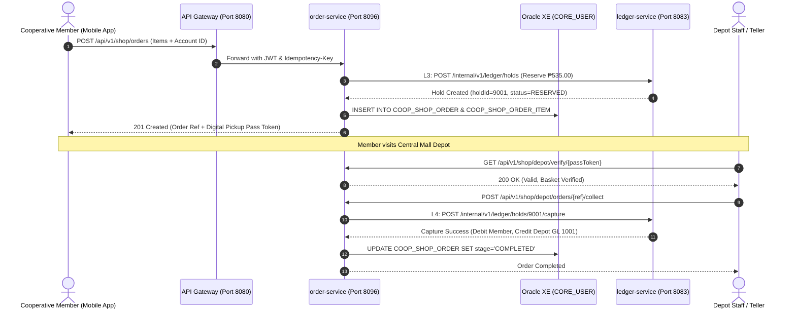

# CooBS Co-op Essentials Depot & Two-Phase Escrow Order Service

## 1. Executive Summary & Purpose

The **`order-service`** is a dedicated Spring Boot microservice engineered for **CooBS (Cooperative Banking System)**. It manages the **Cooperative Essentials Depot** grocery catalogue and provides a financial **Two-Phase Escrow Reservation Bridge** into the core ledger (`ledger-service`).

In accordance with Cooperative Development Authority (CDA) principles, agricultural and multipurpose cooperatives operate member-subsidized retail depots (e.g. PureSilver Essentials) selling zero-markup staples (rice, eggs, dairy) directly sourced from farmer member cooperatives.

Instead of directly deducting money upon order placement, `order-service` leverages the core banking **Two-Phase Hold Protocol (`L3`–`L5`)**:
1. **Hold Placed (`L3`)**: Member account funds are reserved (held) when the order is submitted. The funds remain in the member's account but are blocked from withdrawal.
2. **Hold Captured (`L4`)**: Upon physical pickup at the cooperative depot, teller/staff scans the member's **Digital Pickup QR Pass**, triggering ledger capture that atomically transfers funds into the Depot Merchant Account.
3. **Hold Released (`L5`)**: If the member cancels before basket preparation, the hold is released back to available balance without penalty.

---

## 2. Microservice Architecture & Port Allocations

- **Service Name**: `order-service`
- **Module Path**: `backend/order-service`
- **Default Port**: `8096` (`${SERVER_PORT:8096}`)
- **API Gateway Path**: `/api/v1/shop/**` and `/api/v1/orders/**`
- **Database**: Oracle XE `CORE_USER` schema
- **Downstream Financial Dependency**: `ledger-service` (`http://localhost:8083/internal/v1/ledger/holds`)

### Service Interaction Diagram



---

## 3. Oracle Database Schema (DDL)

```sql
-- 28. COOP_SHOP_PRODUCT TABLE (Catalogue & Produce Provenance)
CREATE TABLE COOP_SHOP_PRODUCT (
    product_id NUMBER(19) GENERATED BY DEFAULT ON NULL AS IDENTITY (START WITH 100) PRIMARY KEY,
    sku VARCHAR2(64) NOT NULL UNIQUE,
    name VARCHAR2(150) NOT NULL,
    category VARCHAR2(50) NOT NULL,
    unit VARCHAR2(80) NOT NULL,
    price NUMBER(18, 4) NOT NULL,
    original_price NUMBER(18, 4),
    badge VARCHAR2(50),
    farm_source VARCHAR2(255),
    stock_quantity NUMBER(10) DEFAULT 999 NOT NULL,
    is_active NUMBER(1) DEFAULT 1 NOT NULL,
    created_at TIMESTAMP DEFAULT CURRENT_TIMESTAMP NOT NULL
);

-- 29. COOP_SHOP_ORDER TABLE (Two-Phase Escrow Reservation & Digital Pickup Vouchers)
CREATE TABLE COOP_SHOP_ORDER (
    order_id NUMBER(19) GENERATED BY DEFAULT ON NULL AS IDENTITY (START WITH 1000) PRIMARY KEY,
    reference_no VARCHAR2(64) NOT NULL UNIQUE,
    customer_id NUMBER(19) NOT NULL,
    source_account_id NUMBER(19) NOT NULL,
    destination_account_id NUMBER(19),
    hold_id NUMBER(19),
    stage VARCHAR2(30) DEFAULT 'HELD' NOT NULL,
    total_amount NUMBER(18, 4) NOT NULL,
    pickup_branch VARCHAR2(150) DEFAULT 'PureSilver Central Mall Depot' NOT NULL,
    pickup_pass_token VARCHAR2(128) NOT NULL,
    pickup_time_slot VARCHAR2(100) DEFAULT '4:00 PM - 6:00 PM' NOT NULL,
    created_at TIMESTAMP DEFAULT CURRENT_TIMESTAMP NOT NULL,
    updated_at TIMESTAMP DEFAULT CURRENT_TIMESTAMP NOT NULL,
    CONSTRAINT fk_coop_order_customer FOREIGN KEY (customer_id) REFERENCES CUSTOMER(customer_id),
    CONSTRAINT fk_coop_order_account FOREIGN KEY (source_account_id) REFERENCES ACCOUNT(account_id)
);

-- 30. COOP_SHOP_ORDER_ITEM TABLE (Order Line Items Snapshot)
CREATE TABLE COOP_SHOP_ORDER_ITEM (
    item_id NUMBER(19) GENERATED BY DEFAULT ON NULL AS IDENTITY (START WITH 1000) PRIMARY KEY,
    order_id NUMBER(19) NOT NULL,
    product_id NUMBER(19),
    product_name VARCHAR2(150) NOT NULL,
    quantity NUMBER(10) NOT NULL,
    unit_price NUMBER(18, 4) NOT NULL,
    subtotal NUMBER(18, 4) NOT NULL,
    CONSTRAINT fk_coop_item_order FOREIGN KEY (order_id) REFERENCES COOP_SHOP_ORDER(order_id) ON DELETE CASCADE
);
```

---

## 4. REST API Endpoints Specification

### Member / Customer Endpoints (`/api/v1/shop`)

| Method | Path | Description | Authorization |
| :--- | :--- | :--- | :--- |
| `GET` | `/api/v1/shop/products` | Retrieve active grocery staples and produce provenance. | Public / Authenticated |
| `POST` | `/api/v1/shop/orders` | Place order basket, lock escrow hold via `ledger-service`. | `ROLE_CUSTOMER`, `ROLE_TELLER` |
| `GET` | `/api/v1/shop/orders` | Retrieve authenticated member's active & completed orders. | `ROLE_CUSTOMER`, `ROLE_TELLER` |
| `GET` | `/api/v1/shop/orders/{referenceNo}` | Query single order details and digital pickup voucher pass. | `ROLE_CUSTOMER`, `ROLE_TELLER` |
| `POST` | `/api/v1/shop/orders/{referenceNo}/cancel` | Cancel order prior to preparation; releases ledger hold. | `ROLE_CUSTOMER`, `ROLE_TELLER` |

### Depot Staff / Teller Endpoints (`/api/v1/shop/depot`)

| Method | Path | Description | Authorization |
| :--- | :--- | :--- | :--- |
| `GET` | `/api/v1/shop/depot/verify/{pickupPassToken}` | Scan member's QR pass and verify order validity. | `ROLE_STAFF`, `ROLE_TELLER`, `ROLE_ADMIN` |
| `POST` | `/api/v1/shop/depot/orders/{ref}/prepare` | Transition order from `HELD` to `PREPARING`. | `ROLE_STAFF`, `ROLE_TELLER`, `ROLE_ADMIN` |
| `POST` | `/api/v1/shop/depot/orders/{ref}/ready` | Transition order to `READY` for collection. | `ROLE_STAFF`, `ROLE_TELLER`, `ROLE_ADMIN` |
| `POST` | `/api/v1/shop/depot/orders/{ref}/collect` | Confirm physical handout; executes `L4 captureHold`. | `ROLE_STAFF`, `ROLE_TELLER`, `ROLE_ADMIN` |

---

## 5. Verification & Test Suite

All 7 unit and integration tests execute successfully:

```text
[INFO] Running com.group2.fse.order_service.OrderServiceApplicationTests
[INFO] Tests run: 1, Failures: 0, Errors: 0, Skipped: 0 (Spring Boot 4.1.1 context loads)
[INFO] Running com.group2.fse.order_service.service.OrderServiceTest
[INFO] Tests run: 6, Failures: 0, Errors: 0, Skipped: 0
[INFO] Total time: 14.349 s
[INFO] BUILD SUCCESS
```
