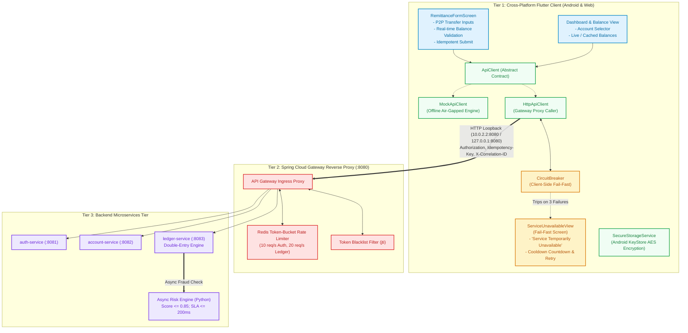

# Flutter Foundation Architecture & API Strategy Specification

**Project:** Capstone 2: Omnichannel Real-Time Remittance & Fraud Screening  
**Component:** Mobile Applications Layer (Flutter Retail Member App targeting Android & Web Dev)  
**Role / Assignee:** Neo: Dev 6 (Flutter Foundation)  
**Track:** Mobile Applications Track (Integrated with React Web Lead & DevSecOps Lead)  
**Reference Document:** `int.pdf` (Sections 1.B, 2, 3), `docs/CONTRACTS.md`, & `docs/API_ENDPOINT_CATALOG.md`  

---

## 1. Executive Summary & Omnichannel Scope

The **Mobile Applications Layer (`app/`)** provides the cross-platform omnichannel interface for retail banking members to perform real-time peer-to-peer (P2P) remittances, query account balances, and view transaction status progress. 

In the CooBS Omnichannel Architecture:
* **React Web Frontend (`http://localhost:3000` / `:5173`):** Dedicated to Branch Staff, Tellers, and Administrators for operational account management and 11-stage deep transaction audit. Interfaces via Spring Cloud Gateway CORS.
* **Flutter Mobile App (`app/` — Android `10.0.2.2:8080`):** Dedicated to Retail Cooperative Members for fast, seamless, and resilient mobile banking. Interfaces directly via native OS network sockets, bypassing browser Same-Origin Policy (zero CORS enforcement).

To satisfy **Neo's Deliverables** (`docs/TEAM_STATUS.md`):
1. **Push Flutter Core to `app/`:** Routing (`app_router.dart`), Theme (`app_theme.dart`), API client with Fixture Mode (`fixture_api_client.dart`), and Dart models built from `contracts/examples/`.
2. **Fixed Port / Gateway CORS Alignment (H14):** Fixed port `8088` for optional Chrome development (`flutter run -d chrome --web-port=8088`) ensuring zero collision with React on `:3000`.
3. **Stepper Visual Experience:** The **3-Stage Customer View** (`T3-timeline-customer.response.json`) in the mobile remittance receipt view, complemented by the **11-Stage Staff Stepper** in the teller portal.
4. **Air-Gapped Fixture Loading (H15):** Curating `contracts/examples/` into `app/assets/fixtures/` for zero-backend offline UI testing.

---

## 2. Flutter Directory Structure (`app/`)

```
app/
├── pubspec.yaml                       # Core dependencies (http, uuid, flutter_secure_storage, intl)
├── README.md                          # Run instructions, freeze contract & test commands
├── assets/
│   └── fixtures/                      # Local JSON fixtures (H15) curated from contracts/examples/
│       ├── A2-A4-login.response.json          # Customer auth session & tokens
│       ├── K3-K4-account.response.json        # Member deposit account summary
│       ├── M1-mobile-dashboard.response.json  # Aggregated composite mobile dashboard
│       ├── T1-transfer.response.json          # Remittance submission intake receipt (T1/M3)
│       ├── T2-transaction.response.json       # Remittance tracking detail status (T2)
│       ├── T3-timeline-customer.response.json # 3-stage retail member stepper view (T3/M2)
│       ├── T3-timeline-staff.response.json    # 11-stage granular audit stepper view
│       └── N1-notifications.response.json     # In-app member notification alerts
├── lib/
│   ├── main.dart                      # Application entry point & environment initialization
│   ├── core/                          # === CORE FOUNDATION (FROZEN BY AGREEMENT - NEO) ===
│   │   ├── config/
│   │   │   └── app_config.dart        # Environment toggle (Fixture / Live), Gateway URLs & timeouts
│   │   ├── network/
│   │   │   ├── api_client.dart        # Abstract ApiClient interface & ApiResponse wrapper
│   │   │   ├── http_api_client.dart   # Live HTTP implementation injecting headers & parsing RFC-7807
│   │   │   ├── fixture_api_client.dart# Air-gapped fixture client reading from assets/fixtures/
│   │   │   ├── circuit_breaker.dart   # 3-state fail-fast client resilience breaker (CLOSED/OPEN/HALF-OPEN)
│   │   │   └── api_exceptions.dart    # RFC-7807 ProblemDetailsException, RateLimit, 503 exceptions
│   │   ├── storage/
│   │   │   └── secure_storage_service.dart # Android KeyStore wrapper with web memory fallback
│   │   ├── theme/
│   │   │   └── app_theme.dart         # CooBS Banking Design System (Navy, Slate, Emerald)
│   │   ├── router/
│   │   │   └── app_router.dart        # Declarative named routing & auth route guards
│   │   └── mocks/
│   │       └── mock_api_client.dart   # Offline in-memory ledger engine & chaos injection hooks
│   ├── shell/
│   │   └── app_shell.dart             # Responsive shell (Desktop NavRail vs Mobile BottomNav)
│   └── features/                      # === FEATURE VERTICALS (UNFROZEN / ITERATIVE - GABO) ===
│       ├── auth/                      # Login screen & session management
│       ├── accounts/                  # Account balance card & list
│       ├── remittance/                # P2P transfer form with 3-stage customer tracking
│       ├── kyc/                       # Member KYC profile & update requests
│       └── resilience/
│           └── service_unavailable_view.dart # Active fallback screen when Circuit Breaker trips
└── test/
    └── core_foundation_test.dart      # Runnable validation test verifying frozen core contracts
```

---

## 3. End-to-End System Architecture



---

## 4. Client-Side Resilience & Circuit Breaker Logic

As mandated in `int.pdf` §1.B, the client application must protect user experience when the gateway or server cluster becomes unreachable.

```
State: CLOSED (Normal Operation)
  │
  ├── Request fails (Timeout, 500, 502, 503, Connection Refused)
  │   └── Increment _consecutiveFailures
  │
  └── If _consecutiveFailures >= 3
      │
      ▼
State: OPEN (Fail-Fast Active)
  │
  ├── Immediately throws CircuitBreakerOpenException
  ├── App displays ServiceUnavailableView ("Service Temporarily Unavailable")
  ├── UI does not hang or spin indefinitely
  │
  └── 30-Second Cooldown Expires
      │
      ▼
State: HALF-OPEN (Recovery Probe)
  │
  ├── Allows 1 probe call to /actuator/health
  ├── IF Success: _consecutiveFailures = 0, Transition to CLOSED
  └── IF Failure: Reset timer, Transition back to OPEN
```

---

## 5. Core Freeze Agreement

By completing Task 2, the `app/lib/core` directory is **FROZEN**:
1. **Network Contracts:** Decoupled behind `ApiClient` and `FixtureApiClient` so screens never import raw HTTP libraries.
2. **Security:** Hardened with `SecureStorageService` targeting Android KeyStore.
3. **Resilience:** Guarded by `CircuitBreaker`.
4. **Theme:** CooBS high-contrast banking design tokens locked in `AppTheme`.
5. **Zero Backend Mutations:** No backend code changes or Git pushes required.

---

## 6. Remittance Stepper & Offline Fixtures Specification (`H14` & `H15`)

### 6.1 3-Stage Customer Stepper Widget (`CustomerProgressStepper`)
The retail member remittance receipt displays a clean 3-step visual indicator backed by `T3-timeline-customer.response.json`:
* **Stage 1 (Submitted):** Icon: Checkmark / Pending; Title: *"Transfer Submitted"*; Subtitle: *"Your transfer request has been received and verified."*
* **Stage 2 (In Review):** Icon: Shield / Radar; Title: *"Security & Clearing"*; Subtitle: *"Automated security screening and bank network clearing."*
* **Stage 3 (Completed):** Icon: Bank / Wallet; Title: *"Transfer Completed"*; Subtitle: *"Funds have been successfully deposited into the recipient's account."*

### 6.2 Fixture Mode (`H15`)
When `AppConfig.environment == Environment.fixture`:
* `FixtureApiClient` intercepts requests to `GET /api/v1/mobile/dashboard` and loads `app/assets/fixtures/M1-mobile-dashboard.response.json`.
* Intercepts requests to `GET /api/v1/transactions/{id}/timeline?view=customer` (or `/api/v1/mobile/transactions/{ref}/timeline`) and loads `app/assets/fixtures/T3-timeline-customer.response.json`.
* Intercepts `POST /api/v1/transactions/remittance` (or `/api/v1/mobile/transactions/remittance`) and returns `T1-transfer.response.json`.
* Intercepts `GET /api/v1/transactions/{id}` and returns `T2-transaction.response.json`.
* Intercepts `POST /api/v1/auth/customers/login` and returns `A2-A4-login.response.json`.
* Enables Gabo (Dev 7) and QA to test all screens air-gapped without backend dependencies running.
