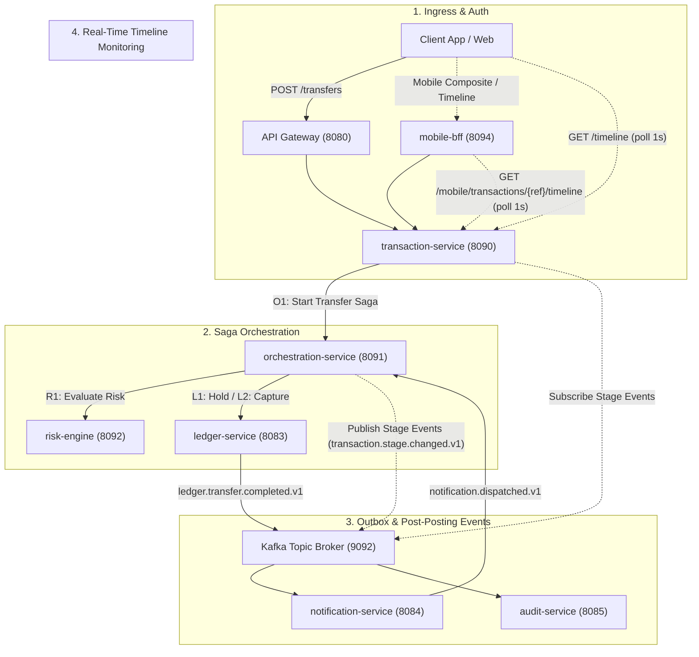
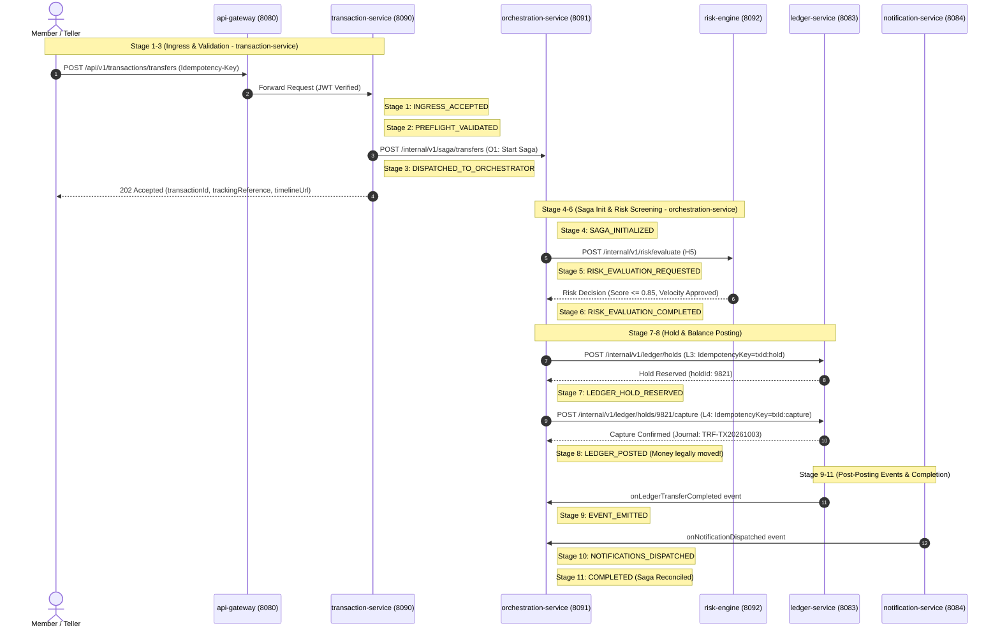
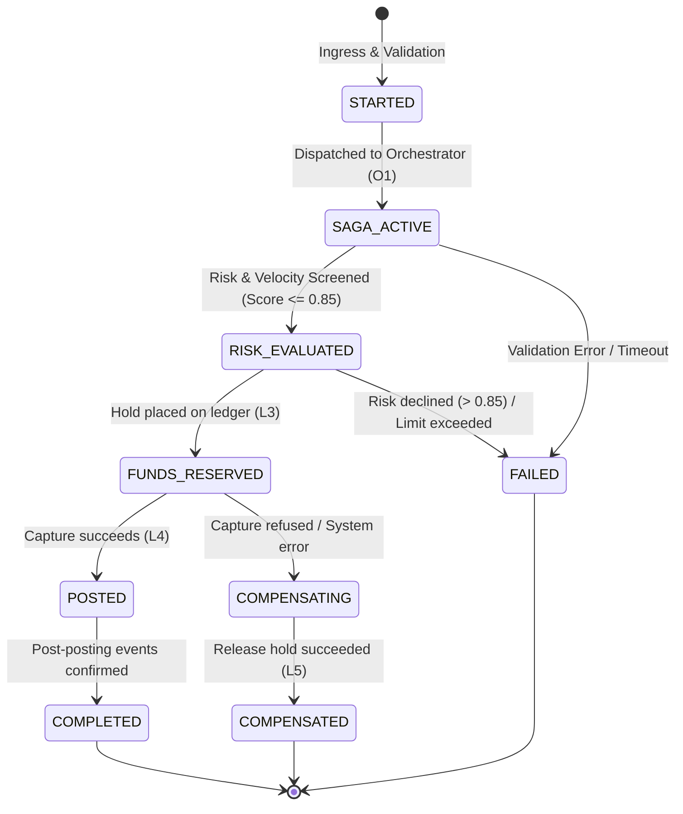

# Real-Time Transaction Monitoring Dashboard Specification

This document provides the definitive specification for the **Real-Time Transaction Monitoring Dashboard** across the CooBS platform. It covers the end-to-end transaction lifecycle, the 11-stage saga execution, role-based visibility (Customer/Member vs. Staff/Teller/Admin), state machine definitions, API contracts, Mobile Backend-for-Frontend (BFF) aggregation, and failure compensation workflows.

---

## 1. Executive Summary & Architecture Overview

When a money movement request is submitted (via Mobile App or Web), CooBS coordinates the transaction through an asynchronous, event-driven **Saga Orchestrator** backed by a real-time polling/event timeline.



### Key Service Ports & Responsibilities

| Service | Port | Primary Responsibility in Monitoring Flow |
| :--- | :---: | :--- |
| **`api-gateway`** | **`8080`** | Edge ingress, JWT authentication, rate limiting (25 req/s burst 50 on `/transactions/**`, 50 req/s on `/mobile/**`). |
| **`transaction-service`** | **`8090`** | Ingress idempotency lock (Redis 30s), stages 1–3 execution, timeline polling provider (`T3`), transaction history (`T8`/`T9`). |
| **`orchestration-service`** | **`8091`** | Saga coordinator, orchestrates stages 4–11 (`TransferSaga.java`), emits `transaction.stage.changed.v1` events. |
| **`risk-engine`** | **`8092`** | Synchronous AML, velocity checks, and heuristic fraud scoring ($\le 0.85$ accepted). |
| **`ledger-service`** | **`8083`** | Core double-entry balance holds (`L3`) and captures (`L4`) on master Oracle store. |
| **`notification-service`** | **`8084`** | Asynchronous member SMS, email, and in-app alerts upon ledger completion. |
| **`audit-service`** | **`8085`** | Immutable forensic audit log and SHA-256 Merkle chain verification. |
| **`mobile-bff`** | **`8094`** | Mobile application middleware adapter; collapses 11 technical stages into 3 member milestones (`M2`). |
| **`flutter-app` (Web)** | **`8088`** | Member and teller cross-platform UI client (`FLUTTER_WEB_PORT=8088`). |

---

## 2. Customer View vs. Staff View (Role-Based Visibility)

To maintain banking confidentiality and prevent fraud reconnaissance, the API contract strictly partitions what Customers/Members can view versus what Internal Staff (Tellers, Compliance Officers, and Admins) can inspect.

| Dimension | Customer / Member View | Staff (Teller / Admin) View |
| :--- | :--- | :--- |
| **Target Roles** | `ROLE_CUSTOMER` | `ROLE_TELLER`, `ROLE_ADMIN` |
| **Visible Stepper Stages** | **3 High-Level Milestone Stages**:<br>1. `SUBMITTED`<br>2. `IN_REVIEW`<br>3. `COMPLETED` (or `FAILED`) | **Full 11 Granular Saga Stages**:<br>Stages 1 through 11 in sequential timeline order |
| **Stage Mapping** | • Step 1 (`SUBMITTED`) = Stages 1–3<br>• Step 2 (`IN_REVIEW`) = Stages 4–6<br>• Step 3 (`COMPLETED`) = Stages 7–11 | 1:1 direct mapping with microservice saga execution states |
| **Risk / Fraud Details** | **Redacted** (Customer never sees fraud scores, rule evaluations, or velocity counters) | **Full Visibility** (exposes risk score e.g. `"score 0.15 (Low Risk)"`, rule hits, journal ref, hold IDs) |
| **Failure Messaging** | Human-friendly plain sentence in `failureMessage` (e.g. *"Transfer could not be processed due to insufficient funds."*) | Exact system diagnostic code in `failureCode` (e.g. `LIMIT_EXCEEDED`, `RISK_DECLINED`, `INSUFFICIENT_FUNDS`) |
| **API Endpoints** | Direct: `GET /api/v1/transactions/{id}/timeline?view=customer`<br>Mobile BFF: `GET /api/v1/mobile/transactions/{ref}/timeline` | Direct: `GET /api/v1/transactions/{id}/timeline?view=staff` |
| **Response Flag** | `"view": "CUSTOMER"` | `"view": "STAFF"` |

---

## 3. The 11-Stage Transaction Lifecycle



### Detailed Stage Breakdown

| Stage No. | Stage Key / Name | Emitted By | Purpose & Criteria | Customer Milestone Mapping |
| :---: | :--- | :--- | :--- | :---: |
| **1** | `INGRESS_ACCEPTED` | `transaction-service` | Ingress endpoint receives `POST /transfers`, validates idempotency lock in Redis (30s), records initial intent. | Subsumed under Step 1: `SUBMITTED` |
| **2** | `PREFLIGHT_VALIDATED` | `transaction-service` | Validates request syntax, positive amount, currency (`PHP`), active account numbers, and preliminary solvency. | Subsumed under Step 1: `SUBMITTED` |
| **3** | `DISPATCHED_TO_ORCHESTRATOR` | `transaction-service` | Dispatches transfer intent to `orchestration-service` via internal endpoint `POST /internal/v1/saga/transfers`. | Step 1 completes (`SUBMITTED`) |
| **4** | `SAGA_INITIALIZED` | `orchestration-service` | Instantiates saga state machine, writes instance row to `saga.saga_instance` table. | Subsumed under Step 2: `IN_REVIEW` |
| **5** | `RISK_EVALUATION_REQUESTED` | `orchestration-service` | Invokes `risk-engine:8092` (`POST /internal/v1/risk/evaluate`) with transaction volume and counterparty data. | Subsumed under Step 2: `IN_REVIEW` |
| **6** | `RISK_EVALUATION_COMPLETED` | `orchestration-service` | Evaluates heuristic fraud score ($\le 0.85$) and Redis velocity limits. Declines if score exceeds threshold. | Step 2 completes (`IN_REVIEW`) |
| **7** | `LEDGER_HOLD_RESERVED` | `orchestration-service` | Invokes `ledger-service:8083` (`POST /internal/v1/ledger/holds`) to reserve source balance. Generates `holdId`. | Subsumed under Step 3: `COMPLETED` |
| **8** | `LEDGER_POSTED` | `orchestration-service` | Captures hold (`POST /internal/v1/ledger/holds/{id}/capture`) and executes core double-entry mutation. **Money legally moved.** | Step 3 marked `COMPLETED` |
| **9** | `EVENT_EMITTED` | `orchestration-service` | Confirmed when transactional outbox emits `ledger.transfer.completed.v1` onto Kafka cluster. | Background completion |
| **10** | `NOTIFICATIONS_DISPATCHED` | `orchestration-service` | Confirmed when `notification-service:8084` sends member SMS, email, and in-app alerts. | Background completion |
| **11** | `COMPLETED` | `orchestration-service` | Dual-entry audit verified, Merkle proof generated, saga reaches terminal reconciled state. | Background completion |

---

## 4. Status Enums & State Machines

### 4.1 Overall Transaction Status (`status` / `overallStatus`)

- **`INITIATED`**: Transfer accepted at gateway, persistence row created.
- **`PROCESSING`**: Ongoing through validation, authentication, risk scoring, or fund reservation (Stages 2–7).
- **`POSTED` / `COMPLETED`**: Successfully committed in the core ledger (Stage 8+).
- **`FAILED`**: Rejected at any point prior to posting (e.g. limit exceeded, risk declined, hold refused).
- **`REVERSED`**: Formally reversed after posting by an authorized Teller/Admin via `POST /reversal`.

### 4.2 Ledger Hold Status (Internal / Ledger Leg)

- **`RESERVED`**: Funds temporarily held on source account during Stages 7–8.
- **`POSTED`**: Hold captured and converted to double-entry ledger mutation at Stage 8.
- **`CANCELLED`**: Hold released back to source account (upon failure or compensation).

### 4.3 Stage Outcome

- **`PASSED` / `COMPLETED`**: Stage completed with success.
- **`FAILED` / `REJECTED`**: Stage breached rules or encountered system rejection.
- **`PENDING` / `IN_PROGRESS`**: Not yet reached or currently executing.

---

## 5. API Contract Specifications

### 5.1 Timeline Query Endpoints

* **Direct Core Endpoint**: `GET /api/v1/transactions/{transactionId}/timeline` (or by `{trackingReference}`)
* **Mobile BFF Adapter Endpoint**: `GET /api/v1/mobile/transactions/{trackingReference}/timeline`
* **Auth**: Bearer JWT (`ROLE_CUSTOMER`, `ROLE_TELLER`, `ROLE_ADMIN`)
* **Polling Strategy**: The UI polls this endpoint once every **1 second** until status reaches `POSTED`/`COMPLETED` or `FAILED`.

#### Staff Response Payload (`view = "STAFF"`) — Fixture: `T3-timeline-staff.response.json`

```json
{
  "transactionId": "6f1c0e0a-3a52-4c0e-9d0b-2f0c8b7a1e11",
  "trackingReference": "TX-20261003-8F3A21C0",
  "status": "POSTED",
  "view": "STAFF",
  "currentStage": 11,
  "totalStages": 11,
  "overallStatus": "COMPLETED",
  "stages": [
    {
      "stageNo": 1,
      "stageNumber": 1,
      "stageKey": "INGRESS_ACCEPTED",
      "stageName": "INGRESS_ACCEPTED",
      "title": "Ingress Accepted",
      "service": "transaction-service",
      "status": "COMPLETED",
      "outcome": "PASSED",
      "occurredAt": "2026-10-03T11:40:00.010Z",
      "timestamp": "2026-10-03T11:40:00.010Z",
      "detail": null
    },
    {
      "stageNo": 2,
      "stageNumber": 2,
      "stageKey": "PREFLIGHT_VALIDATED",
      "stageName": "PREFLIGHT_VALIDATED",
      "title": "Pre-flight Solvency Checked",
      "service": "transaction-service",
      "status": "COMPLETED",
      "outcome": "PASSED",
      "occurredAt": "2026-10-03T11:40:00.020Z",
      "timestamp": "2026-10-03T11:40:00.020Z",
      "detail": null
    },
    {
      "stageNo": 3,
      "stageNumber": 3,
      "stageKey": "DISPATCHED_TO_ORCHESTRATOR",
      "stageName": "DISPATCHED_TO_ORCHESTRATOR",
      "title": "Dispatched to Orchestrator",
      "service": "transaction-service",
      "status": "COMPLETED",
      "outcome": "PASSED",
      "occurredAt": "2026-10-03T11:40:00.030Z",
      "timestamp": "2026-10-03T11:40:00.030Z",
      "detail": null
    },
    {
      "stageNo": 4,
      "stageNumber": 4,
      "stageKey": "SAGA_INITIALIZED",
      "stageName": "SAGA_INITIALIZED",
      "title": "Saga State Machine Initialized",
      "service": "orchestration-service",
      "status": "COMPLETED",
      "outcome": "PASSED",
      "occurredAt": "2026-10-03T11:40:00.040Z",
      "timestamp": "2026-10-03T11:40:00.040Z",
      "detail": null
    },
    {
      "stageNo": 5,
      "stageNumber": 5,
      "stageKey": "RISK_EVALUATION_REQUESTED",
      "stageName": "RISK_EVALUATION_REQUESTED",
      "title": "Risk Evaluation Requested",
      "service": "orchestration-service",
      "status": "COMPLETED",
      "outcome": "PASSED",
      "occurredAt": "2026-10-03T11:40:00.050Z",
      "timestamp": "2026-10-03T11:40:00.050Z",
      "detail": null
    },
    {
      "stageNo": 6,
      "stageNumber": 6,
      "stageKey": "RISK_EVALUATION_COMPLETED",
      "stageName": "RISK_EVALUATION_COMPLETED",
      "title": "Risk Screening Passed",
      "service": "orchestration-service",
      "status": "COMPLETED",
      "outcome": "PASSED",
      "occurredAt": "2026-10-03T11:40:00.060Z",
      "timestamp": "2026-10-03T11:40:00.060Z",
      "detail": "score 0.15 (Low Risk)"
    },
    {
      "stageNo": 7,
      "stageNumber": 7,
      "stageKey": "LEDGER_HOLD_RESERVED",
      "stageName": "LEDGER_HOLD_RESERVED",
      "title": "Ledger Balance Hold Reserved",
      "service": "orchestration-service",
      "status": "COMPLETED",
      "outcome": "PASSED",
      "occurredAt": "2026-10-03T11:40:00.120Z",
      "timestamp": "2026-10-03T11:40:00.120Z",
      "detail": null
    },
    {
      "stageNo": 8,
      "stageNumber": 8,
      "stageKey": "LEDGER_POSTED",
      "stageName": "LEDGER_POSTED",
      "title": "Double-Entry SoR Committed",
      "service": "orchestration-service",
      "status": "COMPLETED",
      "outcome": "PASSED",
      "occurredAt": "2026-10-03T11:40:00.210Z",
      "timestamp": "2026-10-03T11:40:00.210Z",
      "detail": "Journal Ref: TRF-TX20261003"
    },
    {
      "stageNo": 9,
      "stageNumber": 9,
      "stageKey": "EVENT_EMITTED",
      "stageName": "EVENT_EMITTED",
      "title": "Domain Event Emitted",
      "service": "orchestration-service",
      "status": "COMPLETED",
      "outcome": "PASSED",
      "occurredAt": "2026-10-03T11:40:00.450Z",
      "timestamp": "2026-10-03T11:40:00.450Z",
      "detail": "Topic: ledger.transfer.completed.v1"
    },
    {
      "stageNo": 10,
      "stageNumber": 10,
      "stageKey": "NOTIFICATIONS_DISPATCHED",
      "stageName": "NOTIFICATIONS_DISPATCHED",
      "title": "Member Notifications Sent",
      "service": "orchestration-service",
      "status": "COMPLETED",
      "outcome": "PASSED",
      "occurredAt": "2026-10-03T11:40:01.100Z",
      "timestamp": "2026-10-03T11:40:01.100Z",
      "detail": null
    },
    {
      "stageNo": 11,
      "stageNumber": 11,
      "stageKey": "COMPLETED",
      "stageName": "COMPLETED",
      "title": "Saga Fully Reconciled",
      "service": "orchestration-service",
      "status": "COMPLETED",
      "outcome": "PASSED",
      "occurredAt": "2026-10-03T11:40:01.400Z",
      "timestamp": "2026-10-03T11:40:01.400Z",
      "detail": null
    }
  ]
}
```

#### Customer Response Payload (`view = "CUSTOMER"`) — Fixture: `T3-timeline-customer.response.json`

```json
{
  "transactionId": "6f1c0e0a-3a52-4c0e-9d0b-2f0c8b7a1e11",
  "trackingReference": "TX-20261003-8F3A21C0",
  "status": "PROCESSING",
  "overallStatus": "PROCESSING",
  "view": "CUSTOMER",
  "currentStage": 1,
  "totalStages": 3,
  "stages": [
    {
      "stageNumber": 1,
      "stageKey": "SUBMITTED",
      "stageName": "INITIATED",
      "title": "Transfer Submitted",
      "subtitle": "Your transfer request has been received and verified.",
      "status": "COMPLETED",
      "outcome": "PASSED",
      "occurredAt": "2026-10-03T11:40:00.010Z",
      "timestamp": "2026-10-03T11:40:00.010Z"
    },
    {
      "stageNumber": 2,
      "stageKey": "IN_REVIEW",
      "stageName": "PROCESSING",
      "title": "Security & Clearing",
      "subtitle": "Automated security screening and cooperative network clearing.",
      "status": "IN_PROGRESS",
      "outcome": "PENDING",
      "occurredAt": null,
      "timestamp": null
    },
    {
      "stageNumber": 3,
      "stageKey": "COMPLETED",
      "stageName": "POSTED",
      "title": "Transfer Completed",
      "subtitle": "Funds have been successfully deposited into the recipient's account.",
      "status": "PENDING",
      "outcome": "PENDING",
      "occurredAt": null,
      "timestamp": null
    }
  ],
  "failureMessage": null
}
```

---

## 6. Kafka Event Specification (`transaction.stage.changed.v1`)

Each progression in the 11 stages publishes an asynchronous event to Kafka:
* **Primary Topic**: `transaction.stage.changed.v1`
* **Dead Letter Topic**: `transaction.stage.changed.v1.DLT`
* **Partitions**: 3 (Partitioned by `transactionId`)

```json
{
  "transactionId": "6f1c0e0a-3a52-4c0e-9d0b-2f0c8b7a1e11",
  "trackingReference": "TX-20261003-8F3A21C0",
  "stageNo": 6,
  "stageKey": "RISK_EVALUATION_COMPLETED",
  "stageName": "RISK_EVALUATION_COMPLETED",
  "service": "orchestration-service",
  "outcome": "PASSED",
  "transactionStatus": "PROCESSING",
  "failureCode": null,
  "detail": "score 0.15 (Low Risk)",
  "customerMessage": null,
  "occurredAt": "2026-10-03T11:40:00.060Z"
}
```

---

## 7. Failure Handling & Saga Compensation



### Failure Scenarios & Edge Cases

1. **Risk Decline / Limit Exceeded**:
   - Saga fails immediately at Stage 5 or 6 before placing any ledger hold.
   - Status set to `FAILED`. No ledger compensation needed.
2. **Insufficient Funds**:
   - Hold call to `ledger-service:8083` fails with `INSUFFICIENT_FUNDS` at Stage 7.
   - Status set to `FAILED`.
3. **Capture Refusal & Compensation**:
   - If capture fails after a hold was placed (`holdId` reserved), the saga transitions to `COMPENSATING`.
   - `TransferSaga` calls `ledger-service:8083` endpoint `POST /internal/v1/ledger/holds/{id}/release` with `Idempotency-Key: <txId>:release`.
   - Once released, state transitions to `COMPENSATED` and Stage 8 reports `FAILED`.

---

## 8. Related Code & Contract References

- **Saga Orchestrator**: [`orchestration-service`](../backend/orchestration-service/) (`TransferSaga.java` — Dev 1 scaffold under `com.group2.fse.orchestration_service.saga`)
- **API Contract Specification**: [`FUTURE_INTEGRATED_API_CONTRACT.md`](../contracts/api/FUTURE_INTEGRATED_API_CONTRACT.md)
- **Full System Contracts & Models**: [`CONTRACTS.md`](CONTRACTS.md)
- **Runtime Port & Service Settings**: [`RUNTIME_SETTINGS.md`](../contracts/runtime/RUNTIME_SETTINGS.md)
- **Flutter Foundation Architecture**: [`FLUTTER_FOUNDATION_ARCHITECTURE.md`](FLUTTER_FOUNDATION_ARCHITECTURE.md)
- **8-Dev Technical Roadmap**: [`ZERO_CONFLICT_8_DEV_EXECUTION_PLAN.md`](../integrated-capstone-plans/ZERO_CONFLICT_8_DEV_EXECUTION_PLAN.md)
- **Example Response (Staff)**: [`T3-timeline-staff.response.json`](../contracts/examples/T3-timeline-staff.response.json)
- **Example Response (Customer)**: [`T3-timeline-customer.response.json`](../contracts/examples/T3-timeline-customer.response.json)
