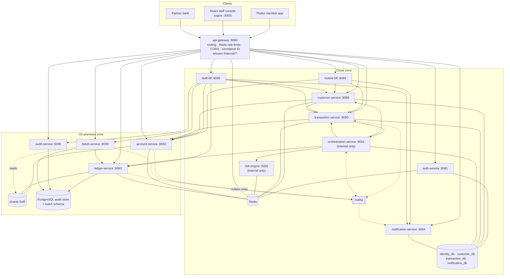
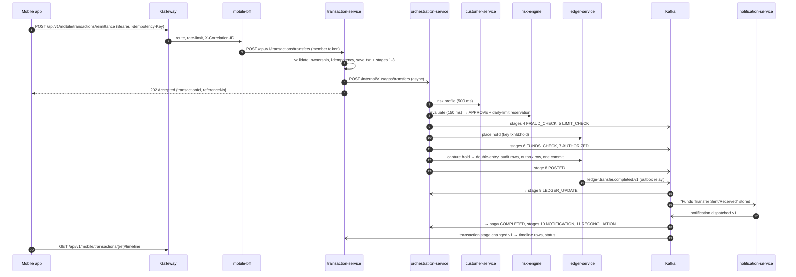

# 2. Architecture

## 2.1 Architectural style

CooBS is a set of domain-oriented microservices behind one API gateway, with:

- **A hybrid placement.** What is needed to sign in, route, decide and display runs in the cloud; the money and the record (accounts, ledger, audit, end-of-day) stay on-premises with the system of record.
- **Orchestrated sagas** for transfers, not distributed transactions. `orchestration-service` owns the sequence and the compensations; each step is a separate, idempotent call.
- **Event-driven side effects.** Notifications, timeline updates and saga completion are driven by Kafka events.
- **Database per service.** Each service owns its tables; no service reads another's database. Cross-service data comes through APIs.
- **Backend-for-frontend.** Each client has a BFF that shapes several backend calls into one screen-sized response.

## 2.2 Design principles (as enforced)

| Principle | How it is enforced |
| --- | --- |
| No cloud service touches Oracle or the audit store | Cloud services are given only the URLs of the four on-premises services; databases publish no port outside the VM; the NSG admits only ports 8082, 8083, 8085, 8093 from the cluster subnet |
| Only the orchestrator (from the cloud) and account/batch (on-premises) call the ledger's internal API | API contract; `/internal/v1/ledger/**` requires `ROLE_SERVICE`; firewall |
| Sign-in works when the inter-zone link is down | `auth-service`, `identity_db` and Redis are all in the cloud zone |
| Compute is stateless | Saga state in `transaction_db.saga`; locks, counters, refresh tokens and idempotency keys in Redis |
| Every outbound call has a time limit | Section 2.6 |
| Events survive an outage | Ledger outbox written in the posting's transaction, relayed after commit |
| Configuration by environment variable only; no secret in images | Every setting is a named variable; Key Vault in Azure (exceptions listed in section 14) |
| One gateway | Spring Cloud Gateway; no API Management |
| Schemas are disposable | Tables come from init scripts under `database/`; services run with `ddl-auto=none`; no Flyway/Liquibase |

## 2.3 Component view

Each arrow between services is a synchronous HTTP call. Dotted arrows are Kafka.

## 2.4 Service placement

| Zone | Services | Data they own |
| --- | --- | --- |
| Cloud | `api-gateway`, `mobile-bff`, `staff-bff`, `auth-service`, `customer-service`, `transaction-service`, `orchestration-service`, `risk-engine`, `notification-service` | `identity_db`, `customer_db`, `transaction_db` (schemas `txn`, `saga`), `notification_db`; Redis keys |
| On-premises | `account-service`, `ledger-service`, `audit-service`, `batch-service` | Oracle (accounts, balances, holds, journal, outbox, vaults, share capital); PostgreSQL `audit_store` and `batch` schemas |

## 2.5 Allowed service-to-service calls

Internal calls go to `/internal/v1/**` with a service token carrying `ROLE_SERVICE`; the person who caused the action travels in the body as `actorId`. BFFs instead forward the caller's own token to public endpoints.

| Caller | Callee | Endpoints | Purpose |
| --- | --- | --- | --- |
| `transaction-service` | `account-service` | `GET /internal/v1/accounts/{id}`, `/accounts/by-number/{no}` | Confirm source and destination accounts and ownership at intake |
| `transaction-service` | `orchestration-service` | `POST /internal/v1/sagas/transfers`, `/reversals`, `/inbound-interbank`; `GET /internal/v1/sagas/{id}` | Start sagas (O1, O2, O4), read saga state (O3) |
| `orchestration-service` | `customer-service` | `GET /internal/v1/customers/{id}/risk-profile` | Risk score, KYC tier, daily limit |
| `orchestration-service` | `risk-engine` | `POST /internal/v1/risk/evaluate`, `/outcomes` | Decision (R1); report outcome (R2) |
| `orchestration-service` | `ledger-service` | `/internal/v1/ledger/holds` (+`/capture`, `/release`), `/postings`, `/reversals` | L3–L8 |
| `orchestration-service` | `transaction-service` | `POST /internal/v1/interbank/outbound` | Send to a partner bank (I4) |
| `customer-service` | `account-service` | `GET /internal/v1/customers/{id}/accounts` | Accounts and balances for Customer 360 |
| `customer-service` | `transaction-service` | `GET /internal/v1/transactions`, `/transactions/spending` | Recent history and spending breakdown (T8, T9) |
| `batch-service` | `ledger-service` | `POST /internal/v1/ledger/postings` | Every EOD posting (L8) |
| `mobile-bff` | customer, account, transaction, notification | Public endpoints with the member's token | Dashboard, remittance, timeline |
| `staff-bff` | customer, account, ledger, transaction, audit, batch, notification | Public endpoints with the staff token | Every console screen |

## 2.6 Time limits and failure handling

| Caller → callee | Limit | On expiry |
| --- | --- | --- |
| Mobile app → gateway | 10 s (2.5 s for token refresh) | After 3 consecutive failures the in-app circuit breaker opens for 30 s |
| Gateway → any service | 3 s connect, 15 s response | 503 if unreachable, 504 if silent |
| `mobile-bff` → services | 2 s connect, 3 s read | Error to the app |
| `staff-bff` → services | 2 s connect, 15 s read | Error to the console |
| `transaction-service` → account/orchestration | 2 s connect, 3 s read | Intake refused (`ACCOUNT_UNAVAILABLE`); saga start re-dispatched in background |
| `customer-service` → account/transaction | 2 s connect, 5 s read | 360 returns what it has |
| Orchestrator → `risk-engine` | 150 ms | Transfer fails closed: `RISK_UNAVAILABLE`, no hold |
| Orchestrator → `customer-service` | 500 ms | Same as above |
| Orchestrator → `ledger-service` | 2 s | Saga stays in flight; sweep repeats the call with the same key |
| Orchestrator → inter-bank gateway | 30 s | Hold kept; sweep asks again |
| Inter-bank gateway → partner | 5 s; then status asked 3 times, 1 s apart | Outcome PENDING; hold kept |

Rule applied throughout the saga: **a refusal ends the transfer; a silence leaves it in flight**, because the hold, capture or reversal may have taken effect. The orchestrator keeps the risk path warm with a call every 20 s (`app.warm-up.keep-warm-interval`) so the first transfer after idle does not miss the 150 ms budget.

## 2.7 Request path of a member transfer

## 2.8 Edge path

- **Local:** browser → `frontend` nginx (`:3000`) → `/api` and `/actuator` proxied to `api-gateway:8080`; the app calls the gateway directly.
- **Azure:** client → public IP `48.193.9.148` (`coobs.indonesiacentral.cloudapp.azure.com`) → Caddy TLS proxy (Let's Encrypt, TLS 1.3, HTTP→HTTPS 308, HSTS) → `frontend` nginx → gateway. nginx answers `/internal` with 403 before the gateway sees it.

The gateway judges the browser's `Origin` once (global CORS) and strips the header (`RemoveRequestHeader=Origin`) so services' own CORS lists are never consulted.

## 2.9 Planned versus built

The team's target design (Front Door, VPN Gateway, Azure Database for PostgreSQL, Event Hubs, 3-node pool) was adapted to the Azure free trial. The deployed differences and their reasons are recorded in `integrated-capstone-plans/ENTERPRISE_ARCHITECTURE_AND_DEPLOYMENT.md` §8 (G1–G9) and summarised in [section 12](12-deployment-and-operations.md#126-azure-deployment).
