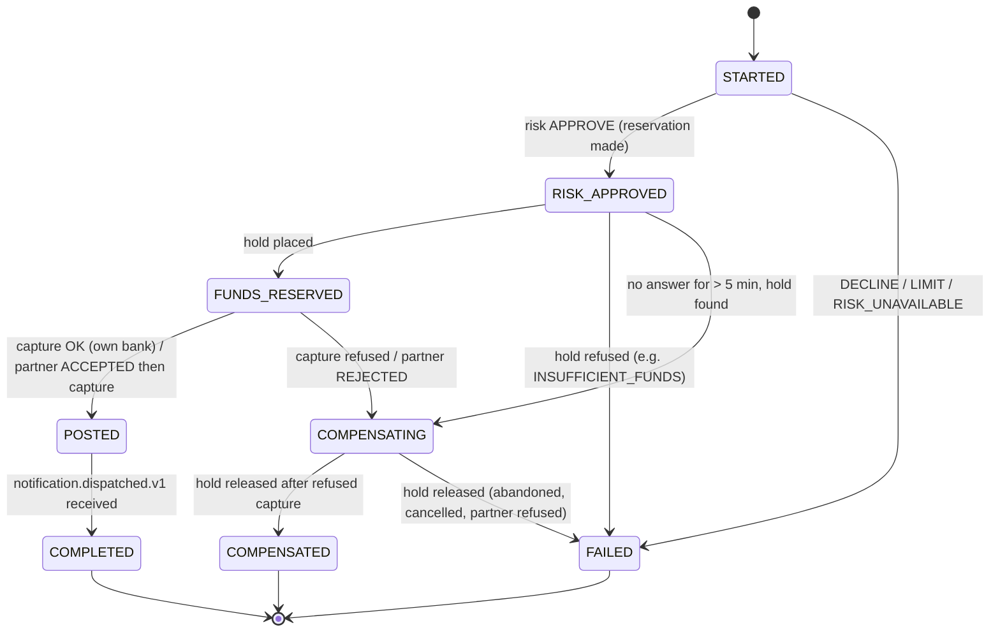

# 5. Transfer lifecycle

A transfer touches six services. This section follows one from the client's request to its completion, and covers every way it can fail, be compensated or be reversed.

Code: `transaction-service/.../service/impl/TransferServiceImpl.java`, `orchestration-service/.../saga/TransferSaga.java`, `ReversalSaga.java`, `InboundInterbankSaga.java`, `SagaRecoveryRunner.java`, `ledger-service/.../service/impl/HoldServiceImpl.java`.

## 5.1 Entry points

| Who | Call | Path to T1 |
| --- | --- | --- |
| Member, mobile app | M3 `POST /api/v1/mobile/transactions/remittance` | `mobile-bff` validates (₱0.01–₱500,000.00), resolves the source account, forwards to T1 with the member's token |
| Member or staff, direct | T1 `POST /api/v1/transactions/transfers` | — |
| Teller, assisted transfer | `POST /api/v1/staff/counter/transfer` | `staff-bff` forwards to T1 with the teller's token; channel recorded as `TELLER` |

Counter **cash** deposits and withdrawals do not use T1 or the saga: `staff-bff` posts them directly to ledger `/credits` and `/debits` as single-leg postings on the member's account (active status and funds are checked; `Idempotency-Key` required).

## 5.2 Intake (T1, `transaction-service`) — stages 1 to 3

1. **Validate** the body: positive amount, source and destination present, idempotency key present and ≤ 40 characters.
2. **Scope the idempotency key** to the caller: stored as `<callerId>:<key>` so two users cannot collide.
3. **Replay check:** if a transaction already has this key, return the first answer (`replayed: true`). If the stored transaction differs in source, destination or amount, refuse (`DUPLICATE_IDEMPOTENCY_KEY`, key reused).
4. **Partner check:** `destinationBankCode` absent or `COOBS` → internal. Otherwise the bank must be a configured partner (else 422 `INTERBANK_REJECTED`); the account number must be ≤ 34 characters and the amount ≤ 2 decimals.
5. **Look up the source account** through `account-service` (K6). A member may send only from their own account (`ACCOUNT_NOT_OWNED`); staff may send from any.
6. **Look up the destination** by account number (K7), or, for a partner bank, use that partner's settlement GL account (9005) as the posting destination.
7. If either lookup cannot be completed, refuse with `ACCOUNT_UNAVAILABLE` (503). Nothing is guessed.
8. **Acquire a Redis lock** on the scoped key (60 s). If held, answer 409 `DUPLICATE_IDEMPOTENCY_KEY`. Re-check for a committed row after acquiring.
9. **In one database transaction:** insert `txn_transaction` (status `PROCESSING`, reference `TX-YYYYMMDD-XXXXXXXX`, channel `APP` or `TELLER`), the `interbank_message` row for an outbound partner transfer (status `CREATED`), and stage rows 1 `INITIATED`, 2 `VALIDATED`, 3 `AUTHENTICATED` — all `PASSED`. A unique index on the key catches any race the lock missed.
10. **After commit:** publish stages 1–3 to `transaction.stage.changed.v1`, then hand the saga start (O1) to a background executor with `isNewBeneficiary` (true if this customer has never had a posted transfer to this account).
11. **Answer 202** with `transactionId`, `referenceNo`, `status: INITIATED` and `timelineUrl`.

If O1 never arrives, `SagaStartRedispatcher` sends it again; O1 is idempotent on `transactionId`.

## 5.3 The saga (`orchestration-service`) — stages 4 to 11

### State machine



The saga row (`saga.saga_instance`) is saved **before** each stage event is published, and every step reads the saved state, makes one outbound call, then saves. Nothing is held in memory between steps, so a saga that stops anywhere continues from its row. The row has an optimistic-lock `version`; a run that loses a race (most often to a reversal) reloads and decides again, up to three times.

### Steps

| Stage | Step | Call | Success | Refusal | No answer |
| --- | --- | --- | --- | --- | --- |
| 4 `FRAUD_CHECK`, 5 `LIMIT_CHECK` | Risk | C7 risk profile (500 ms), then R1 evaluate (150 ms) | `RISK_APPROVED`; stages 4 and 5 passed, stage 4 detail "score 0.18" | Limit only failed → `FAILED`/`LIMIT_EXCEEDED`, stage 4 passed, stage 5 failed. Otherwise → `FAILED`/`RISK_DECLINED`, stage 4 failed with reasons | `FAILED`/`RISK_UNAVAILABLE` (fail closed); reservation released via R2 |
| 6 `FUNDS_CHECK`, 7 `AUTHORIZED` | Hold | L3, key `<txnId>:hold` (2 s) | `FUNDS_RESERVED`; stages 6 and 7 passed (stage 7 deferred for outbound inter-bank) | `FAILED` with the ledger's code (usually `INSUFFICIENT_FUNDS`, `ACCOUNT_NOT_ACTIVE`); reservation released | Stay `RISK_APPROVED`; sweep repeats L3 with the same reference (ledger returns the existing hold). After 5 minutes (`hold-retry-window`) the hold is looked up once more and released → `FAILED`/`LEDGER_UNAVAILABLE` at stage 6 |
| 7 `AUTHORIZED` (outbound only) | Partner | I4 (30 s) | Partner `ACCEPTED` → capture; stage 7 detail "accepted by BANKB, reference …" | Partner or gateway refuses → `COMPENSATING` → release → `FAILED`/`INTERBANK_REJECTED` at stage 7 | `PENDING` or silence → stay `FUNDS_RESERVED`, hold kept, sweep asks again. Never released on a timeout |
| 8 `POSTED` | Capture | L4, key `<txnId>:capture`, 3 attempts 500 ms apart | `POSTED`; stage 8 passed | Own bank → `COMPENSATING` → release → `COMPENSATED`, stage 8 failed. Outbound after partner accepted → hold kept, saga left `FUNDS_RESERVED` for staff (the partner already holds the money) | Stay `FUNDS_RESERVED`; sweep retries |
| 9 `LEDGER_UPDATE` | Event | Consumes `ledger.transfer.completed.v1` | Stage 9 passed | — | Saga stays `POSTED`; money has moved |
| 10 `NOTIFICATION`, 11 `RECONCILIATION` | Event | Consumes `notification.dispatched.v1` | `COMPLETED`; stages 10 and 11 passed | — | Saga stays `POSTED` with stage 10 pending |

**Principle:** a refusal ends the transfer; a silence never does, because the call may have taken effect. Ledger calls carry `<transactionId>:<step>` keys and are safe to repeat.

### Recovery

`SagaRecoveryRunner` resumes every saga in `STARTED`, `RISK_APPROVED`, `FUNDS_RESERVED` or `COMPENSATING`:

- at start-up, all of them;
- every 30 s (`app.saga.sweep-interval`), those not written for 60 s (`sweep-stale-after`).

It re-reads the stored request payload (keeping the amount's exact scale) and runs the saga again on a fresh correlation ID. `POSTED` sagas are not swept: they wait for events, not calls. Inbound inter-bank sagas store no payload and are not swept; the partner repeats its own call. The service is designed for one instance (no row claim yet).

### Risk outcome reporting (R2)

Whenever an approved transfer ends without posting (hold refused, capture refused, cancelled, partner refused, given up), the saga reports `FAILED` and the engine gives the amount back to the member's daily limit. When a posted transfer is reversed, it reports `REVERSED`: one reversal is counted for the sender and no limit is given back. Reports are best effort and idempotent per transfer.

## 5.4 Money movement in the ledger

| Step | `available_balance` (source) | `ledger_balance` (source) | Destination | Journal |
| --- | --- | --- | --- | --- |
| Hold (L3) | − amount | unchanged | — | `HOLD` row `RESERVED` |
| Capture (L4) | unchanged | − amount | both + amount | Two `TRANSACTION` rows (`DEBIT`, `CREDIT`); hold `POSTED`; audit rows; outbox row |
| Release (L5) | + amount | unchanged | — | Hold `CANCELLED` |

So "held" = `ledger_balance − available_balance`. The constraint `ledger_balance >= available_balance` always holds.

## 5.5 Stages and timelines

| No | `stageName` | Published by | Customer milestone |
| --- | --- | --- | --- |
| 1 | `INITIATED` | transaction-service | 1 Submitted |
| 2 | `VALIDATED` | transaction-service | 2 Security & Clearing |
| 3 | `AUTHENTICATED` | transaction-service | 2 |
| 4 | `FRAUD_CHECK` | orchestration-service | 2 |
| 5 | `LIMIT_CHECK` | orchestration-service | 2 |
| 6 | `FUNDS_CHECK` | orchestration-service | 2 |
| 7 | `AUTHORIZED` | orchestration-service | 2 |
| 8 | `POSTED` | orchestration-service | 3 Completed |
| 9 | `LEDGER_UPDATE` | orchestration-service | 3 |
| 10 | `NOTIFICATION` | orchestration-service | 3 |
| 11 | `RECONCILIATION` | orchestration-service | 3 |

Every stage is an event on `transaction.stage.changed.v1` with outcome `PASSED`, `FAILED` or `PENDING`, plus `failureCode` and a detail string. `transaction-service` consumes them into `txn_stage_event` and updates the transaction status: `PROCESSING` → `POSTED` (stage 8 or 11 passed) or `FAILED`; an original becomes `REVERSED` when its reversal posts.

Three views exist: the **staff view** (all 11 stages with risk score and reasons; staff only), the **customer view** (3 milestones; enforced by role, not by the `view` parameter), and the **execution status** (`/status`: Ingress 1–3, Screened 4–6, Committed 7–8, Notified 9–11).

## 5.6 Reversal (T5 → O2 → L7)

Requested by a teller or admin from the console tracker. `transaction-service` creates a reversal transaction (`RV-…`, pointing at the original with `reverses_transaction_id`) and starts O2. The reversal saga decides from the **original saga's state**:

| Original state | Action | Result |
| --- | --- | --- |
| `POSTED` or `COMPLETED` (own bank) | L7: compensating `REVERSAL_CREDIT` to the sender and `REVERSAL_DEBIT` from the recipient (recipient must have the funds), ordered locks, audit rows | Reversal `COMPLETED`; original becomes `REVERSED`; R2 `REVERSED` |
| `FUNDS_RESERVED` (own bank) | Release the hold | Original `COMPENSATED`; R2 `FAILED` (limit given back) |
| `STARTED` | Mark original `FAILED`/`CANCELLED_BEFORE_HOLD` | Any reservation released |
| `RISK_APPROVED` | Wait: the hold may already exist | Reversal stays `STARTED`; sweep retries it after the transfer moves on |
| Outbound inter-bank, `FUNDS_RESERVED`/`POSTED`/`COMPLETED` | Refuse | `REVERSAL_NOT_ALLOWED`: money that has (or may have) left can only come back as a transfer from that bank |
| `FAILED`, `COMPENSATED` | Refuse | `ALREADY_TERMINAL` |

The ledger refuses a second reversal of the same transaction (`ALREADY_REVERSED`), backed by a unique constraint on `TRANSACTION.reverses_transaction_id`. A repeated L7 with the same references returns the stored result.

## 5.7 Outbound inter-bank transfer

```mermaid
sequenceDiagram
    participant OR as orchestrator
    participant LE as ledger
    participant GWI as transaction-service (I4 gateway)
    participant P as Partner bank
    OR->>LE: hold on sender
    OR->>GWI: I4 send (transactionId = messageId)
    GWI->>P: send (signed / API key / loopback)
    alt partner answers ACCEPTED
        P-->>GWI: ACCEPTED, partnerReference
        GWI-->>OR: ACCEPTED
        OR->>LE: capture → credit settlement GL 9005
    else REJECTED or unreachable before connecting
        GWI-->>OR: REJECTED (reason or PARTNER_UNREACHABLE)
        OR->>LE: release hold
    else no answer
        GWI->>P: status query ×3, 1 s apart
        GWI-->>OR: PENDING
        Note over OR: hold kept; sweep asks again
    end
```

Rules in `OutboundInterbankGateway`: **one message per transaction** (message ID = transaction ID; an answered message is answered from the record; a possibly-sent message is asked about before any resend), and **an error means nothing was sent** (once a message may have left, the gateway answers `PENDING`, never an error). The message is recorded in `txn.interbank_message` with direction `OUTBOUND`. Partner adapters: `LoopbackPartnerAdapter` when no URL is configured (accepts everything except accounts starting `0000`), `ProposalPartnerAdapter` (HMAC-signed, `INTERBANK_TRANSFER_PROPOSAL.md`), `AuraBankPartnerAdapter` (`X-API-Key`).

## 5.8 Inbound inter-bank credit (I1 → O4 → L8)

1. Partner calls I1 with a signed message. `InterbankAuthValidator` checks bank code, timestamp (±300 s) and signature or API key.
2. `transaction-service` commits an `interbank_message` (direction `INBOUND`, unique `messageId`) and a `PROCESSING` transaction **before** calling the saga, so a repeat finds the row.
3. O4 runs synchronously: one L8 posting, debit the partner's settlement account (9005), credit the beneficiary. No risk check and no hold.
4. Stages 1–11 are published (1–7 with "not applicable" where no check runs).
5. Answer `ACCEPTED` or `REJECTED` with reason. If the saga does not answer, the row stays `PROCESSING` and the partner is told to repeat (503); the repeat reuses the same transaction ID and reference, so it posts once.

I2 returns the stored outcome for a `messageId`; I3 confirms an account and returns a masked name.

## 5.9 Idempotency, layer by layer

| Layer | Mechanism | Window |
| --- | --- | --- |
| Mobile app | Same `Idempotency-Key` reused on retap/retry of one submission | Per submission |
| `transaction-service` T1 | Caller-scoped key; DB unique index `txn_transaction.idempotency_key`; Redis lock | Permanent / 60 s |
| `orchestration-service` | O1/O2 idempotent on `transactionId` (`saga_instance.transaction_id` unique) | Permanent |
| `ledger-service` internal | Unique `HOLD.reference_no`, `TRANSACTION.reference_no`; same reference + different account/amount → 409 | Permanent |
| `ledger-service` public | `IdempotencyInterceptor`: Redis `SETNX` lock, response cached 24 h, replay header `X-Cache-Replay` | 30 s lock / 24 h |
| `risk-engine` | Reservation keyed by `transactionId`; re-evaluation of a reserved transfer does not count it twice; R2 once per transfer | Business day |
| Inter-bank | `messageId` unique in `interbank_message` | Permanent |
| `notification-service` | Unique `event_id` | Permanent |
| `batch-service` | Each posting reference unique in the ledger journal | Permanent |
