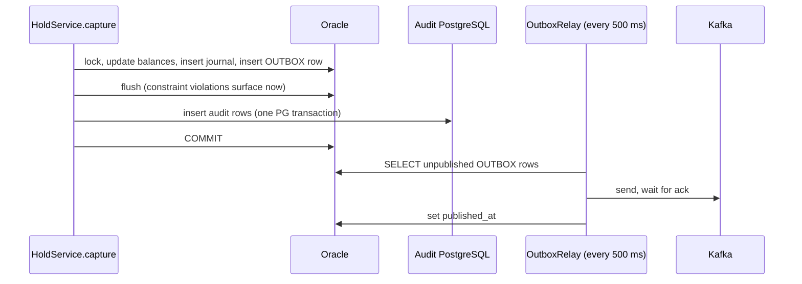

# 7. Ledger, audit and end of day

## 7.1 Accounting model

- Every account has one `BALANCE` row with two figures: **`ledger_balance`** (posted money) and **`available_balance`** (what can be spent: ledger minus holds and earmarks).
- Every money movement is **double-entry**: one `DEBIT` row and one `CREDIT` row in `"TRANSACTION"` (the journal) with the same reference stem, so total debits equal total credits.
- Single-sided business events (fees, interest, loan instalments, inter-bank settlement) are made double-entry with **internal GL accounts** owned by internal customer 900. The exception is **counter cash** at runtime: `/api/v1/ledger/credits` and `/debits` post a single leg to the member's account; the end-of-day reconciliation therefore reports counter cash in/out beside the debit = credit check rather than inside it. (The seed history books its counter movements against 9001.)

| ID | Number | Other leg of |
| --- | --- | --- |
| 9001 | `GL_CASH_VAULT` | Counter deposits and withdrawals, opening deposits |
| 9002 | `GL_INTEREST_EXPENSE` | Interest paid to savings (debited) |
| 9003 | `GL_FEE_INCOME` | Service fees (credited) |
| 9004 | `GL_LOAN_RECEIVABLE` | Loan bookings and repayments |
| 9005 | `GL_SETTLEMENT_BANKB` | Inter-bank settlement (all configured partners use it) |

GL accounts open with ₱1,000,000,000.00 because the balance constraint forbids negatives and they are debited.

**Database invariants (Oracle):**

```sql
CONSTRAINT chk_ora_bal_non_neg       CHECK (available_balance >= 0)
CONSTRAINT chk_ora_ledger_ge_avail   CHECK (ledger_balance >= available_balance)
CONSTRAINT chk_ora_txn_amount_pos    CHECK (amount > 0)
CONSTRAINT chk_ora_txn_new_bal_non_neg CHECK (new_balance >= 0)
CONSTRAINT chk_ora_hold_pos          CHECK (amount > 0)
CONSTRAINT uq_txn_reversed_once      UNIQUE (reverses_transaction_id)
-- plus UNIQUE reference_no on "TRANSACTION" and HOLD
```

So an overdraft, a zero or negative posting, or a second reversal is refused by the database even if application code were wrong.

## 7.2 The posting engine

`ledger-service/.../posting/PostingEngineImpl.java` is the single code path that changes a balance.

1. **Lock.** `SELECT … FOR UPDATE` on the `BALANCE` row(s). Two-account operations lock `min(id)` then `max(id)` (`lockAccountsInOrder`) — a global lock order, so concurrent postings cannot deadlock. Active status is checked under the lock (`ACCOUNT_NOT_ACTIVE`).
2. **Validate.** Amount > 0 (`INVALID_TRANSACTION`); sufficient available funds (`INSUFFICIENT_FUNDS`).
3. **Post.** `post(balance, availableDelta, ledgerDelta)` at scale 4.
4. **Journal.** Insert `"TRANSACTION"` rows with previous and new balance, type, reference, `approved_by` actor.
5. **Audit.** Record audit rows (written at commit, 7.4).
6. **Outbox.** For transfers, append an `OUTBOX` row in the same transaction.
7. **Cache.** Evict `ledger:balance:{id}` from Redis.

Isolation is `READ_COMMITTED` with explicit row locks. Holds lock the hold row first and the balance second, in both capture and release, so those two cannot deadlock either. A request that waited for a lock re-checks its reference after acquiring it (a concurrent duplicate may have committed meanwhile).

### Operation table

| Operation | Source available | Source ledger | Destination | Journal type(s) |
| --- | --- | --- | --- | --- |
| Credit (counter deposit) | +amount (target account) | +amount | — (single leg) | `CREDIT` |
| Debit (counter withdrawal) | −amount | −amount | — (single leg) | `DEBIT` |
| Direct transfer | −amount | −amount | +amount both | `DEBIT` / `CREDIT` |
| Hold | −amount | — | — | `HOLD` row `RESERVED` |
| Capture | — | −amount | +amount both | `DEBIT` / `CREDIT`; hold `POSTED` |
| Release | +amount | — | — | hold `CANCELLED` |
| Reversal of a transfer | +amount both (sender) | | −amount both (recipient, must have funds) | `REVERSAL_CREDIT` / `REVERSAL_DEBIT` |
| L8 posting | debit account −amount both | | credit account +amount both | `DEBIT` / `CREDIT` |

### L8 postings (batch and inbound inter-bank)

Each posting in the list commits on its own (not one big transaction), up to 500 per request. A posting whose reference is already in the journal with the same accounts and amount is reported `POSTED` and not posted again; with different accounts or amount it is refused `DUPLICATE_IDEMPOTENCY_KEY`. Only a business refusal becomes an error code in the result; a database or audit failure is thrown so the caller sees "no answer" instead of a false "refused".

## 7.3 Transactional outbox



An event row is stamped published only after Kafka acknowledges; an unacknowledged send is retried on the next poll, never lost. Consumers deduplicate by `eventId`. Other ledger events (`ledger.mutation.completed.v1`, `ledger.transfer.failed.v1` for direct postings) are published by `LedgerEventPublisher` after commit (`@TransactionalEventListener(AFTER_COMMIT)`), so a rolled-back posting emits nothing.

## 7.4 Audit store and the SHA-256 hash chain

**Table:** `audit_store.ledger_mutation_audit` in the on-premises PostgreSQL (`database/postgres/02_create_tables.sql`):

`audit_id` (BIGSERIAL), `transaction_id`, `account_id`, `reference_no`, `transaction_type`, `amount`, `old_balance`, `new_balance`, `previous_hash`, `current_hash`, `actor_id`, `client_ip`, `event_timestamp`.

**Writing.** `DualWriteLedgerAuditService` holds a posting's audit rows until the Oracle transaction is about to commit: Oracle is flushed first so any broken rule fails before an audit row exists; then all rows of the posting are inserted in one PostgreSQL transaction; then Oracle commits. If the audit write fails, Oracle rolls back (`LEDGER_AUDIT_DUAL_WRITE_FAILED`, 500). Known residual gap: audit rows committed and then the Oracle COMMIT itself fails.

**Chaining** (`database/postgres/03_audit_triggers.sql`, trigger `trg_compute_hash_chain`, `BEFORE INSERT`):

```
previous_hash = current_hash of the latest row for the same account_id
                (genesis: 64 × '0')
current_hash  = SHA256( previous_hash | transaction_id | account_id | reference_no
                        | transaction_type | amount | new_balance
                        | event_timestamp as YYYY-MM-DD"T"HH24:MI:SS.USOF )
```

The chain is **per account**. Changing any field of any row breaks every later hash for that account.

**Immutability.** Trigger `trg_prevent_audit_tampering` (`BEFORE UPDATE OR DELETE`) raises `COMPLIANCE VIOLATION … (ERRCODE 55000)` for every update or delete — even by the database owner through SQL.

**Verification (U3).** `audit-service` reads the account's rows in order, recomputes each hash with the same formula (`AuditQueryServiceImpl.computeSha256`), and compares both links. The console's Audit screen and `scripts/verify_audit_hash_chain.ps1` call it; the CI "Infra" stage proves that the triggers exist and that UPDATE/DELETE are refused.

## 7.5 Daily seal

Step 6 of the EOD batch writes `audit_store.daily_audit_seal`:

```
seal_hash = SHA256( businessDate + ":" + lastAuditId + ":" + lastHash )
```

where `lastAuditId`/`lastHash` are those of the newest audit row dated on or before the business date. A past date is sealed once and never rewritten; today's date may be re-sealed by a later run to cover new rows. U4 returns the seal.

## 7.6 End-of-day batch

Triggered by an admin (B1, console "Trigger EOD Run"); one run at a time (`BATCH_ALREADY_RUNNING`). Runs asynchronously in `EodPipelineImpl`; progress is read with B2/B3, and each finished step is published to `batch.eod.step.completed.v1`.

| # | Step | What it does | Ledger postings (L8) | Reference |
| --- | --- | --- | --- | --- |
| 1 | `INTEREST_ACCRUAL` | Savings accounts with last audited balance ≥ ₱1,000 earn `balance × 2% × days / 365` (rounded to centavos). Daily: 1 day. Month-end (last day of month): days in month. Only `SAVINGS` accounts (types read from Oracle). Sends an in-app "Monthly Interest Credited" notification through `ledger.mutation.completed.v1` | Debit 9002, credit member | Daily `EOD-YYYYMMDD-B{run}-INT-{acct}`; month-end `EOD-YYYYMM-INT-{acct}` |
| 2 | `SERVICE_FEES` | Non-loan accounts with balance between ₱0.01 and ₱499.99 are charged ₱50 (or the whole balance if less). The ledger decides on the live balance, so money on hold is protected | Debit member, credit 9003 | `EOD-YYYYMM-FEE-{acct}` (once a month) |
| 3 | `STANDING_INSTRUCTIONS` | Recurring transfers due on or before the date. Moves to the next run date only if posted; a refused one stays due | Debit source, credit destination | `EOD-SI-{id}-{date}` |
| 4 | `LOAN_AMORTIZATION` | Instalments due on or before the date: debit the borrower's deposit account. Marked `PAID` only when posted | Debit member, credit 9004 | `EOD-LN-{scheduleId}` |
| 5 | `GL_RECONCILIATION` | Compares the day's journal debits and credits; any variance fails the step. Counter cash is reported beside the comparison | — | — |
| 6 | `AUDIT_SEAL` | Writes the daily seal (7.5) | — | — |

**Rules.**
- Steps run in order. A step that fails marks the run `HALTED` and the remaining steps `SKIPPED`. Item-level refusals (e.g. a member without funds for an instalment) do not fail the step; they are counted and left for the next run.
- If the ledger gives no answer, the step fails rather than guess; re-running is safe because references are unique.
- A run left `RUNNING` by a restart is marked `HALTED` (its running step `SKIPPED`) at the next start-up, so it cannot block later triggers.
- Candidates come from the audit store's last balance per account; the ledger posts against the live balance.
- `batch-service` never writes a balance itself and never connects to the cloud `notification_db`.

**Run and step states:** run `RUNNING`, `COMPLETED`, `HALTED`; step `PENDING`, `RUNNING`, `COMPLETED`, `FAILED`, `SKIPPED`.

**Tables** (`database/postgres/05_batch_schema.sql`): `batch.batch_run`, `batch.batch_step`, `batch.standing_instruction`, `batch.loan_schedule`, `audit_store.daily_audit_seal`.

**Seeded EOD scenarios:** standing instruction 1 executes today; instruction 2 (`liza_mercado`) fails for funds; loan schedule 2 (`juan_delacruz`) is collected; schedule 5 (`liza_mercado`) fails; batch run 2 is a completed run with a seal; batch run 1 is a halted run (step 5 failed, step 6 skipped).
