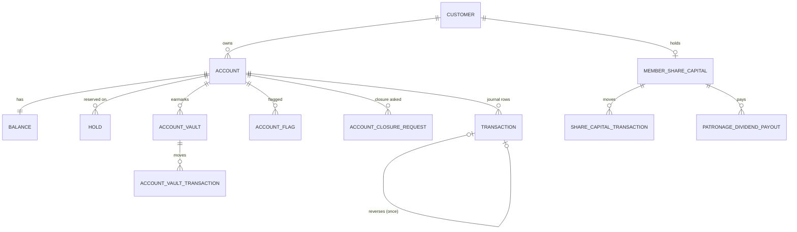

# 8. Data model

## 8.1 Stores and ownership

| Store | Engine (local / Azure) | Zone | Owner(s) | Init scripts |
| --- | --- | --- | --- | --- |
| System of record, schema `core_user` in `XEPDB1` | Oracle Free 23ai (both) | On-prem | `ledger-service` (balances, journal, holds, outbox), `account-service` (accounts, flags, closures, vaults, share capital); `batch-service` reads | `database/oracle/` |
| Audit store `audit_store` (schemas `audit_store`, `batch`) | PostgreSQL 16 (both) | On-prem | `ledger-service` writes audit; `audit-service` reads; `batch-service` owns `batch` + seal | `database/postgres/` |
| `identity_db` | PostgreSQL 16 / Azure SQL S0 | Cloud | `auth-service` | `database/postgres-cloud/02_identity_db.sql` |
| `customer_db` | PostgreSQL 16 / Azure SQL S0 | Cloud | `customer-service` | `03_customer_db.sql` |
| `transaction_db` (schemas `txn`, `saga`) | PostgreSQL 16 / Azure SQL S0 | Cloud | `transaction-service` (`txn`), `orchestration-service` (`saga`) | `04_transaction_db.sql` |
| `notification_db` | PostgreSQL 16 / Azure SQL S0 | Cloud | `notification-service` | `05_notification_db.sql` |
| Redis | Redis 7.4 / Azure Managed Redis B0 (TLS :10000) | Cloud (reached from both) | gateway, auth, customer, transaction, risk, account, ledger | — |

Rules: tables come only from these init scripts (no migrations; Hibernate `ddl-auto=none`); one service per table set; the same IDs are used in every store so seeded members, accounts and transfers line up.

**Azure SQL scripts** (`database/azure-sql/`) are generated from the PostgreSQL cloud scripts by `database/seed/pg_cloud_to_tsql.py`; edit the PostgreSQL versions and regenerate. Collation `Latin1_General_100_CI_AS_SC_UTF8`. A local SQL Server variant runs with `docker-compose.azure-sql.yml`.

**Schema evolution folders.** `database/next/` holds the target on-premises schema without `ROLE`/`APP_USER`/credential columns (identity moved to the cloud). `docker-compose.target.yml` mounts it for opt-in testing. The local `database/oracle/02_create_tables.sql` still contains copies of tables that other services now own in the cloud (`CUSTOMER`, `APP_USER`, `KYC`, `TXN_TRANSACTION`, `SAGA_INSTANCE`, `NOTIFICATIONS`, `LEDGER_MUTATION_AUDIT`, …); those copies are legacy and unused by the current services.

## 8.2 Oracle — system of record (tables in use)

| Table | Key columns | Notes |
| --- | --- | --- |
| `ACCOUNT` | `account_id` (identity from 100000; seed uses 1–54, GL 9001–9005), `customer_id`, `account_number` (unique, ≤ 34), `account_type`, `currency` (`PHP`), `status`, `created_at` | Types `SAVINGS`, `CHECKING`, `CURRENT`, `LOAN`, `GL`. Status `ACTIVE`, `FROZEN`, `DORMANT`, `CLOSED` |
| `BALANCE` | `account_id` (unique), `available_balance`, `ledger_balance` NUMBER(18,4), `updated_at` | `available >= 0`, `ledger >= available` |
| `HOLD` | `hold_id`, `account_id`, `reference_no` (unique, ≤ 36), `amount` (> 0), `status`, `created_at`, `resolved_at` | `RESERVED` → `POSTED` or `CANCELLED` |
| `"TRANSACTION"` | `transaction_id`, `account_id`, `reference_no` (unique), `transaction_type`, `amount` (> 0), `previous_balance`, `new_balance` (≥ 0), `status`, `reverses_transaction_id` (unique FK), `approved_by`, `created_at` | The journal. Types `DEBIT`, `CREDIT`, `REVERSAL_DEBIT`, `REVERSAL_CREDIT` |
| `OUTBOX` | `outbox_id`, `topic`, `event_key`, `payload` (CLOB), `created_at`, `published_at` | Index on `(published_at, outbox_id)` |
| `ACCOUNT_FLAG` | `flag_id`, `account_id`, `reason`, `status`, `flagged_by`, `removed_by`, `flagged_at`, `removed_at` | `ACTIVE`/`FLAGGED` → `REMOVED`. Flag types used: `AML_WATCH`, `FRAUD_SUSPECTED`, `DORMANT_WARNING`, … |
| `ACCOUNT_CLOSURE_REQUEST` | `closure_request_id`, `account_id`, `reason`, `status`, `approved_by`, `rejection_reason`, `requested_at`, `reviewed_at` | `PENDING` → `APPROVED`/`REJECTED` |
| `ACCOUNT_VAULT` | `vault_id`, `vault_reference` (unique), `customer_id`, `account_id`, `name`, `target_amount`, `current_amount`, `target_date`, `category`, `icon_code`, `color_value`, `status`, `version` | `ACTIVE`, `COMPLETED`, `CLOSED` |
| `ACCOUNT_VAULT_TRANSACTION` | `vault_tx_id`, `vault_id`, `transaction_type` (`ALLOCATE`, `RELEASE`), `amount`, `balance_after`, `reference_no`, `created_at` | |
| `MEMBER_SHARE_CAPITAL` | `share_capital_id`, `certificate_no` (unique), `customer_id`, `account_id`, `subscribed_shares`, `paid_up_shares`, `par_value` (100), `total_paid_amount`, `minimum_required_shares` (20), `dividend_rate` (7.25), `membership_type`, `has_voting_rights`, `status`, `version` | |
| `SHARE_CAPITAL_TRANSACTION` | `tx_id`, `share_capital_id`, `transaction_type` (`INITIAL_SUBSCRIPTION`, `TOP_UP`), `amount`, `shares_added`, `balance_after`, `source_account_id`, `reference_no` | |
| `PATRONAGE_DIVIDEND_PAYOUT` | `dividend_id`, `share_capital_id`, `customer_id`, `fiscal_year`, `share_capital_dividend`, `patronage_refund`, `total_payout`, `disposition`, `payout_date`, `reference_no`, `status` | |

Also present for history/compatibility: `TRANSFER_REQUEST`, `TRANSACTION_FLAG`, `SYSTEM_LOG`, `LOAN_SCHEDULE`, `STANDING_INSTRUCTION`, `BATCH_RUN`, `BATCH_STEP` (the live batch tables are in PostgreSQL).

## 8.3 PostgreSQL audit store

| Table | Columns | Notes |
| --- | --- | --- |
| `audit_store.ledger_mutation_audit` | `audit_id`, `transaction_id`, `account_id`, `reference_no`, `transaction_type`, `amount`, `old_balance`, `new_balance`, `previous_hash`, `current_hash`, `actor_id`, `client_ip`, `event_timestamp` | Append-only; hash-chained per account by trigger; UPDATE/DELETE raise 55000. Indexes on account, transaction, timestamp, hash |
| `audit_store.daily_audit_seal` | `seal_id`, `business_date`, `last_audit_id`, `seal_hash`, `sealed_at` | One per business date |
| `batch.batch_run` | `batch_run_id`, `business_date`, `triggered_by`, `status`, `started_at`, `finished_at` | |
| `batch.batch_step` | `batch_step_id`, `batch_run_id`, `step_no`, `step_name`, `status`, `items_processed`, `duration_ms`, `total_amount`, `message` | |
| `batch.standing_instruction` | `instruction_id`, `source_account_id`, `destination_account_id`, `amount`, `frequency`, `next_run_date`, `active` | |
| `batch.loan_schedule` | `schedule_id`, `loan_account_id`, `due_date`, `principal_due`, `interest_due`, `status` | `DUE` → `PAID` |
| `audit_store.notifications` | — | Legacy (pre-split); the live inbox is `notification_db` |

`pgcrypto` provides `digest()` for the hash trigger.

## 8.4 Cloud databases

**`identity_db`**

| Table | Columns |
| --- | --- |
| `role` | `role_id`, `role_name` (`ROLE_CUSTOMER`, `ROLE_TELLER`, `ROLE_ADMIN`, `ROLE_SERVICE`) |
| `app_user` | `user_id`, `role_id`, `user_type` (`CUSTOMER`/`STAFF`), `customer_id`, `username`, `password_hash` (bcrypt), `email`, `mfa_secret_ref`, `status` (`ACTIVE`/`INACTIVE`), `created_at` |

**`customer_db`**

| Table | Columns |
| --- | --- |
| `customer` | `customer_id`, `kyc_status`, `created_at` |
| `channel_profile` | `customer_id`, `membership_number`, `username`, `display_name`, `email`, `preferred_language`, `kyc_tier`, `kyc_status`, `risk_score` (0–1), `credit_score`, `daily_limit`, timestamps |
| `kyc` | `kyc_id`, `customer_id`, `first_name`, `middle_initial`, `last_name`, `address`, `civil_status`, `occupation`, `mobile_number`, `status` |
| `kyc_update_request` | `kyc_request_id`, `kyc_id`, `new_*` fields, `status` (`PENDING`/`APPROVED`/`REJECTED`), `approved_by`, `requested_at`, `approved_at` |
| `beneficiary` | `beneficiary_id`, `customer_id`, `account_number`, `nickname`, `bank_code`, `active`, `created_at` |

**`transaction_db`**

| Table | Columns |
| --- | --- |
| `txn.txn_transaction` | `transaction_id` (UUID PK), `reference_no` (unique), `idempotency_key` (unique, `<caller>:<key>`), `channel` (`APP`, `TELLER`, `INTERBANK`, `BATCH`), `customer_id`, `source_account_id`, `destination_account_id`, `destination_account_number`, `destination_bank_code`, `amount` (> 0), `currency`, `category`, `remarks`, `status` (`PROCESSING`, `POSTED`, `FAILED`, `REVERSED`), `failure_code`, `reverses_transaction_id`, `created_at`, `completed_at` |
| `txn.txn_stage_event` | `stage_event_id`, `transaction_id`, `stage_no` (1–11), `stage_name`, `outcome`, `detail`, `occurred_at` |
| `txn.interbank_message` | `message_id` (PK; = transaction ID outbound, partner's ID inbound), `direction` (`INBOUND`/`OUTBOUND`), `partner_bank_code`, `transaction_id`, `counterparty_account`, `counterparty_name`, `status`, `reason_code`, `created_at` |
| `saga.saga_instance` | `saga_id`, `transaction_id` (unique), `reference_no`, `state`, `hold_id`, `risk_decision`, `failure_code`, `payload` (the start request as JSON, for recovery), `updated_at`, `version` (optimistic lock) |

**`notification_db`**

| Table | Columns |
| --- | --- |
| `notifications` | `id`, `customer_id`, `title`, `message`, `channel` (`IN_APP`), `is_read`, `event_id` (unique — idempotent consumer), `created_at`, `read_at` |

## 8.5 Redis keys

| Prefix | Owner | Purpose | TTL |
| --- | --- | --- | --- |
| `request_rate_limiter.*` | gateway | Token buckets | Managed by Spring Cloud Gateway |
| `refresh:{token}`, `session:customer:{id}` | auth | 7-day refresh tokens; the member's single current session | 7 days |
| `blacklist:jti:{jti}` | auth writes; auth, account, ledger read | Revoked access tokens | Remaining token life |
| idempotency lock keys | transaction (T1), ledger (public mutations) | In-flight lock; ledger also caches responses | 60 s / 30 s lock, 24 h cache |
| `ledger:balance:{accountId}` | ledger | Balance cache | 10 s |
| `risk:*` | risk-engine | Velocity, daily reservation, reversals, devices, geo, stats | See [section 6.5](06-risk-engine.md#65-counters-in-redis) |

## 8.6 Seed data

Generated by `database/seed/generate_seed.py`; every script under `database/*/0x_seed*.sql` and `database/next/` comes from it, and CI checks the committed output equals a fresh generation. Full listing: `database/seed/SEED_REFERENCE.md`.

| Item | Count / value |
| --- | --- |
| Staff logins | 12: `admin`, `manager_ramon`, `manager_teresa` (ADMIN); `teller_alice` … `teller_irene` (TELLER) |
| Members | 50 (customer IDs 1–50), plus internal customer 900 for GL accounts |
| Accounts | 54 member accounts (`ACC_10000001`…) plus 5 GL accounts (9001–9005) |
| Password | `Password123!` for every seeded login locally. In Azure the staff password is replaced at load time by a generated secret |
| Timestamps | Relative to database creation, so "due today" items are always due and the last 30 days always have history |
| Baseline balances | `john_doe` ₱50,000 (`ACC_10000001`), `maria_santos` ₱25,000 (`ACC_10000002`), `david_kim` ₱100,000 (`ACC_10000003`) |

Scenario members (each designed to demonstrate one behaviour):

| Member | Scenario |
| --- | --- |
| `juan_delacruz` (4) | Customer 360 showcase; happy-path transfer `ACC_10000004` → `ACC_10000007`; external beneficiary at BANKB; loan instalment due today |
| `andrea_reyes` (5), `gabriel_florendo` (19) | Risk > 0.85 → `HIGH_RISK` |
| `jose_bautista` (6), `marveen_bernabe` (22) | Risk 0.60–0.85 → `REVIEW_REQUIRED`; Jose has a pending KYC update |
| `liza_mercado` (7) | Low balance → `INSUFFICIENT_FUNDS`; failing EOD items |
| `ramon_villanueva` (8) | Frozen account with active flag (`ACC_10000011`) |
| `grace_pangilinan` (9) | Tier 1, ₱5,000 limit; approved KYC update; inactive beneficiary |
| `carmela_garcia` (10) | Dormant account charged the EOD fee |
| `paolo_navarro` (11) | Closed account; empty account with pending closure |
| `teresita_ramos` (12) | Transfer in flight with a `RESERVED` hold (`TX-SEED-0013`); a reversed transfer |
| `ricardo_magbanua` (13) | Tier 2; no beneficiaries (first-time beneficiary) |
| `lourdes_salazar` (14) | `INACTIVE` login — sign-in refused |
| 15–29 | Demonstration members named after the team, one savings account each |

Seeded transactions include `TX-SEED-0005` reversed by `RV-SEED-0001`, inbound inter-bank `IB-SEED-IN-0001`, outbound `TX-SEED-0011`, teller withdrawal `TX-SEED-0012`, and a released hold `TX-SEED-RELEASED`.

## 8.7 Resetting data

| Where | Command | Effect |
| --- | --- | --- |
| Local, everything | `scripts/reset.ps1` (`docker compose down -v`) | Removes volumes; init scripts reload the seed on next start |
| Local, demo state only | `scripts/reset_demo_data.ps1` | Resets batch state and risk counters without rebuilding databases |
| Azure on-prem VM | `infra/scripts/deploy-onprem.ps1 -ResetData` | Drops Oracle and audit volumes, reloads |
| Azure cloud DBs | `infra/scripts/deploy-cloud.ps1 -ResetData` | Stops services, empties Redis, drops and reloads the four Azure SQL databases |

Run the two Azure resets together (VM first), because the ledger and the transfer records describe the same transfers.
