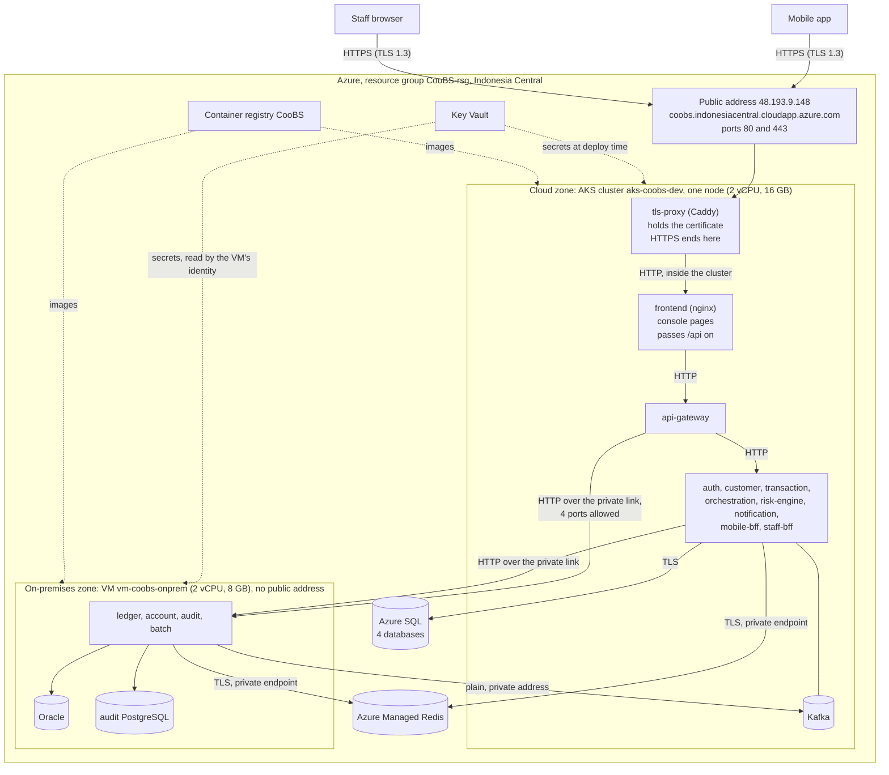

# The Azure deployment, as built

This page records what was deployed to Azure on 10 October 2026, with which tools and commands, how HTTPS was added, what went wrong on the way and how each problem was fixed. It is a record of one real deployment. The general runbook, for doing it again from nothing, is `infra/README.md`.

Three labels are used:

- **Read from Azure:** checked against the live system with a read-only command.
- **Reported:** run by Carl on his machines; the result is his report.
- **Not proven:** nobody has checked it.

## 1. Result

| | |
| --- | --- |
| Address | `https://coobs.indonesiacentral.cloudapp.azure.com` |
| What answers there | The staff console, and the API for the mobile app, partner banks and Postman |
| Version running | `version-1.3` on the cluster, `version-1` on the on-premises VM (the same code for those four services) |
| Code | `dev` at `2fcb789` (pull request 160) |
| Proof | E2E suite 143 of 143 on the HTTPS address, console and app working (reported); the checks in section 9 (read from Azure) |
| Subscription | Azure free trial, spending limit on, region Indonesia Central |

## 2. The picture



## 3. What exists in Azure (read from Azure)

Everything is in the resource group `CooBS-rsg`, region `indonesiacentral`, availability zone 3. It was created by the Bicep templates in `infra/bicep`, except the registry, which existed before.

| Resource | Name | Size or setting |
| --- | --- | --- |
| Kubernetes cluster | `aks-coobs-dev` | AKS Free tier, Kubernetes 1.35, one node `Standard_E2as_v5` |
| Virtual machine | `vm-coobs-onprem` | `Standard_B2as_v2`, Ubuntu 24.04, private address `10.250.0.4`, no public address |
| Azure SQL server | `sql-coobs-c2whi3` | Databases `identity_db`, `customer_db`, `transaction_db`, `notification_db`, each S0 |
| Azure Managed Redis | `redis-coobs-c2whi3` | `Balanced_B0`, TLS on port 10000, private endpoint `pe-redis-coobs-c2whi3` |
| Key Vault | `kv-coobs-c2whi3` | Ten secrets (section 6) |
| Container registry | `CooBS` | Standard, 14 repositories under `coobs/` |
| Cloud network | `vnet-coobs-cloud-dev` | `10.240.0.0/16` |
| On-premises network | `vnet-coobs-onprem-dev` | `10.250.0.0/16`, peered with the cloud network in both directions |
| Firewall between the zones | `nsg-coobs-onprem` | Lets the cluster's subnet reach ports 8082, 8083, 8085 and 8093 on the VM's subnet; denies everything else from the cloud network |
| Outbound route for the VM | `nat-coobs-onprem`, `pip-coobs-onprem-nat` | So the VM can pull images without a public address of its own |
| Logs | `law-coobs-dev`, `appi-coobs-dev`, Container Insights | Log Analytics, capped at 1 GB a day |

Not created: Front Door. Azure refuses it on a free trial (section 8).

The trial's limits shaped all of this: four vCPUs in the region (two for the node, two for the VM, none left) and three public addresses (the cluster's outbound address, the public entry, the VM's NAT gateway).

## 4. What runs where (read from Azure)

**On the cluster**, namespace `coobs`:

| Object | What |
| --- | --- |
| 10 Deployments from our images | `api-gateway`, `auth-service`, `customer-service`, `transaction-service`, `orchestration-service`, `risk-engine`, `notification-service`, `mobile-bff`, `staff-bff`, `frontend` (the console's nginx) |
| 1 Deployment `tls-proxy` | Caddy 2.10.0, pinned by digest, with a 1 GB disk for the certificate |
| 1 StatefulSet `kafka-broker` | Apache Kafka, pinned by digest, with an 8 GB disk; a Job created the topics |
| Service `coobs-public` | The one public load balancer, ports 80 and 443, pointing at `tls-proxy` |
| Service `kafka-external` | An internal load balancer at `10.240.15.200:9094`, so the VM can reach Kafka |
| Services `account-service`, `ledger-service`, `audit-service`, `batch-service` | Names inside the cluster that point at the VM (`10.250.0.4`), so cloud services call the on-premises ones by the same names as locally |
| Job `coobs-load-schemas` | Loaded the four Azure SQL databases once, and set the staff password |

**On the VM**, as Docker Compose (`infra/onprem/docker-compose.yml`): `ledger-service`, `account-service`, `audit-service`, `batch-service`, Oracle Database Free and PostgreSQL 16 for the audit store. The databases publish no port outside the VM.

## 5. The deployment, step by step

### Tools used

| Tool | For |
| --- | --- |
| Azure CLI (`az`) with Bicep | Creating the Azure resources, reading outputs, Key Vault, running a script on the VM |
| Docker Desktop | Building and pushing the 14 images |
| `kubectl` with kustomize | Rendering and applying the Kubernetes manifests |
| PowerShell scripts in `infra/scripts` | `publish-images.ps1`, `deploy-cloud.ps1`, `deploy-onprem.ps1` |
| Newman | Running the Postman E2E suite against the address |
| Caddy | The TLS proxy in the cluster |
| Let's Encrypt | The certificate |

The pipeline (`CooBS-CI`) did not deploy anything. It checks and tests the code; its deploy stages are placeholders. The deployment was run by hand with the scripts.

### The commands, in the order that worked

Every command below was run on 10 October. None contains a secret: the values come from Key Vault or are typed into the shell.

**1. One-time preparation of the subscription and the shell**

```
az provider register --namespace Microsoft.OperationsManagement --wait
ssh-keygen -t ed25519
Set-Item Env:COOBS_SQL_ADMIN_PASSWORD '<a new password>'
Set-Item Env:COOBS_VM_SSH_PUBLIC_KEY (Get-Content ~\.ssh\id_ed25519.pub)
Set-Item Env:COOBS_KEYVAULT_ADMIN_OBJECT_ID (az ad signed-in-user show --query id -o tsv)
```

On a later run from another machine the same two values were read back from Azure, so nothing had to be retyped or copied:

```
Set-Item Env:COOBS_SQL_ADMIN_PASSWORD (az keyvault secret show --vault-name kv-coobs-c2whi3 --name cloud-db-password --query value -o tsv)
Set-Item Env:COOBS_VM_SSH_PUBLIC_KEY (az vm show --resource-group CooBS-rsg --name vm-coobs-onprem --query "osProfile.linuxConfiguration.ssh.publicKeys[0].keyData" -o tsv)
```

**2. Create the Azure resources**

```
az deployment group what-if --resource-group CooBS-rsg --parameters infra/bicep/main.bicepparam
az deployment group create --resource-group CooBS-rsg --name coobs-demo --parameters infra/bicep/main.bicepparam
```

The first line creates nothing; it shows what the second would do.

**3. Build and push the images** (on the machine with Docker)

```
az acr login --name CooBS
.\infra\scripts\publish-images.ps1 -ImageTag version-1.3
```

Fourteen images: ten for the cluster and four for the VM, each pushed as `coobs-asfagkfjadgsgfcf.azurecr.io/coobs/<service>:<tag>`.

**4. Deploy the cloud zone**

```
.\infra\scripts\deploy-cloud.ps1 -ImageTag version-1.3 -SkipSchemaLoad -DnsLabel coobs -AcmeEmail <an address you read>
```

The very first run was without `-SkipSchemaLoad`, `-DnsLabel` and `-AcmeEmail`: it loaded the databases and brought the system up on plain HTTP. In order, the script:

1. reads the names of the cluster, vault, SQL server and Redis from the Bicep outputs;
2. generates the application secrets into Key Vault, keeping any that exist;
3. copies them into one Kubernetes Secret, `coobs-app-secrets`;
4. loads the four databases with a Job inside the cluster, because Azure SQL accepts connections from the cluster's subnet only;
5. renders the manifests with the real values and the image tag, applies them, and waits for every Deployment.

**5. Start the on-premises zone**

```
.\infra\scripts\deploy-onprem.ps1 -KeyVaultName kv-coobs-c2whi3 -ImageTag version-1 -RedisHost redis-coobs-c2whi3.indonesiacentral.redis.azure.net
.\infra\scripts\deploy-onprem.ps1 -StatusOnly
```

The VM has no public address, so nothing is copied to it over SSH. The script packs the Compose file, `start.sh` and the database init scripts, carries them inside `az vm run-command`, and `start.sh` on the VM reads its secrets from Key Vault with the VM's own identity.

**6. Prove it**

```
npx --yes newman run postman/e2e/CooBS_End_To_End.postman_collection.json -e postman/CooBS_Local.postman_environment.json --env-var baseUrl=https://coobs.indonesiacentral.cloudapp.azure.com --env-var staffPassword=<staff password> --env-var tellerPassword=<staff password> --delay-request 150 --reporters cli
```

The staff password is read with `az keyvault secret show --vault-name kv-coobs-c2whi3 --name staff-password --query value --output tsv`.

**7. The mobile app**

```
cd app
flutter build apk --release --dart-define=GATEWAY_URL=https://coobs.indonesiacentral.cloudapp.azure.com
```

The app is not hosted. The package is installed on the phones by hand, and the address can also be typed on its sign-in screen.

## 6. Secrets

No secret is in the repository, in an image, or on a command line.

| Secret in Key Vault | Made by | Used by |
| --- | --- | --- |
| `cloud-db-password` | Typed once into the shell for the Bicep | Cloud services, for Azure SQL |
| `redis-key` | The Bicep, from Redis itself | Every service that uses Redis, on both sides |
| `jwt-secret` | `deploy-cloud.ps1`, random | Every service: signs and checks tokens |
| `internal-service-secret` | `deploy-cloud.ps1`, random | Service-to-service calls |
| `interbank-shared-secret`, `interbank-bankb-secret` | `deploy-cloud.ps1`, random | Signed inter-bank messages |
| `oracle-password`, `app-user-password`, `audit-db-password` | `deploy-cloud.ps1`, random | The databases on the VM and the four services there |
| `staff-password` | `deploy-cloud.ps1`, random | Admin and teller sign-ins, in place of the seeded demo password |

The cluster gets them as one Kubernetes Secret created at deploy time. The VM reads its own with its managed identity, which has the "Key Vault Secrets User" role and nothing more.

## 7. How HTTPS works here

### The parts

1. **A name for the address.** The public Service carries the annotation `service.beta.kubernetes.io/azure-dns-label-name: coobs`. Azure then gives the public address the name `coobs.indonesiacentral.cloudapp.azure.com`. It is free and needs no domain of our own.
2. **A TLS proxy.** One Caddy pod (`infra/k8s-https/tls-proxy.yaml`) receives ports 80 and 443 of that address. Inside the pod it listens on 8080 and 8443, so it runs without root.
3. **A certificate, fetched automatically.** When the pod starts it asks Let's Encrypt for a certificate for the name. Let's Encrypt checks that we control the name by calling `http://<name>/.well-known/acme-challenge/...` from several places on the internet; the proxy answers, and the certificate is issued. This took about ten seconds on the first attempt.
4. **Storage and renewal.** The certificate and its key are kept on a 1 GB disk, so a restart of the pod does not ask for a new one. The proxy renews it by itself, about a month before it expires.
5. **Redirect.** A call to plain HTTP is answered with a redirect to HTTPS (status 308). Every HTTPS answer carries the `Strict-Transport-Security` header, which tells a browser to use HTTPS only from then on.
6. **Passing on.** The proxy hands each call to the console's nginx (`frontend:3000`), which serves the pages and passes `/api` and `/actuator` to the gateway. Nothing behind the proxy was changed.

### The certificate in use (read from Azure)

| | |
| --- | --- |
| Name | `coobs.indonesiacentral.cloudapp.azure.com` |
| Issuer | Let's Encrypt |
| Valid | 10 October 2026 to 8 January 2027 |
| Protocol offered | TLS 1.3 |

### What is encrypted, hop by hop

| Hop | Encrypted? |
| --- | --- |
| Phone or browser to the public address | Yes, TLS 1.3 with a publicly trusted certificate |
| Proxy to nginx to gateway to services, inside the cluster | No. Plain HTTP between pods on the cluster's private network |
| Cluster to the four services on the VM | No. Plain HTTP over the private link between the two networks; the firewall allows four ports |
| Services to Azure SQL | Yes (`encrypt=true`, certificate checked) |
| Services to Redis, from both zones | Yes, TLS through a private endpoint |
| Services to Kafka | No. Plain, on private addresses only |

So HTTPS protects the part that crosses the internet. Inside, the protection is the private network, the firewall between the zones, and the fact that every service checks every token itself. A bank in production would add encryption between services as well (mutual TLS, usually through a service mesh). That was not built: every pod would need a helper container, and the one node has no CPU left to reserve for them.

### The browser origin

A browser tells the server which page a call comes from, in the `Origin` header. Two settings make the console work on the HTTPS address:

- `deploy-cloud.ps1` adds `https://coobs.indonesiacentral.cloudapp.azure.com` to the origins the gateway allows.
- The gateway judges the origin once and does not pass the header on to the services (`default-filters: RemoveRequestHeader=Origin` in its `application.yml`). Before this, the four services on the VM refused the console's write calls with "Invalid CORS request", because each service keeps a list of its own and theirs held only `localhost`.

### Going back to plain HTTP

```
.\infra\scripts\deploy-cloud.ps1 -ImageTag <tag> -SkipSchemaLoad -PlainHttp
kubectl delete deployment/tls-proxy service/frontend configmap/tls-proxy-config pvc/tls-proxy-data --namespace coobs
```

## 8. Problems met, and how each was fixed

| # | What happened | Cause | Fix |
| --- | --- | --- | --- |
| 1 | The first Bicep run ended with the cluster marked `Failed` | The cluster's logging add-on needs the provider `Microsoft.OperationsManagement`, which was not registered. What-if does not notice this | Registered it and deployed again. Now step 2 of the runbook |
| 2 | `deploy-cloud.ps1` stopped at `az aks get-credentials` on the second machine | That machine's kubectl settings file was empty | Renamed the file; `az` wrote a new one |
| 3 | Four pods stayed `Pending`, among them Kafka | The node gives 1900m of CPU to reserve. AKS's own pods reserve about 1160m and ours asked for 1060m | Each Java service now reserves 50m, not 100m (pull request 159). A reservation is not a limit |
| 4 | E2E step 10.6 failed: an internal path answered 200 | The console's nginx answers any unknown path with its home page. Nothing internal was reachable, but it read as allowed | nginx now answers `/internal` with 403 (pull request 159) |
| 5 | The console rollout hung with `ImagePullBackOff` | The cluster was told to use the tag `version-2`; the image had been pushed as `version-1.01` | Pointed the Deployment at the tag that existed. Since then one tag is used for all images |
| 6 | Front Door could not be created | "Free Trial and Student account is forbidden for Azure Frontdoor resources" | The TLS proxy of section 7 (pull request 160) |
| 7 | After that failure `deploy-cloud.ps1` could not read the deployment's outputs | A failed deployment record has none | Deployed the Bicep once more with Front Door off |
| 8 | A second machine had no SSH key for the Bicep | The key was made on the laptop, and Azure does not allow a VM's key to change | Read the public key back from the VM in Azure (section 5, step 1) |
| 9 | The console's writes to accounts, ledger, audit and end-of-day were refused | Section 7, "The browser origin". E2E and the app send no `Origin`, so neither showed it | The gateway no longer passes `Origin` on (pull request 160) |
| 10 | One image build failed on a download from Maven Central | A single failed connection; every other download in the same second worked | Ran the build again |
| 11 | A console-only update switched HTTPS off and left nine rollouts stuck, while the script reported success | Only the console image was built under the new tag, and the script was run without the HTTPS options. It applied the tag to all ten images, put the plain entry back, and its wait passed because the old pods were still answering | Built all images under the tag and ran the script with the HTTPS options. The script now checks the registry for every image first, keeps HTTPS unless told `-PlainHttp`, and waits for each rollout to finish |

For problem 3, a bigger node was considered and set aside: the trial allows four vCPUs in total, and raising that needs a paid subscription and an approved request.

## 9. How it was checked

Read from Azure against the live HTTPS address on 10 October:

| Check | Result |
| --- | --- |
| Pods | Ten Deployments on `version-1.3`, `tls-proxy` and Kafka, all running |
| `/actuator/health` over HTTPS | 200, certificate trusted |
| Plain HTTP on the name | 308, redirect to HTTPS |
| `/internal/...` | 403 |
| A browser-style write, no token, to accounts, ledger, audit, batch | 401: it reaches the service. It was 403 before the gateway fix |
| The same from a page hosted elsewhere | 403 |
| The bare IP address | Only redirects; it serves nothing |

Reported by Carl: the E2E suite passes 143 of 143 on the HTTPS address; the console works in a browser; the app, built with the HTTPS address, works.

Checked before anything was applied: the manifests render with and without HTTPS, the cluster accepted them in a server-side dry run, and Caddy 2.10.0 parsed the rendered configuration.

## 10. Day-to-day commands

```
kubectl get pods --namespace coobs
kubectl logs deployment/<name> --namespace coobs --tail 100
kubectl logs deployment/tls-proxy --namespace coobs --tail 40
.\infra\scripts\deploy-onprem.ps1 -StatusOnly
```

To put a new version on the cluster: build all images under one new tag (`publish-images.ps1 -ImageTag <tag>`, with no `-Services`), then run `deploy-cloud.ps1 -ImageTag <tag> -SkipSchemaLoad`. The script applies a single tag to all ten images. Since problem 11 it refuses to start when the registry lacks that tag for any of them, keeps HTTPS on by itself, and fails if a rollout does not finish.

To remove everything after the presentation, follow "Removing it" in `infra/README.md`. Key Vault keeps a deleted vault for seven days under the same name.

## 11. Limits, and what is not proven

- **One of everything.** One node, one pod per service, one proxy pod, one VM. A restart of any of them is a short outage.
- **Two vCPUs on the node.** Start-up is slow, and nothing heavier than the E2E suite has run. The load test (scenario 12) has not run against Azure.
- **Inside traffic is plain HTTP**, as section 7 says.
- **The link-down check** (cutting the link between the zones with a firewall rule) has not been run against this deployment.
- **Certificate renewal** has not happened yet; it is due in about two months.
- **Front Door** has never been created, so the Bicep module for it is untested beyond what-if.
- **The on-premises zone is a VM in Azure**, standing in for a datacenter. The two zones are separate networks with a firewall between them, which is what the design needs to show.

## 12. Cost

List prices read on 8 October put this at about USD 60 for six days, most of it the node, the VM and the four databases. The trial has USD 200 of credit, which expires on 31 October 2026. The TLS proxy adds one small disk and nothing else. Delete the resources when the presentation is over.
