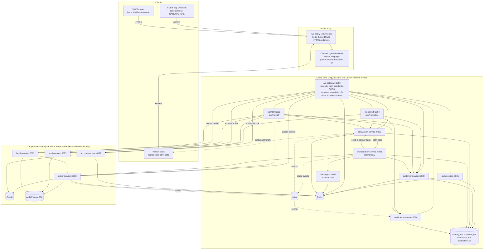

# How the mobile app and the staff console reach the backend

This page says how the two clients find the backend, what stands between them and the services, how sign-in and tokens work, and what changes between a laptop and Azure. It was written from the code at `dev` `d11c2ff` (10 October 2026) and brought up to date on 11 October 2026, after the system was deployed to Azure and HTTPS was switched on. Every statement names the file it comes from.

Three labels are used throughout:

- **Built:** in the code and run on the local stack.
- **Deployed:** running in Azure and checked there. The deployment itself is recorded in `AZURE_DEPLOYMENT_AS_BUILT.md`.
- **Not built:** planned or missing. Nothing depends on it today.

## 1. The two clients

| Client                            | For                                                                                                           | Where it is                                                        | Status                   |
| --------------------------------- | ------------------------------------------------------------------------------------------------------------- | ------------------------------------------------------------------ | ------------------------ |
| Flutter app (`app/`)              | Members: sign in, dashboard, send money, track a transfer, beneficiaries, notifications                       | An Android package installed on a phone. It is not hosted anywhere | Built                    |
| React staff console (`frontend/`) | Tellers and admins: Customer 360, counter cash, approvals, accounts, tracker and reversals, audit, end of day | Static files served by nginx                                       | Built; deployed in Azure |

Neither client talks to a database, to Kafka or to another client. Both speak HTTP and JSON to one address.

## 2. The picture

On a laptop there is no TLS proxy, and the app skips the nginx box and calls the gateway on port 8080 directly; everything else is the same. In Azure the TLS proxy holds the only public address and hands every call to the nginx pod (deployed, section 9).

## 3. How each client finds the backend

### The Flutter app

The app builds every address from one base, in this order (`app/lib/core/config/app_config.dart:20-35`):

1. An address typed on the sign-in screen and kept on the phone (`app/lib/features/auth/auth_screens.dart`, `secure_storage_service.dart` `saveGatewayUrl`).
2. The build-time value `--dart-define=GATEWAY_URL=...`.
3. A default: `http://10.0.2.2:8080` on an Android emulator, `http://localhost:8080` elsewhere.

To that base it adds `/api/v1` and the path (`api_client.dart:264-283`). It has a second mode, `USE_FIXTURES`, that answers from sample files in the package and calls nothing; `main.dart:14` turns it off unless the build asks for it.

### The staff console

The console never holds a backend address. Its code calls relative paths such as `/api/v1/staff/accounts` (`frontend/src/services/api/*.ts`), so requests go to wherever the page itself came from. What is behind that origin decides the rest:

| How the console is served                                 | `/api` goes to                                                                                                                               | File                            |
| --------------------------------------------------------- | -------------------------------------------------------------------------------------------------------------------------------------------- | ------------------------------- |
| nginx container, local Compose and Azure                  | `http://api-gateway:8080`, every path                                                                                                        | `frontend/nginx.conf:12-26`     |
| `npm run dev` or `npm run preview` on a developer machine | The gateway on`127.0.0.1:8080`, **except** `/api/v1/auth` (straight to auth-service, 8081) and `/api/v1/staff` (straight to staff-bff, 8095) | `frontend/vite.config.ts:13-62` |

The second row means a developer running the console with Vite skips the gateway, and so its rate limits and CORS, for sign-in and for every staff-bff call. Behaviour seen there can differ from the container.

## 4. Gateway, BFF or straight to a service

Every public call passes the gateway, which picks a service from the path (`backend/api-gateway/src/main/resources/application.yml:61-207`). There are two backend-for-frontend services, one per client, and both clients also call some services through the gateway without a BFF.

| Path                                                        | Goes to                                   | Used by                                                       |
| ----------------------------------------------------------- | ----------------------------------------- | ------------------------------------------------------------- |
| `/api/v1/auth/**`                                           | auth-service                              | app, console                                                  |
| `/api/v1/mobile/**`                                         | mobile-bff                                | app                                                           |
| `/api/v1/staff/**`                                          | staff-bff                                 | console                                                       |
| `/api/v1/customers/**`                                      | customer-service                          | app (profile, beneficiaries, KYC), console                    |
| `/api/v1/accounts/**`                                       | account-service                           | app, console                                                  |
| `/api/v1/transactions/**`                                   | transaction-service                       | app, console                                                  |
| `/api/v1/notifications/**`                                  | notification-service                      | app, console                                                  |
| `/api/v1/ledger/**`, `/api/v1/audit/**`, `/api/v1/batch/**` | ledger, audit, batch                      | console only; staff roles                                     |
| `/api/v1/interbank/**`                                      | transaction-service                       | partner banks                                                 |
| `/internal/**`                                              | nothing: refused with 403, encoded or not | nobody from outside (`InternalPerimeterRejectionFilter.java`) |

What the two BFFs add:

- **mobile-bff** (`MobileBffController.java`) gives the app four calls shaped for its screens: the dashboard (profile, main account, balance, unread count, recent transfers in one answer), a three-step timeline, the remittance form's limits, and the remittance itself. It calls customer, account, transaction and notification services.
- **staff-bff** (`StaffBffController.java`) gives the console Customer 360, counter cash and assisted transfer, the approval queues, account actions, tracker and reversal, audit views, and the end-of-day and dead-letter views. It calls customer, account, ledger, transaction, audit, batch and notification services.

Both BFFs pass the caller's own token on to the services they call. They hold no data and no credentials of their own.

## 5. Sign-in, tokens and who may do what

**Signing in (built).** The app posts to `/api/v1/auth/customers/login`, the console to `/api/v1/auth/staff/login`. auth-service checks the password (bcrypt) against `identity_db` and answers with two things:

- an **access token**: a signed JWT carrying the user ID, the user type and the roles (`ROLE_CUSTOMER`, `ROLE_TELLER`, `ROLE_ADMIN`);
- a **refresh token**: a random value kept in Redis for seven days (`RedisRefreshTokenService.java`).

**Checking a token (built).** The gateway does not check tokens. Each service checks the signature itself with the shared signing key `JWT_SECRET`, then applies its own role and ownership rules: a member reads only their own accounts and transactions, and the ledger, audit and batch endpoints take staff roles only. A service refuses to start without `JWT_SECRET`.

**How long a token lasts.** `JWT_EXPIRATION_MS`: 24 hours on the local stack (`.env.example`), two hours in Azure (`infra/k8s/config.yaml`, deployed).

**Renewing.**

| Client  | What it does when a call is answered 401                                                                                                               | File                              |
| ------- | ------------------------------------------------------------------------------------------------------------------------------------------------------ | --------------------------------- |
| App     | Exchanges the refresh token for a new pair once, however many calls are waiting, repeats the call, and signs the member out if the exchange is refused | `api_client.dart:160-261`         |
| Console | Nothing. It has no refresh; the user signs in again                                                                                                    | `frontend/src/services/client.ts` |

auth-service spends a refresh token when it is used and reads the user again, so a deactivated user gets no new token (`TokenServiceImpl.java`).

**Where tokens are kept.** The app keeps them in the Android key store (`secure_storage_service.dart`). The console keeps its session in the browser's `sessionStorage`, which ends with the tab (`client.ts:9-47`).

**Signing out.** Both clients call `/api/v1/auth/token/revoke`, which puts the access token on a revoked list in Redis.

Known limits, all open by decision:

- Only auth, account and ledger services read the revoked list. A revoked token still works at the other services until it expires.
- Signing out does not end the refresh token. The app's fingerprint sign-in relies on that: it keeps a copy of the refresh token and exchanges it later (`auth_screens.dart:69-72`). Changing it needs an app change (plan decision D6).
- The gateway's limits for a signed-in caller are keyed on the caller's address, not on a checked identity.

**Request rules every client follows.** `X-Correlation-ID` on every call; `Idempotency-Key` on every call that moves money (the app sends one per transfer and keeps it across a retry; the console sends one per counter operation; mobile-bff and staff-bff refuse a money call without it). Errors come back in one problem shape with an `errorCode` (contract section 2.5), which the app reads as such.

## 6. How services talk to each other

- **Calls on behalf of a user** use the public paths with the user's token passed along (the two BFFs).
- **Calls between services** use `/internal/v1/**`. The caller makes a short service token with the role `ROLE_SERVICE` from the same signing key; the user who caused the action travels in the body as `actorId`. The gateway never routes these paths.
- **The transfer saga.** transaction-service accepts a transfer and asks orchestration-service to run it. The orchestrator asks customer-service for the risk profile, risk-engine for a decision, and ledger-service to hold and then capture the money; for another bank it asks transaction-service's inter-bank gateway to send the message. The full list of allowed calls is contract section 3.2.
- **Events.** ledger, account, batch, transaction and orchestration services publish to Kafka; notification-service and transaction-service consume. The ledger writes its events to an outbox table in the same database transaction as the posting and relays them.
- **Every call has a time limit**, so a service that is down or a cut link shows as a clear error and never as a hang:

| Caller       | Limit                                                                                           | File                                      |
| ------------ | ----------------------------------------------------------------------------------------------- | ----------------------------------------- |
| App          | 10 s a call, 2.5 s for a token refresh; after three failures in a row it stops calling for 30 s | `app_config.dart`, `circuit_breaker.dart` |
| Gateway      | 3 s to connect, 15 s for an answer; then 503 or 504                                             | gateway`application.yml:23-25`            |
| mobile-bff   | 2 s to connect, 3 s to read                                                                     | its`application.properties`               |
| staff-bff    | 2 s to connect, 15 s to read                                                                    | its`application.properties`               |
| Orchestrator | risk 150 ms, customer 500 ms, ledger 2 s, inter-bank 30 s                                       | its`application.properties`               |

## 7. How data is reached

- Each service has its own database or schema and no other service reads it. A cloud service that needs account or ledger data asks account-service or ledger-service.
- **In Azure (deployed):** the four cloud databases are Azure SQL, reachable only from the cluster's subnet; Redis is reached through a private endpoint with TLS and an access key; Oracle and the audit PostgreSQL publish no port at all, and the firewall between the two networks lets the cluster reach four service ports and nothing else (`infra/bicep/modules/network.bicep`).
- **Secrets** are never in the repository. Locally they are in `.env`, which is not committed. In Azure they are generated into Key Vault and copied into one Kubernetes Secret at deploy time (`infra/scripts/deploy-cloud.ps1`); the on-premises VM reads its own from Key Vault with its identity (`infra/onprem/start.sh`).

## 8. Settings by environment

There are two environments today: a developer's machine and the Azure demo. **There is no separate test, staging or production environment** (not built); the Azure demo is the only deployed target.

| Setting                      | Developer machine                                                        | Azure demo (deployed)                                                                                                                 |
| ---------------------------- | ------------------------------------------------------------------------ | ------------------------------------------------------------------------------------------------------------------------------------- |
| App's backend address        | Emulator default, or typed on the sign-in screen                         | `--dart-define=GATEWAY_URL=https://coobs.indonesiacentral.cloudapp.azure.com` at build time, or typed on the sign-in screen           |
| Console's backend address    | None: same origin as the page                                            | None: same origin as the page                                                                                                         |
| Service-to-service addresses | Container names, e.g.`http://ledger-service:8083` (`docker-compose.yml`) | The same names, as Kubernetes Services; the four on-premises ones resolve to the VM (`infra/k8s/config.yaml`, `onprem-services.yaml`) |
| Cloud databases              | PostgreSQL container, or SQL Server with`docker-compose.azure-sql.yml`   | Azure SQL                                                                                                                             |
| Access token life            | 24 hours                                                                 | 2 hours                                                                                                                               |
| Allowed browser origins      | Any port on`localhost` and `127.0.0.1`                                   | The same, plus the HTTPS address, which the deploy script adds                                                                        |
| Secrets                      | `.env` from `.env.example`                                               | Key Vault                                                                                                                             |
| Staff passwords              | The seeded demo password                                                 | A generated one, set when the databases are loaded                                                                                    |

All names are in `contracts/runtime/RUNTIME_SETTINGS.md`. Configuration is by environment variable only; no service reads a file that differs per environment.

## 9. Reaching the services in Azure (deployed)

- **One public address, over HTTPS.** `https://coobs.indonesiacentral.cloudapp.azure.com`. The load balancer `coobs-public` hands ports 80 and 443 to a TLS proxy pod (`infra/k8s-https/tls-proxy.yaml`), which holds a Let's Encrypt certificate, answers plain HTTP with a redirect, and passes every call to the console's nginx. nginx serves the console and passes `/api` and `/actuator` to the gateway's internal Service. The console, the app, a partner bank and Postman all use that one address.
- **The console** is opened at that address. Its calls go to the same origin the page came from.
- **The app** is built with that address as `GATEWAY_URL` and installed by hand; the address can also be typed on its sign-in screen. It is signed with the debug key, which is fine for a demo and not for a store.
- **Where HTTPS ends.** At the TLS proxy. From there to nginx, the gateway and the services the calls are plain HTTP on the cluster's private network. Front Door, the planned edge, is refused by Azure on a free trial; the module for it stays in `infra/bicep/modules/frontdoor.bicep`.
- **The browser's origin** is judged once, at the gateway, against a list the deploy script fills with the HTTPS address. The gateway does not pass the `Origin` header on, because each service has a list of its own and the on-premises ones refused calls the gateway had allowed (`backend/api-gateway/src/main/resources/application.yml`, `default-filters`).
- **Internal paths.** `/internal/...` is answered 403 by nginx before it reaches anything (`frontend/nginx.conf`), and by the gateway for anything that reaches it another way.
- **Rate limits.** Because every call reaches the gateway from the nginx pod, calls without a token share one limit for all callers.

## 10. Gaps to know about

| Gap                                                                                                                                                                                    | Status                                   |
| -------------------------------------------------------------------------------------------------------------------------------------------------------------------------------------- | ---------------------------------------- |
| HTTPS ends at the cluster entry; calls inside the cluster and to the on-premises zone are plain HTTP                                                                                   | Open; needs encryption between services  |
| The Android manifest still allows plain HTTP, which is no longer needed                                                                                                                | Open, with the app's developers          |
| The console's tracker opens on a sample reference that does not exist, so the backend answers 404 each time it is opened (`frontend/src/components/tracker/TransactionTracker.tsx:38`) | Open, with the console's developer       |
| A revoked token is refused by three services only                                                                                                                                      | Open                                     |
| Signing out leaves the refresh token valid                                                                                                                                             | Open (D6)                                |
| The console cannot renew a token                                                                                                                                                       | Not built; the console is frozen         |
| With Vite, the console bypasses the gateway for sign-in and staff-bff                                                                                                                  | Built that way; affects development only |
| The console's sign-in page pre-fills the seeded password, which is wrong for staff in Azure                                                                                            | Open; type the real one                  |
| No test, staging or production environment                                                                                                                                             | Not built                                |
| Both clients fall back to bundled sample data in places when a call fails                                                                                                              | Open, with the client owners             |
