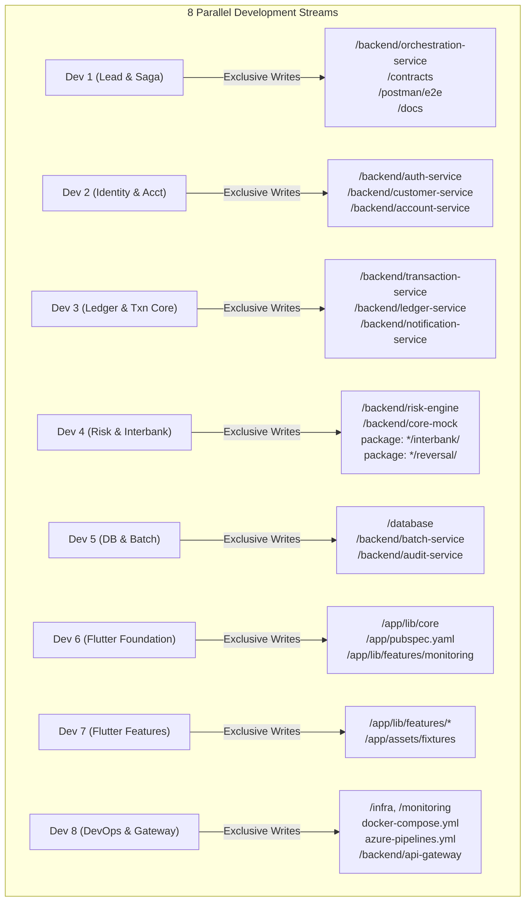

# Day-by-Day Parallel Execution Roadmap & Current Status Review

## CooBS Hybrid-Cloud Cooperative Banking Platform (Integrated Target State v2.2)

**Document Version:** 1.0  
**Target Group:** Group 2 (Developers 1 through 8)  
**Parent Plans:**
- [`ZERO_CONFLICT_8_DEV_EXECUTION_PLAN.md`](ZERO_CONFLICT_8_DEV_EXECUTION_PLAN.md)
- [`PER_DEV_TECHNICAL_WORK_PACKAGES.md`](PER_DEV_TECHNICAL_WORK_PACKAGES.md)
- [`SERVICE_SCOPE_SCENARIOS_AND_ACTIONS.md`](SERVICE_SCOPE_SCENARIOS_AND_ACTIONS.md)
- [`contracts/api/FUTURE_INTEGRATED_API_CONTRACT.md`](../contracts/api/FUTURE_INTEGRATED_API_CONTRACT.md)

---

## 1. Current State Assessment (Where the Codebase Stands Now)

Following the commit `6a4c293` (*"feat: add backend microservices, security configurations, and database schemas"*), the foundation for our 8-developer parallel workflow has been successfully established.

| Area | Delivered Artifacts in Codebase | Milestone Status | Plan Alignment |
| :--- | :--- | :--- | :--- |
| **All 11 Microservices** | Scaffolding for `batch-service`, `customer-service`, `orchestration-service`, `risk-engine`, and `transaction-service` with Java 21, Spring Boot, Security, JWT, Dockerfiles, and Maven wrappers. | **PR 1 Completed** (Dev 8) | Section 3 Merge Order #1 |
| **Database Schemas & Seeds** | `database/next/oracle/`, `database/next/postgres/`, `database/postgres-cloud/` schemas, and `generate_seed.py` (1,192 lines deterministic synthetic generator). | **PR 2 Completed** (Dev 5) | Section 3 Merge Order #2 |
| **API & Architecture Contracts** | `contracts/api/FUTURE_INTEGRATED_API_CONTRACT.md`, its examples exported to `contracts/examples/`, interactive topology visualizer `docs/interactive-architecture.html`. | **Frozen at tag `contracts-v1`** (Dev 1) | Section 3 Merge Order #3 |
| **CI/CD & Local Runtime** | Multi-stage `azure-pipelines.yml` (448 lines) and `docker-compose.yml` (Oracle 23ai, Postgres Cloud & On-Prem, Redis, Kafka KRaft). | **Merged & Active** (Dev 8) | Handshake H13 & H14 |

> **Current Checkpoint:** We have completed **Day 1** and the foundational scaffolding of **Day 2 (PR 1, PR 2, and PR 3)**. The team is now transitioning into **Day 2 Wrap-Up (PR 4: Flutter Shell & PR 5: PostingEngine Extraction)** and **Day 3 (Independent Vertical Slices & Unit Tests)**.

---

## 2. Parallel Development Architecture: The Zero-Conflict Model

To ensure 8 developers push code concurrently without merge conflicts or blocked dependencies, the project enforces **Strict Directory Ownership**, **Single-Editor Rules**, and **Frontend Decoupling via Fixtures**.



### The 3 Golden Rules in Action

1. **Strict Directory & Service Isolation:**
   - Dev 2, Dev 3, and Dev 5 work in completely disjoint service directories under `/backend/`.
   - Dev 4 contributes to `ledger-service` and `transaction-service` strictly through isolated sub-packages (`com.group2.fse.ledger_service.reversal` and `com.group2.fse.transaction_service.interbank`), preventing collisions with Dev 3's core controllers.
2. **Single-Editor Gatekeeper Rule:**
   - Root configuration (`docker-compose.yml`, `azure-pipelines.yml`, gateway `application.yml`) $\rightarrow$ **Dev 8 only**.
   - DDL init scripts and seed scripts (`database/**`) $\rightarrow$ **Dev 5 only**.
   - API & Event contracts (`contracts/**`) $\rightarrow$ **Dev 1 only**.
   - Flutter core architecture (`app/pubspec.yaml`, `app/lib/core/**`) $\rightarrow$ **Dev 6 only**.
   - Any developer needing an env variable, port, route, or dependency submits a request to the gatekeeper (file, exact lines, reason).
3. **Frontend Independence via Fixtures:**
   - Dev 6 and Dev 7 build all screens against curated JSON fixtures (`app/assets/fixtures/`) on Days 2 and 3 using `USE_FIXTURES=true`.
   - The UI team never waits for backend microservices to boot or deploy before implementing screens and widgets.

---

## 3. Day-by-Day Parallel Output Roadmap (Days 2 to 9)

### Day 2 (Immediate Checkpoint): Contract Freeze, Service Skeletons & Fixtures
*Goal: Every microservice compiles in CI, boots with a health check, and the Flutter shell runs on fixtures.*

| Developer | Core Day 2 Outputs & Deliverables | Handshake / PR |
| :--- | :--- | :--- |
| **Dev 1** | **Freeze v1 contracts** and tag `contracts-v1`. Export example request/response payloads as JSON fixtures for UI. Scaffold the saga state machine skeleton in `orchestration-service`. | Tag `contracts-v1` (PR 3) |
| **Dev 2** | Scaffold entity mappings in `auth-service` for `identity_db` (`app_user`, `role`). Scaffold controller/DTO stubs for `customer-service` (`/api/v1/customers/**`). | Handshake H1, H6 |
| **Dev 3** | **Critical Milestone (PR 5):** Extract `PostingEngine` out of `AccountBalanceServiceImpl.java` so holds and reversals can share lock and balance math without editing the same file. Scaffold `transaction-service` validation shell. | PR 5, Handshake H4 |
| **Dev 4** | Implement deterministic risk scoring in `risk-engine` (sub-40ms mock score engine); scaffold interbank webhook DTOs. | Handshake H5 |
| **Dev 5** | Verify generated seeds via `generate_seed.py` into local Oracle, Postgres Cloud, and Postgres On-Prem. Confirm shared keys (`customer_id=1`, `account_id=1`, `john_doe`) match across all DBs. | PR 2, Handshake H2 |
| **Dev 6** | **Critical Milestone (PR 4):** Push `/app` Flutter foundation (routing, Dio/Http client with `USE_FIXTURES=true` interceptor, theme, state shell). Freeze `app/lib/core`. | PR 4, Handshake H18 |
| **Dev 7** | Curate JSON fixtures in `app/assets/fixtures/` and start isolated screens for Customer 360, Transfer, and KYC. | Handshake H15 |
| **Dev 8** | Verify all 11 services compile in CI pipeline (`azure-pipelines.yml`). Add Flutter web origin to `api-gateway` CORS. | PR 1, Handshake H14 |

* **Exit Gate:** All 11 microservices boot green locally and in CI; Flutter app runs on web and Android using fixtures.

---

### Day 3: Independent Vertical Slices & Unit Tests
*Goal: Business logic implemented and covered by unit tests in isolation.*

| Developer | Core Day 3 Outputs & Deliverables | Handshake / Scope |
| :--- | :--- | :--- |
| **Dev 1** | Implement the 11 saga transitions in `orchestration-service` with correlation IDs against mock downstream clients. | Saga Stages 4–11 |
| **Dev 2** | Cut `auth-service` over to `identity_db` (remove Oracle dependencies, disable public self-registration). Implement `customer-service` profile endpoints and internal `/internal/v1/customers/{id}/risk-profile`. | Handshake H6, H8 |
| **Dev 3** | Implement transfer validation & idempotency guard (Redis `SETNX`) in `transaction-service`. Add `/internal/v1/ledger/holds` in `ledger-service`. Repoint `notification-service` to `notification_db`. | Handshake H3, H7 |
| **Dev 4** | Implement rule checks in `risk-engine` (daily limit velocity from Redis counters, score thresholds: below 0.60 `APPROVE`; 0.60 to 0.85 `DECLINE` with `REVIEW_REQUIRED`; above 0.85 `DECLINE` with `HIGH_RISK`). | Handshake H5 |
| **Dev 5** | Generate final production seed dataset. Verify all foreign keys, constraints, and audit trigger hash chains on `audit_store`. | Handshake H2 |
| **Dev 6** | Build the 11-stage staff stepper and 3-stage customer tracker in Flutter against fixture timelines. | Handshake H7 |
| **Dev 7** | Complete Customer 360 screen (cards for accounts, recent activity, spending breakdown, tier). | Handshake H9 |
| **Dev 8** | Configure `.DLT` topics in Kafka, setup Redis velocity keys, and optimize Docker multi-stage build caching. | Handshake H17 |

* **Exit Gate:** All unit test suites pass (`mvn test`); PRs merged into `dev` branch.

---

### Day 4: Connect Services (First Live Transfer Happy Path)
*Goal: End-to-end distributed transaction runs live across microservices.*

| Developer | Core Day 4 Outputs & Deliverables | Handshake / Scope |
| :--- | :--- | :--- |
| **Dev 1** | Wire `orchestration-service` to call live `risk-engine` (`POST /internal/v1/risk/evaluate`) and `ledger-service` (`POST /internal/v1/ledger/holds`). | Live Saga Wiring |
| **Dev 2** | Wire `customer-service` 360 aggregator to call `account-service` on-premises for legal KYC & account list. | Hybrid 360 Read |
| **Dev 3** | Connect `transaction-service` to trigger `orchestration-service`; enable hold capture and outbox event append in `ledger-service`. | Core Transfer Flow |
| **Dev 4** | Expose live risk endpoint on port 8092; provide mock interbank partner responses. | Handshake H5 |
| **Dev 5** | Fix any schema/query performance issues; scaffold `batch-service` on port 8093 with on-prem Oracle and PostgresAudit connections. | Handshake H11 |
| **Dev 6 & 7** | Toggle `USE_FIXTURES=false` for login and transfer initiation; verify live timeline updates via polling or SSE. | Live Client Sync |
| **Dev 8** | Deploy shared dev environment; verify cross-container networking and correlation ID propagation (`X-Correlation-ID`) across gateway logs. | Environment Sync |

* **Exit Gate:** First live transfer succeeds end-to-end: `Flutter -> api-gateway -> transaction-service -> orchestration-service -> risk-engine -> ledger-service (Oracle hold & capture) -> Kafka event`.

---

### Day 5: Integration Checkpoint 1 & Contract Lock
*Goal: Validate 3 primary customer flows; lock API contract.*

| Developer | Core Day 5 Outputs & Deliverables | Checkpoint Focus |
| :--- | :--- | :--- |
| **Dev 1** | Run Postman E2E automated test suite. **Formally lock v1 contracts.** | Contract Lock |
| **Dev 2** | Test hybrid read: Customer 360 seamlessly combining cloud profile with on-prem Oracle accounts. | Hybrid Consistency |
| **Dev 3** | Verify Kafka event publication (`transaction.stage.changed.v1`) and notification delivery to `notification_db`. | Event Propagation |
| **Dev 4** | Verify that high-risk transfer is immediately rejected with `422 RISK_DECLINED` **without creating any ledger hold or Oracle row lock**. | Limit / Fraud Rejection |
| **Dev 5** | Verify ledger balance debit matches credit; check hash integrity in `audit_store`. | Double-Entry Integrity |
| **Dev 6 & 7** | Test responsive layouts on Chrome Web and Android emulator. | Cross-Platform QA |
| **Dev 8** | Benchmark risk evaluation latency: confirm $p95 < 40\text{ ms}$. | SLA Benchmark |

* **Exit Gate:** Happy path, fraud decline, and insufficient funds scenarios pass cleanly.

---

### Day 6: Advanced Features (Holds, Reversals, DLQ & EOD Batch)
*Goal: Edge cases, fault tolerance, and end-of-day compliance pipeline.*

| Developer | Core Day 6 Outputs & Deliverables | Feature Scope |
| :--- | :--- | :--- |
| **Dev 1** | Implement compensating sagas: if hold capture fails downstream, orchestrator executes automatic hold release. | Saga Compensations |
| **Dev 2** | Implement beneficiary management (`/api/v1/customers/me/beneficiaries`) in `customer-service`. | Beneficiary Domain |
| **Dev 3** | Implement Kafka 3-attempt exponential backoff in `notification-service`, routing poison pills to `notification.events.DLT`. Add DLQ admin replay endpoint to `transaction-service`. | DLQ & Admin Replay |
| **Dev 4** | Implement interbank inbound remittance webhook (`POST /api/v1/interbank/transfers/inbound`) and transaction reversal logic in `ledger-service`. | Reversals & Inbound |
| **Dev 5** | **Implement all 6 steps of the EOD Batch Pipeline** in `batch-service`: 1. Interest accrual $\rightarrow$ 2. Service fees $\rightarrow$ 3. Standing orders $\rightarrow$ 4. Loan amortization $\rightarrow$ 5. General Ledger balance check (Debits == Credits) $\rightarrow$ 6. Closing SHA-256 daily seal in `audit_store`. | 6-Step EOD Engine |
| **Dev 6** | Add DLQ retry indicator and error handling in Flutter client. | Error Recovery UI |
| **Dev 7** | Build the **EOD Batch Control Deck UI** in Flutter/Web with step-by-step progress bars and Daily Seal certificate viewer. | EOD Control Deck |
| **Dev 8** | Configure Azure Key Vault secrets, TLS certificates, and Grafana dashboard alerts. | Production Hardening |

* **Exit Gate:** 6-step EOD batch runs in 5–8 seconds and creates a verified daily seal; poison messages route to `.DLT` and replay successfully.

---

### Day 7: Integration Checkpoint 2 & System Hardening
*Goal: Full end-to-end regression, security checks, and load resilience.*

| Developer | Core Day 7 Outputs & Deliverables | Focus Area |
| :--- | :--- | :--- |
| **Whole Team** | Run the 8 core scenario tests defined in `SERVICE_SCOPE_SCENARIOS_AND_ACTIONS.md`. | Smoke Test |
| **Dev 1** | Run full E2E checklist; triage and assign any remaining P1/P2 bugs. | Defect Triage |
| **Dev 2** | Remove residual `User`/`Role` entities from on-premises services; verify no service reads raw password hashes. | Entity Purge |
| **Dev 3** | Verify that direct access to `/api/v1/ledger/**` is blocked for external users and permitted only for authenticated staff console roles. | Perimeter Gate |
| **Dev 4** | Run bilateral interbank loopback test; verify GL ledger accounts reflect cleared balances. | Interbank Proof |
| **Dev 5** | Prepare demo data reset script (`scripts/reset_demo_data.ps1` or `.sh`) to restore clean state in $< 30$ seconds. | Data Reset |
| **Dev 6 & 7** | Polish UI transitions, loading skeletons, and validation error messages on mobile and web. | UI Polish |
| **Dev 8** | Execute JMeter concurrency/double-spend test; verify Redis rate-limiting and token bucket protection. | Concurrency Defense |

* **Exit Gate:** Zero open P1/P2 bugs; end-to-end data reset script tested and verified.

---

### Day 8: Hard Feature Freeze & Defense Rehearsal
*Goal: Code locked, rehearsal completed, zero new features.*

- **ALL DEVS:** **HARD FEATURE FREEZE.** Only critical P1 fixes permitted with Dev 1 sign-off.
- **Dev 5:** Take baseline database backup for the defense demonstration.
- **Dev 8:** Tag release candidate (`v2.2-rc1`) in Azure DevOps; prepare local Docker fallback stack on a secondary laptop in case of venue Wi-Fi loss.
- **Dev 1 & Dev 6:** Timed walkthrough of the oral presentation and scenario demonstrations (target: 20 minutes total).
- **Dev 7:** Capture backup demonstration videos and high-resolution slides.
* **Exit Gate:** Release candidate frozen and rehearsed; clean reset works on two laptops.

---

### Day 9: Live Capstone Defense
*Goal: Flawless live demonstration and technical justification to faculty/evaluators.*

| Speaker | Presentation Segment | Key Talking Points & Demonstration Focus |
| :--- | :--- | :--- |
| **Dev 1** | System Overview & Saga Architecture | Hybrid cloud rationale, zero-conflict git workflow, 11-stage distributed saga coordination, compensating transactions. |
| **Dev 2** | Identity Separation & Customer 360 | Moving auth to `identity_db`, why KYC master stays in sovereign Oracle on-prem, Customer 360 hybrid aggregation. |
| **Dev 3** | Ledger Engine & Event Outbox | Double-entry bookkeeping, ordered balance row locks (`SELECT FOR UPDATE`), outbox relay pattern, dead-letter recovery. |
| **Dev 4** | Sub-40ms Risk Engine & Interbank Remittance | Deterministic scoring rules, Redis velocity tracking, why fraud declines bypass ledger row locks, interbank loopback. |
| **Dev 5** | Database Architecture & EOD Batch Pipeline | Multi-database isolation, 6-step EOD engine, debit-equals-credit GL verification, tamper-evident SHA-256 audit chain. |
| **Dev 6** | Omnichannel Flutter Architecture | Single codebase for Web (CanvasKit) & Android, reactive state management, 11-stage visual stepper. |
| **Dev 7** | Live Customer Demonstration | Driving the live app: sign-in, Customer 360, instant transfer, fraud limit block, and EOD batch execution. |
| **Dev 8** | Cloud Infrastructure, CI/CD & Security | Azure AKS deployment, Front Door / WAF perimeter, Redis token bucket rate limiting, zero-downtime rollback drill. |

---

## 4. Immediate Action Checklist for Today

```
[NEXT IMMEDIATE MERGES]
  ├── Dev 3: Pull dev, extract PostingEngine (H4) in ledger-service -> Unblocks Dev 4
  ├── Dev 6: Push /app Flutter foundational shell (H18) with fixture mode -> Unblocks Dev 7
  ├── Dev 5: Validate generate_seed.py against local Oracle & Postgres containers -> Unblocks Dev 2 & 3 entities
  ├── Dev 1: contracts-v1 is tagged. Examples are in contracts/examples/; Dev 7 curates them into app/assets/fixtures/ (H15)
  └── Dev 2 & 4: Begin Day 3 vertical slices inside customer-service & risk-engine
```
