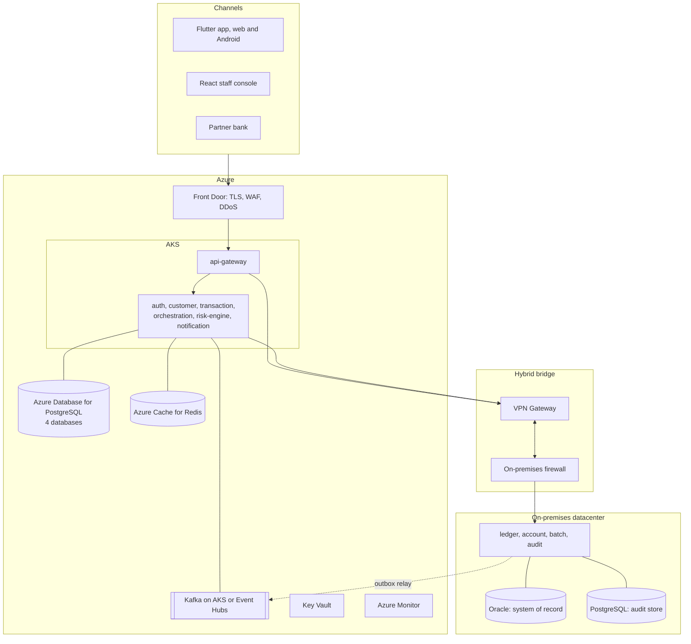
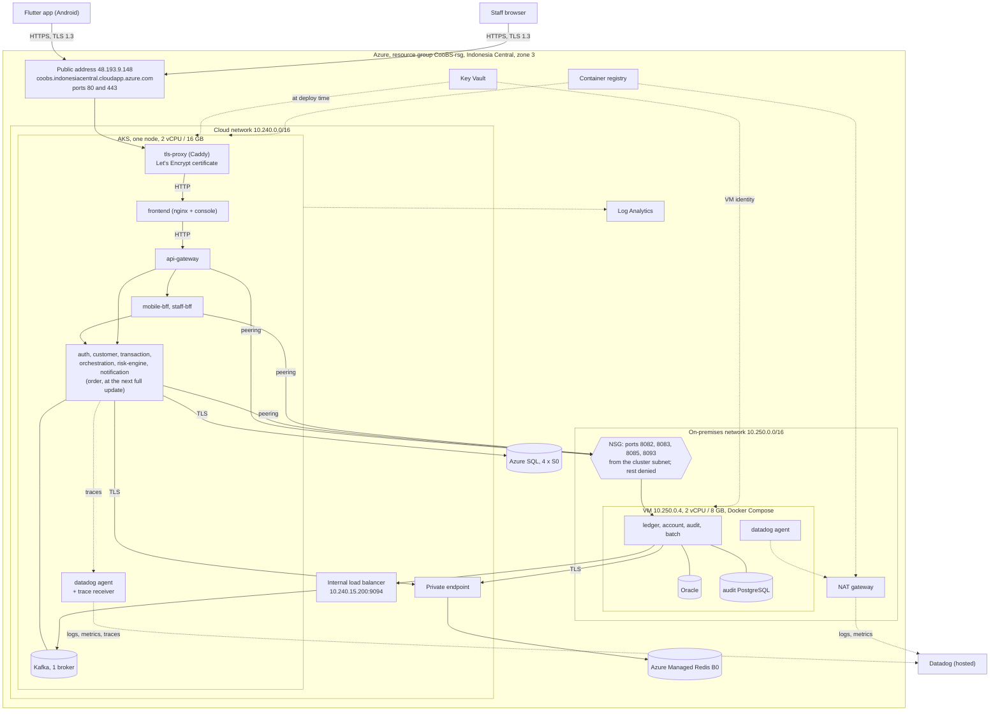
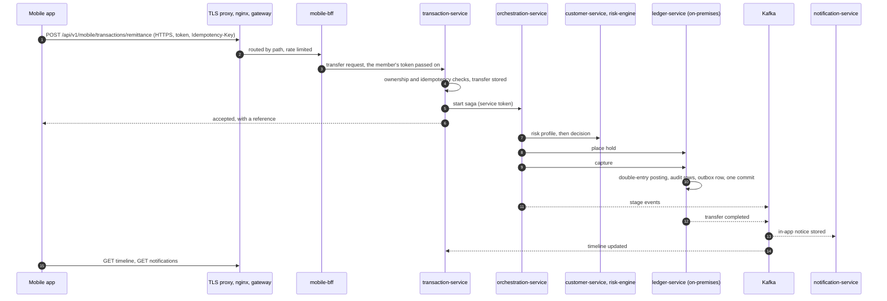
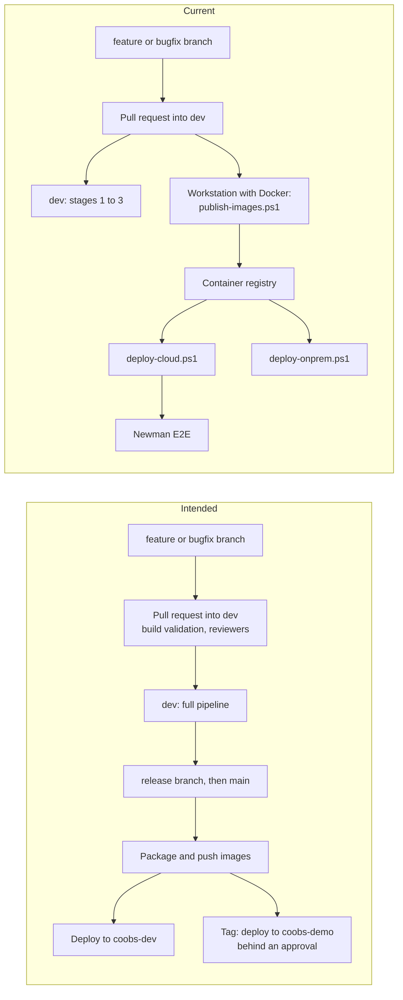

# CooBS: enterprise architecture and deployment

**Audience:** cloud engineers, solution architects, enterprise architects and technical reviewers.
**Describes:** the code on `dev` and the system running in Azure, read again on 13 October 2026.
**Covers:** what the platform is made of, the architecture that was planned, the architecture that is deployed, how it is deployed and operated, where the two differ and why, and what closes the differences.

This document stands on its own. It needs no other material to be read.

**Terms used throughout**

| Term | Meaning here |
| --- | --- |
| Cloud zone | The part of the system that runs in Azure on a Kubernetes cluster |
| On-premises zone | The part that belongs in the bank's own datacenter. In this deployment a virtual machine in a separate, firewalled Azure network plays that role |
| Gateway | The single service through which every API call enters |
| BFF (backend for frontend) | A service that shapes backend data for one client's screens: one for the mobile app, one for the staff console |
| Saga | The step-by-step run of one transfer across several services, with a defined undo for each step |
| Hold, capture, release | Reserving money for a transfer, then either taking it or giving it back |
| Outbox | A table the ledger writes an event to in the same database transaction as the money movement, so the event cannot be lost |
| Idempotency key | A value sent with a request so that sending it twice has the effect of sending it once |
| Dead-letter topic | Where a message goes after repeated failures, to be inspected and replayed |
| Seed | The fixed starting data: members, accounts, balances |
## 1. Executive summary

CooBS is a cooperative banking platform: fourteen Spring Boot services, a Flutter mobile app for members and a React console for staff. It is a hybrid system by design. The services that sign in, route, decide and display run in the cloud. The ledger, the accounts, the audit trail and the end-of-day batch stay on-premises with the system of record.

The platform is deployed in Azure and serves both clients at `https://coobs.indonesiacentral.cloudapp.azure.com`. Nine services, the console and Kafka run on an AKS cluster. Four services, Oracle and the audit store run on a virtual machine in a second network that stands in for the bank's datacenter, behind a firewall that admits four ports from the cluster and nothing else. The fourteenth service, `order-service` (the members' shop), was added on 13 October: it is in the code, the local stack and the deployment files as a tenth cloud service with its own database, and joins the running system at the next full update (section 6.5). The end-to-end suite of 143 checks passes against that address, as it does against the local stack.

The deployment follows the planned placement of services and data exactly. It differs from the planned platform in six places, each forced by the Azure free trial the system was first deployed on, or decided on record: Azure SQL in place of PostgreSQL, Kafka inside the cluster in place of Event Hubs, network peering in place of a VPN, a TLS proxy in the cluster in place of Front Door, one two-vCPU node in place of a three-node pool, and two backend-for-frontend services added to the original seven cloud services.

What separates this deployment from a production one is stated in section 8: one environment and one instance of everything, no encryption between services, delivery by script from a workstation, no backup of the on-premises data, no security scanning in the pipeline, and monitoring that rests on a trial of a hosted product.

The subscription became pay-as-you-go on 12 October 2026. That lifts the limits which shaped the deployment (ten vCPUs and twenty public addresses in place of four and three) and removes the spending limit, so cost is now controlled by a budget alert and by removing the resources after the presentation (section 5.9). The topology was reassessed against the new limits on 13 October and kept: one cluster and one virtual machine (section 5.8).

## 2. Design principles

These rules were set before any code was written and hold in the deployed system.

| Principle | How it is met |
| --- | --- |
| The cloud holds what is needed to sign in, route, decide and display; on-premises holds the money and the record | Section 3.2, column "Zone" |
| No cloud service connects to Oracle or to the audit store | Cloud services receive only the URLs of the four on-premises services; the databases publish no port outside the VM |
| Only the orchestrator, from the cloud, and account and batch, locally, call the ledger | The API contract allows no other caller, and the firewall admits the ledger's port from the cluster subnet only |
| Sign-in works when the link between the zones is down | `auth-service`, `identity_db` and Redis are all in the cloud zone |
| Compute is stateless | Saga state is in `transaction_db`; locks, counters, refresh tokens and idempotency keys are in Redis |
| Every outbound call has a time limit | Section 5.6 |
| Events survive an outage of the link | The ledger writes each event to an outbox table in the same database transaction as the posting, and relays it |
| Configuration by environment variable only; no secret in the repository | Every setting is a named environment variable; secrets are held in Key Vault (section 5.5) |
| One API gateway | Spring Cloud Gateway; no Azure API Management |
| Schemas and data are disposable | Tables come from database init scripts; services run with `ddl-auto=validate`; there are no migrations |

## 3. Component inventory

### 3.1 Client applications

| Component | Users and purpose | Technology | Delivery |
| --- | --- | --- | --- |
| Mobile app | Members: sign-in (password or fingerprint), dashboard, remittance, transfer timeline, beneficiaries, notifications | Flutter 3.44, Dart 3.12; `http`, `flutter_secure_storage`, `local_auth` | An Android package built with the HTTPS address and installed by hand. A web build target exists in the code and is not built or hosted. iOS is outside the project's scope |
| Staff console | Tellers and admins: Customer 360, counter cash, assisted transfer, approvals, account actions, tracker and reversals, audit views, end of day, dead-letter replay | React 19, TypeScript 6, Vite 8; served by nginx | A container on the cluster. Its nginx is also the path every API call takes to the gateway |

### 3.2 Backend services

All services run on Java 21 and expose health, liveness and Prometheus metrics through Spring Boot Actuator. Thirteen are built on Spring Boot 4.1.1 with Spring MVC; `api-gateway` is built on Spring Boot 3.3.4 with Spring Cloud Gateway on WebFlux. Each service validates the caller's token itself.

| Service | Port | Zone | Responsibility | Owns | Calls |
| --- | --- | --- | --- | --- | --- |
| `api-gateway` | 8080 | Cloud | Single API entry. Routes by path, applies Redis token-bucket rate limits and CORS, sets time limits, adds `X-Correlation-ID`, refuses `/internal/**` | Nothing; Redis for rate limits | Every public service |
| `mobile-bff` | 8094 | Cloud | Calls shaped for the app's screens: dashboard, remittance form and submission, three-step timeline | Nothing | customer, account, transaction, notification |
| `staff-bff` | 8095 | Cloud | Calls shaped for the console: Customer 360, counter cash, assisted transfer, approval queues, account actions, tracker, audit, end-of-day and dead-letter views | Nothing | customer, account, ledger, transaction, audit, batch, notification |
| `auth-service` | 8081 | Cloud | Sign-in for members and staff; access and refresh tokens; revocation | `identity_db`; refresh tokens and the revoked list in Redis | None |
| `customer-service` | 8089 | Cloud | Member profile, Customer 360, beneficiaries, KYC update requests, risk profile for the saga | `customer_db` | account, transaction |
| `transaction-service` | 8090 | Cloud | Transfer intake with ownership and idempotency checks, history, timeline, reversal requests, the inter-bank gateway in both directions | `transaction_db`, schema `txn` | account, orchestration, partner banks |
| `orchestration-service` | 8091 | Cloud, internal only | The transfer, reversal and inbound inter-bank sagas; publishes stage events 4 to 11; compensation; a periodic sweep for sagas left in flight | `transaction_db`, schema `saga` | customer, risk-engine, ledger, transaction |
| `risk-engine` | 8092 | Cloud, internal only | Fraud score bands, daily limit held as a reservation, velocity and reversal counters, customer risk floor | Counters in Redis | None |
| `notification-service` | 8084 | Cloud | In-app inbox, read flags, retry, dead-letter list and replay | `notification_db` | None |
| `account-service` | 8082 | On-premises | Account lifecycle, status, flags, closure requests; balances through the ledger | Oracle, account tables | ledger |
| `ledger-service` | 8083 | On-premises | Double-entry postings, holds, capture, release, reversal, batch postings, outbox, audit rows written at commit | Oracle, ledger tables; writes the audit store | None |
| `audit-service` | 8085 | On-premises | Read-only audit statements, forensic records, hash-chain verification, daily seal | Reads the audit store | None |
| `batch-service` | 8093 | On-premises | Six-step end-of-day pipeline on demand: fees, interest, standing instructions, loan instalments, GL reconciliation, audit seal | Audit store, schema `batch`; reads Oracle | ledger |
| `order-service` | 8096 | Cloud | The members' shop (Co-op Essentials Depot): catalogue, orders, and payment in two phases, a hold when the order is placed and a capture when it is collected, or a release when it is cancelled | `order_db` | ledger |

The calls one service may make to another are fixed by the project's API contract and are the ones listed in the table above. They use `/internal/v1/**` with a service token carrying `ROLE_SERVICE`; the person who caused the action travels in the request body as `actorId`.

### 3.3 Data stores and messaging

| Store | Engine and size in Azure | Local stack | Used by |
| --- | --- | --- | --- |
| `identity_db`, `customer_db`, `transaction_db`, `notification_db` | Azure SQL Database, one logical server, four S0 databases, collation `Latin1_General_100_CI_AS_SC_UTF8` | PostgreSQL 16, or SQL Server 2022 with `docker-compose.azure-sql.yml` | auth; customer; transaction and orchestration; notification |
| System of record | Oracle Database Free 23ai, container on the VM | Same image | ledger, account; batch reads |
| Audit store | PostgreSQL 16, container on the VM; append-only table with a SHA-256 hash chain enforced by triggers; schema `batch` | Same image | ledger writes, audit reads, batch reads and writes |
| Cache, locks, counters | Azure Managed Redis `Balanced_B0`, TLS on port 10000, private endpoint | Redis container | gateway, auth, customer, transaction, risk-engine, account, ledger |
| Event bus | Apache Kafka, one broker as a StatefulSet with an 8 GB disk | Kafka container | ledger, account, batch, transaction, orchestration publish; notification, transaction, orchestration consume |

Kafka carries twenty topics: ten event topics (`ledger.mutation.completed.v1`, `ledger.transfer.completed.v1`, `ledger.transfer.failed.v1`, `account.closure.completed.v1`, `account.created.v1`, `kyc.request.submitted.v1`, `kyc.request.evaluated.v1`, `transaction.stage.changed.v1`, `notification.dispatched.v1`, `batch.eod.step.completed.v1`) and ten dead-letter topics. All events share one envelope: `eventId`, `eventType`, `timestamp`, `version`, `correlationId`, `payload`.

### 3.4 Azure platform

One resource group, `CooBS-rsg`, region Indonesia Central, availability zone 3, created from Bicep templates (Azure's infrastructure-as-code language) kept with the code.

| Resource | Name | Specification |
| --- | --- | --- |
| Kubernetes cluster | `aks-coobs-dev` | AKS Free tier, Kubernetes 1.35, Azure CNI, one node `Standard_E2as_v5` (2 vCPU, 16 GB) |
| Virtual machine | `vm-coobs-onprem` | `Standard_B2as_v2` (2 vCPU, 8 GB), Ubuntu 24.04, Docker installed at first boot, private address `10.250.0.4` |
| SQL server | `sql-coobs-c2whi3` | Four S0 databases; reachable through a service endpoint from the cluster subnet only |
| Redis | `redis-coobs-c2whi3` | Azure Managed Redis `Balanced_B0`, one node, access key, private endpoint with a private DNS zone linked to both networks |
| Key Vault | `kv-coobs-c2whi3` | RBAC authorisation; thirteen secrets |
| Container registry | `CooBS` | Standard; fourteen repositories under `coobs/`, fifteen once `order-service` is published |
| Cloud network | `vnet-coobs-cloud-dev` | `10.240.0.0/16`: `snet-aks` `10.240.0.0/20`, `snet-private-endpoints` `10.240.16.0/24` |
| On-premises network | `vnet-coobs-onprem-dev` | `10.250.0.0/16`: `snet-core` `10.250.0.0/24`; peered with the cloud network in both directions |
| Zone firewall | `nsg-coobs-onprem` | Section 5.2 |
| NAT gateway | `nat-coobs-onprem` | Outbound route for the VM, which has no public address |
| Log Analytics | `law-coobs-dev` | Receives the cluster's container logs through Container Insights; capped at 1 GB a day, kept 30 days |

The deployment was sized for the free trial it began on: four vCPUs in the region and three public addresses, both fully used (two vCPUs each for the node and the VM; one address each for the cluster's outbound traffic, the public entry and the NAT gateway). Since 12 October the subscription is pay-as-you-go and allows ten vCPUs and twenty addresses. The sizing was kept; what the new limits allow is in section 5.8.

### 3.5 Delivery and observability tooling

| Tool | Role |
| --- | --- |
| Azure Repos, Azure Pipelines (`CooBS-CI`) | Source control and continuous integration (section 7) |
| `publish-images.ps1` | Builds and pushes the fifteen images: fourteen services and the console |
| `deploy-cloud.ps1`, `deploy-onprem.ps1` | Deploy and update the two zones; reset the data; start monitoring |
| `setup-datadog.ps1` | Creates the log pipelines, dashboard and monitors in Datadog |
| Datadog | Logs, metrics and traces from both zones (section 9) |
| Prometheus, Grafana, Loki, Promtail | The same signals on the local stack, with two dashboards and nine alert rules |
| Postman and Newman, and a release-check script | End-to-end verification: a suite of 143 checks and seven further stack checks |

### 3.6 Designed or written, and not part of the running system

| Component | Position |
| --- | --- |
| Azure Front Door | The planned edge. Azure refused it on the free trial. On pay-as-you-go it can be created; the module is kept, switched off by default, and has never created anything, so it is not switched on before the presentation |
| VPN Gateway, Azure API Management | In the target design only. Both were placed outside the build from the start |
| Azure Event Hubs, Azure Database for PostgreSQL, Azure Cache for Redis | Earlier platform choices, replaced by decisions recorded in section 8 |
| Application Insights (`appi-coobs-dev`) | Created by the Bicep; no service sends to it. Superseded by Datadog |
| An ingress controller with a supplied certificate | An earlier design for the entry, superseded by the TLS proxy of section 5.4 |
| Flutter web target | Present in the code; not built or hosted |
| Partner bank `AURABANK` | The adapter is merged into `transaction-service`. Its key and address are not in the deployment's configuration, so in Azure the only working partner is still `BANKB`, answered by a loopback inside `transaction-service` |
| Pipeline deploy stages | Present in the pipeline definition as placeholders; deployment is done by the scripts above |

## 4. Planned architecture

This is the architecture and the delivery process the team set out before building.



| Topic | Plan |
| --- | --- |
| Hosting of the demonstration | Local first, on one Docker network; an Azure environment "if a subscription is confirmed". Splitting the zones into separate networks was deferred |
| Edge | Front Door in the target state; the Spring gateway as the ingress for the demonstration |
| Cloud databases | Azure Database for PostgreSQL Flexible Server |
| Messaging | Kafka on AKS or Event Hubs, left open at first; the cost estimate then chose Event Hubs Standard |
| Sizing | A three-node `Standard_D4s_v5` pool, 12 vCPUs, in the cost estimate |
| Clients | Flutter for web and Android; the React console frozen as staff console and fallback |
| Enterprise layout | Two AKS clusters, a namespace per team, mutual TLS between clusters, workload identity. Drawn as a paper exercise and marked as not built |
| Branching | `main` (presented), `dev` (integration), `feature/*`, `bugfix/*`, `release/<version>`, `hotfix/*` |
| Pull requests | Into `dev`: one reviewer, owners by path, linked work item, build validation, squash. Into `main` and `release/*`: two reviewers including the lead, build validation, merge commit |
| Release | Tags `contracts-v1`, `v1.0.0-rc1`, `v1.0.0`; images packaged on `main`, `release/*` and tags; deployment to `coobs-dev`, then to `coobs-demo` behind an approval |
| Recovery | Three failure drills: risk engine timeout, capture failure, dead-letter replay |

The plans set no recovery objective, backup schedule, second region or autoscaling rule, and name no staging or production environment. Data is declared disposable and rebuilt from the seed.

## 5. Deployed architecture

### 5.1 Topology



### 5.2 Network

| Element | Configuration |
| --- | --- |
| Public entry | One Standard load balancer address, `48.193.9.148`, with the Azure DNS label `coobs`. Ports 80 and 443 go to the TLS proxy. `externalTrafficPolicy: Local` keeps the caller's address |
| Cluster networking | Azure CNI: pods take addresses from `snet-aks`. Service range `10.0.0.0/16`, cluster DNS `10.0.0.10` |
| Zone boundary | VNet peering in both directions. On `snet-core`, rule `Allow-Cluster-To-Core-Services` (priority 100) admits `snet-aks` to TCP 8082, 8083, 8085 and 8093; rule `Deny-Everything-Else-From-Cloud` (priority 4000) denies the rest of the cloud network. Oracle and PostgreSQL publish no port outside the VM |
| Cloud to on-premises naming | Four Kubernetes Services without selectors, backed by EndpointSlices that point at `10.250.0.4`. Cloud services call `http://ledger-service:8083` exactly as on the local stack |
| On-premises to Kafka | An internal load balancer at `10.240.15.200:9094` in front of the broker's external listener |
| On-premises to Redis | The same private endpoint as the cluster; the private DNS zone is linked to both networks |
| Azure SQL | No public access. A virtual network rule admits `snet-aks`; the schema load therefore runs as a Job inside the cluster |
| Outbound from the VM | Through the NAT gateway: image pulls, Key Vault, Datadog. The VM has no public address and is administered with `az vm run-command` |

### 5.3 Compute

**Cluster, namespace `coobs`.** Each of the nine services is one Deployment with one replica, a memory request of 384 MB and limit of 640 MB, a CPU request of 50m and no CPU limit, and a 256 MB heap. Start-up, liveness and readiness probes use `/actuator/health`; a first start is allowed six minutes. Containers run as a non-root user with all capabilities dropped. The console, the TLS proxy and Kafka are sized separately.

The node can reserve 1900m of CPU. AKS's own pods reserve about 1200m; the nine services 450m; Kafka 100m; the console, the TLS proxy and the Datadog agent 70m between them. About 80m is free, which is enough for a rolling update to start one replacement pod at a time. Measured use is far lower: on 11 October the node ran at 28% CPU and 44% memory with every service traced.

**VM.** One Docker Compose project, `coobs-onprem`: four services with a 384 MB heap each, Oracle, PostgreSQL and the Datadog agent. About 3.5 GB of the 8 GB is free in steady state. Compose restarts a failed container.

### 5.4 Edge and HTTPS

A Caddy 2.10 pod receives ports 80 and 443. It obtains a certificate for the Azure host name from Let's Encrypt through the ACME HTTP challenge, keeps it on a 1 GB disk, and renews it without intervention. Plain HTTP is answered with a 308 redirect; every HTTPS answer carries `Strict-Transport-Security`. The proxy hands each call to the console's nginx, which serves the console's static files, answers `/internal` with 403, and passes `/api` and `/actuator` to the gateway.

The certificate in service was issued on 10 October 2026 and is valid to 8 January 2027; connections negotiate TLS 1.3.

### 5.5 Configuration and secrets

Every setting is an environment variable with a fixed, documented name. On the cluster, non-secret values are in the ConfigMap `coobs-config` and secret values in the Secret `coobs-app-secrets`.

| Secret in Key Vault | Origin | Consumer |
| --- | --- | --- |
| `cloud-db-password` | Entered once for the Bicep | Cloud services, for Azure SQL |
| `redis-key` | Written by the Bicep from the Redis resource | Every service that uses Redis |
| `jwt-secret`, `internal-service-secret` | Generated by `deploy-cloud.ps1` | Every service: user tokens and service tokens |
| `interbank-shared-secret`, `interbank-bankb-secret` | Generated | Signed inter-bank messages |
| `oracle-password`, `app-user-password`, `audit-db-password` | Generated | The databases on the VM and the four services there |
| `staff-password` | Generated | Admin and teller sign-ins; its bcrypt hash replaces the seeded one when the databases are loaded |
| `datadog-api-key`, `datadog-site`, `datadog-app-key` | From the Datadog account | The two agents and `setup-datadog.ps1` |

The cluster receives the secrets at deploy time, when the script copies them from Key Vault into Kubernetes Secrets. The VM reads its own from Key Vault with its managed identity, which holds the role Key Vault Secrets User. No secret is in the repository, in an image or on a command line, and no `application.properties` or Compose file gives a secret a default: a service without its secret does not start.

### 5.6 Request path, time limits and data flow



| Caller | Time limit | On expiry |
| --- | --- | --- |
| Mobile app | 10 s a call, 2.5 s for a token refresh | After three failures in a row the app stops calling for 30 s |
| Gateway | 3 s to connect, 15 s for an answer | 503 when the target cannot be reached, 504 when it does not answer |
| `mobile-bff` | 2 s to connect, 3 s to read | Error to the app |
| `staff-bff` | 2 s to connect, 15 s to read | Error to the console |
| Orchestrator to risk engine | 150 ms | The transfer fails closed with `RISK_UNAVAILABLE`; no hold is placed |
| Orchestrator to customer service | 500 ms | As above |
| Orchestrator to ledger | 2 s | The saga stays in flight and the sweep repeats the call with the same idempotency key |
| Orchestrator to the inter-bank gateway | 30 s | The hold is kept and the sweep asks again |

A refusal and a silence are treated differently throughout the saga: a refusal ends the transfer; a silence leaves it in flight, because the hold, capture or reversal may have been applied. Every ledger call carries the key `<transactionId>:<step>` and is safe to repeat.

Rate limits at the gateway: 10 requests a second with a burst of 20 on `/api/v1/auth/**`, keyed on the caller's address; higher limits on the other routes. Because every call reaches the gateway from the nginx pod, calls without a token share one bucket.

The browser's origin is judged once, at the gateway, against a list that the deploy script extends with the HTTPS address. The gateway removes the `Origin` header before passing a call on, so the services' own CORS lists are not consulted.

### 5.7 Local stack

A Docker Compose file runs the same fourteen services, the console, Oracle, both PostgreSQL servers, Redis, Kafka and the monitoring tools on one Docker network. It is the development environment and the fallback for the demonstration. A release-check script resets it, runs the end-to-end suite and seven further checks, and reports the twelve demonstration scenarios; it passes with 143 of 143 checks. Scenario 12 is a JMeter load test.

### 5.8 Topology options, reassessed on 13 October 2026

Pay-as-you-go allows more than the trial did, so the layout was weighed again against the services that exist, the presentation on 14 October and about USD 170 of credit.

| Option | What it would add | Decision |
| --- | --- | --- |
| One AKS cluster and one VM as the datacenter | Nothing: it is what runs and what the 143 checks pass on | **Kept** |
| Two AKS clusters that call each other (edge and BFFs in one, the cloud services in the other) | A second node at the least (about USD 2.93 a day). AKS's own pods reserve about 1200m of a 2 vCPU node before any service starts, so the second node would mostly carry system pods. Every call between the clusters needs an internal load balancer and a name both sides resolve, and the gateway's time limits would have to be proven again | Not for the demonstration. Nothing in the code needs it, and it cannot be proven end to end before the presentation |
| A separate cluster for the console and the BFFs | The same costs. The BFFs hold no data and call the other services by name, so a cluster boundary adds a network hop and no isolation that a namespace and a network policy would not give | Not built. In production this is a node pool and a namespace with network policies, not a cluster |
| A cluster in place of the VM for the on-premises zone | Oracle and the audit store as stateful workloads on Kubernetes | Not built. The on-premises zone stands for a bank's own datacenter; a VM running Docker Compose behind a firewall is the honest stand-in |
| One more node on the existing cluster | Room for a rollout to start more than one replacement pod; about USD 2.93 a day while it exists | Recommended once `order-service` joins the cluster: `az aks scale ... --node-count 2`, or `COOBS_AKS_MAX_NODES=2` to let the autoscaler add it with two nodes as its ceiling |

**Where `order-service` belongs.** In the cloud. A shop's catalogue and its orders are not the bank's system of record; only the money is. The service therefore has its own cloud database, `order_db`, and an order carries the ledger's hold number and the account numbers as plain values. Three calls cross to the on-premises zone: place a hold, capture it, release it. They go to the ledger on port 8083, which the firewall already admits, so the zone boundary did not change. The service was first written against Oracle tables, which would have put it on-premises or opened the database to the cloud; it was moved to `order_db` on 13 October. If the link is down, members can still browse the catalogue and see their orders; placing and collecting an order fail visibly at the ledger call.

**How the parts communicate.**

| Path | Route |
| --- | --- |
| Clients to the system | The DNS name `coobs.indonesiacentral.cloudapp.azure.com` on one public address; ports 80 and 443 to the TLS proxy, then nginx, then the gateway |
| Inside the cluster | Kubernetes Service names over plain HTTP (`http://auth-service:8081`); only the gateway is reachable from outside |
| Cluster to on-premises | Selector-less Services whose EndpointSlices point at `10.250.0.4`; over the peering; admitted by the firewall on four ports and denied on every other |
| On-premises to the cloud | Kafka through the internal load balancer at `10.240.15.200:9094`; Redis through the private endpoint; nothing else |
| On-premises to the internet | Outbound only, through the NAT gateway |

### 5.9 Cost and its controls

List prices read from the Azure Retail Prices API on 8 October 2026 for Indonesia Central. They are not a quote. The last row was not read from the API.

| Item | A day (USD) |
| --- | --- |
| AKS node, `Standard_E2as_v5`, at 0.122 an hour | 2.93 |
| VM, `Standard_B2as_v2`, at 0.0855 an hour | 2.05 |
| Azure SQL, five S0 databases at 0.4839 each (four until `order_db` is created) | 2.42 |
| Container registry, Standard | 0.67 |
| Azure Managed Redis B0, at 0.018 an hour | 0.43 |
| NAT gateway, three public addresses, the load balancer, disks, logs | about 2 |
| **Total** | **about 10.50** |

The cost drivers are the two machines and the databases: they bill by the hour whether or not anyone uses the system. `order-service` adds its database, about 0.48 a day. A second node adds 2.93 a day, which makes about 13.40; Front Door about 1.20 a day (from a base fee remembered as about USD 35 a month, not read).

About USD 170 of credit is left and it expires on 31 October 2026. At USD 10.50 a day that is about 16 days, and about 12 with two nodes, both short of the expiry. Removing the deployment after the presentation leaves most of it unspent.

| Control | What it does |
| --- | --- |
| Budget alert (`infra/bicep/budget.bicep`) | E-mails at 50 and 90 percent of USD 60 a month, and when the forecast passes it. It warns and stops nothing |
| Fixed sizes | One node unless the autoscaler ceiling is raised, and then two at most; one replica per service; Log Analytics capped at 1 GB a day |
| Removal after the presentation | Deleting the resource group ends every charge. Pay-as-you-go has no spending limit: once the credit is used or expired, the card is charged |

## 6. Deployment and operation

### 6.1 Procedure

| Step | Command | Effect |
| --- | --- | --- |
| 1 | `az provider register --namespace Microsoft.OperationsManagement --wait` | Once per subscription; the cluster's logging add-on requires it |
| 2 | `az deployment group create --resource-group CooBS-rsg --name coobs-demo --parameters infra/bicep/main.bicepparam` | Creates every Azure resource. Three values come from the shell's environment: the SQL administrator password, the VM's SSH public key, the Key Vault administrator's object ID |
| 3 | `publish-images.ps1 -ImageTag <tag>` | Builds the fifteen images for linux/amd64 and pushes them as `<registry>/coobs/<service>:<tag>` |
| 4 | `deploy-cloud.ps1 -ImageTag <tag> -DnsLabel coobs -AcmeEmail <address>` | Generates the application secrets into Key Vault, creates the Kubernetes Secret, loads the four databases with a Job in the cluster, renders the Kubernetes manifests with the tag and the real values, applies it, and waits for every rollout |
| 5 | `deploy-onprem.ps1 -KeyVaultName <vault> -ImageTag <tag> -RedisHost <host>` | Packs the Compose file, `start.sh` and the database init scripts, carries them to the VM inside `az vm run-command`, and starts the zone |
| 6 | `npx newman run postman/e2e/... --env-var baseUrl=https://<address>` | Verifies the deployment end to end |
| 7 | `deploy-cloud.ps1 ... -TraceServices <services>`, then `setup-datadog.ps1 -KeyVaultName <vault>` | Adds the tracer to the named services; creates the Datadog pipelines, dashboard and monitors |

### 6.2 Safeguards in the deploy script

`deploy-cloud.ps1` applies one image tag to all ten cluster images. Before it changes anything it checks that the registry holds that tag for every one of them. It keeps HTTPS on by reading the label and contact address from the cluster when they are not given; `-PlainHttp` is required to turn HTTPS off. It restarts the services when a run changes the ConfigMap, because a pod reads its settings only at start. It waits for each Deployment's rollout to finish and fails when one does not. The monitoring step never fails the deployment.

### 6.3 Updating

One new tag is built for every image and both zones are moved to it. Images whose code did not change come from Docker's build cache.

```
.\infra\scripts\publish-images.ps1 -ImageTag <new tag>
.\infra\scripts\deploy-cloud.ps1 -ImageTag <new tag> -SkipSchemaLoad
.\infra\scripts\deploy-onprem.ps1 -KeyVaultName <vault> -ImageTag <new tag> -RedisHost <host>
```

Rolling back is the same commands with an earlier tag.

### 6.4 Returning the data to the seed

`deploy-onprem.ps1 -ResetData` removes the Oracle and PostgreSQL volumes on the VM before the start, so the init scripts load the seed again. `deploy-cloud.ps1 -ResetData` stops the services, empties Redis, removes every table from the four Azure SQL databases and loads them again, then starts the services. The two are run together, the VM first, because the ledger and the transfer records describe the same transfers. The staff password, HTTPS and the certificate are not affected.

### 6.5 Bringing `order-service` into the running deployment

The deployment files carry the service; the running system does not yet.

| Step | Command | Effect |
| --- | --- | --- |
| 1 | `az sql db create --resource-group CooBS-rsg --server <server> --name order_db --service-objective S0 --collation Latin1_General_100_CI_AS_SC_UTF8` | Creates the fifth database, about USD 0.48 a day. The template lists it too |
| 2 | `az aks scale --resource-group CooBS-rsg --name aks-coobs-dev --nodepool-name agentpool --node-count 2` | A second node, about USD 2.93 a day: the first has 95 percent of its CPU reserved |
| 3 | `publish-images.ps1 -ImageTag <new tag>` | Builds all fifteen images under one tag |
| 4 | `deploy-cloud.ps1 -ImageTag <new tag>` | Loads `order_db` (the load job skips the four databases already loaded), starts `order-service` and gives the gateway its address |
| 5 | `deploy-onprem.ps1 -KeyVaultName <vault> -ImageTag <new tag> -RedisHost <host>` | Moves the on-premises zone to the same tag |
| 6 | Open `https://<address>/api/v1/shop/products` | Three products answer |

Open points: a collected order is captured into account 9003 (`GL_FEE_INCOME`) as a stand-in, because the seed has no account for shop sales; the API contract's list of internal calls does not yet name `order-service` as a caller of the ledger; and the service has run only on the in-memory database of its tests, never on PostgreSQL or SQL Server.

## 7. CI/CD and release

### 7.1 Pipeline

One Azure Pipelines definition, `CooBS-CI`, on one Microsoft-hosted agent. A run of `dev` takes about 19 minutes.

| Stage | Runs | Content |
| --- | --- | --- |
| 1 Validate | Always | A scope script decides what the build must run. Then: Compose validation, shell and PowerShell syntax, layout of each service, presence of the SQL files, `az bicep build`, and a render of both sets of Kubernetes manifests |
| 2 Infra | On every branch build; on a pull request when database scripts, operational scripts or Compose change | Audit store: scripts apply, hash chain present, UPDATE and DELETE refused by trigger. Seed: generator output equals the committed files and loads. Redis lock and Kafka round trip |
| 3 Test | Always | `backend`: `mvnw clean test` per selected service, with Oracle, PostgreSQL, Redis and Kafka started when a suite needs them. `clients`: console `npm ci`, lint and build on Node 22; `flutter test` on Flutter 3.44.8 |
| 4 Package | `main`, `release/*`, `v*` tags | Builds the thirteen backend images; pushes them when the run is queued with "push images", through the service connection `coobs-acr` |
| 5 Deploy | When queued with "run deployment stages" | Placeholders |

Triggers: pushes to `main`, `dev`, `release/*` and `v*` tags, batched. A push that changes only documentation or client code starts no run; the clients are checked on pull requests. On a pull request the scope script selects only the services and clients the change touches. Azure Repos builds a pull request only through a Build Validation branch policy.

### 7.2 Intended and current flow



### 7.3 Azure DevOps configuration

| Setting | Plan | Configured |
| --- | --- | --- |
| Pipeline | Enabled | Enabled |
| Build validation on `dev` | Required, expiring after 12 hours | Present, disabled |
| Build validation on `main` | Required | Enabled, blocking |
| Reviewer counts, owners by path, work item link, comment resolution, merge type | As in the "Pull requests" row of section 4 | Not configured |
| Environments `coobs-dev`, `coobs-demo` | With an approval on the second | Not created |
| Registry service connection `coobs-acr` | Present | Not created |
| Release tags | `v1.0.0-rc1`, `v1.0.0` | `contracts-v1` only; `main` last moved on 1 October |

### 7.4 Coverage and next steps

The pipeline covers the thirteen services' unit and integration tests, the console's build and lint, the app's tests, and the validity of Compose, Bicep, both manifest sets and every script. It does not build the console image, push images, deploy, run the end-to-end suite, test the cloud services on SQL Server, or scan dependencies and images.

1. Enable build validation on `dev`.
2. Create the two environments, with an approval on `coobs-demo`, and the `coobs-acr` connection.
3. Add the console image to the Package stage, so the pipeline produces all fourteen images under one tag.
4. Replace the deploy placeholders with the two deploy scripts, run by a service principal that can reach the cluster and the VM.
5. Run the end-to-end suite against the deployed address as the last step of the deploy stage.
6. Add a dependency check and an image scan.
7. Cut `release/1.0` from `dev`, merge it to `main`, tag `v1.0.0`.

## 8. Planned against deployed

Severity states the consequence if the system were used beyond a demonstration. Effort: S is hours, M is days, L is weeks or requires a paid subscription. Reasons given as decisions were taken by the project lead on 8 October 2026.

### 8.1 Platform deviations

| # | Planned | Deployed | Reason | Consequence | Remediation | Severity | Effort |
| --- | --- | --- | --- | --- | --- | --- | --- |
| G1 | Front Door: TLS, WAF, DDoS | A Caddy pod ends TLS with a Let's Encrypt certificate | Azure: "Free Trial and Student account is forbidden for Azure Frontdoor resources". Pay-as-you-go since 12 October allows it; the module is unproven and was not switched on before the presentation | No edge filtering; one pod in the request path | Enable the existing module with an HTTPS origin, and prove it | High | M |
| G2 | VPN Gateway to a datacenter | Two peered Azure networks and an NSG; a VM as the datacenter | Decision: a gateway pair is billed by the hour and slow to create; the target design allows peering in a lab | The link is not a WAN link | Site-to-site VPN or ExpressRoute to a real host | Medium | L |
| G3 | Azure Database for PostgreSQL | Azure SQL, four S0 databases; T-SQL scripts generated from the PostgreSQL ones | Decision by the project lead. The audit store stays PostgreSQL, because its triggers and hash chain use PL/pgSQL and pgcrypto | The pipeline tests the cloud services on PostgreSQL; SQL Server is exercised by the end-to-end suite | A SQL Server test path in the pipeline | Medium | M |
| G4 | Event Hubs Standard | One Kafka broker in the cluster | Decision: Event Hubs Standard allows ten event hubs in a namespace and the system uses twenty topics | One broker, one disk, no replication; plain listeners | Managed Kafka, or three brokers with SASL and TLS | High | M |
| G5 | Azure Cache for Redis | Azure Managed Redis `Balanced_B0`, one node | Azure Cache for Redis can no longer be created | No high availability | Enable it on a paid tier | Low | S |
| G6 | Three nodes, 12 vCPUs | One node, 2 vCPUs | Decision: the trial allowed four vCPUs in the region; Indonesia Central zone 3 is where a usable size is offered. Pay-as-you-go allows ten; one node was kept for cost and because it is the proven state | About 80m of CPU left to reserve (95 percent reserved on 13 October); no capacity for a second replica | Raise the autoscaler ceiling to two (`COOBS_AKS_MAX_NODES=2`), then a larger pool | High | L |
| G7 | Seven cloud services | Nine: two backend-for-frontend services added | One per client, to give each screens-shaped calls | `staff-bff` is absent from the API contract's list of allowed internal calls | Add it to that list | Low | S |
| G8 | Flutter for web and Android | Android only | The app is delivered as an installed package; the web target was not taken forward | No web channel for members | Build and host the web target behind the same entry, or remove it from the plan | Low | M |
| G9 | Zone split deferred | Two networks and a firewall | The Azure deployment went further than the plan | The planning notes still describe the earlier state | Update them | Low | S |

### 8.2 Missing capabilities

| # | Gap | Present state | Consequence | Remediation | Severity | Effort |
| --- | --- | --- | --- | --- | --- | --- |
| G10 | Environment separation | One resource group; `environmentName = 'dev'` in `main.bicepparam` | Every change lands on the only system | A second resource group from the same templates | High | M |
| G11 | Redundancy and scaling | One replica per service, one node, one broker, one VM, one zone; no autoscaler or disruption budget | Any restart is an outage | Two replicas, a second node, an autoscaler | High | L |
| G12 | Backup of the on-premises data | Oracle and the audit store are on the VM's disk; nothing copies them | A lost disk loses the ledger | Scheduled disk snapshots or exports | High | M |
| G13 | Monitoring on a permanent footing | Datadog agents, tracers, pipelines, a dashboard and four monitors run on a trial of the product | Monitoring stops when the trial ends; logs and traces leave Azure | A Datadog plan, or a self-hosted stack on a larger node; remove the unused Application Insights | Medium | S |
| G14 | `staff-bff` in the contract | Not in the API contract's list of internal calls | The source of truth and the code differ | One contract edit | Low | S |
| G15 | Tracing of the on-premises services | The nine cluster services are traced; the VM's four are not | A request is followed to the ledger's door, with the time the ledger took, not inside it | Add the tracer to the four services in the VM's Compose file | Low | M |
| G16 | Automated delivery | Pipeline deploy stages are placeholders | Delivery depends on a workstation | Section 7.4, steps 2 to 5 | Medium | M |
| G17 | A real partner bank | The `AURABANK` adapter is merged. Its key has a default written in the service's configuration, and the deployment does not carry the key or the partner's address | Once deployed, anyone sending the default key to the public inbound address is treated as the partner | Remove the default; put the key and address in Key Vault and the deployment configuration | High | S |

### 8.3 Security

| # | Gap | Present state | Remediation | Severity | Effort |
| --- | --- | --- | --- | --- | --- |
| G18 | Encryption between services | Plain HTTP inside the cluster and across the link, on private addresses | Mutual TLS by a service mesh or per-service certificates | High | L |
| G19 | Kafka security | `PLAINTEXT` listeners, no authentication | SASL and TLS, or a managed service | Medium | M |
| G20 | Network policies | None in the cluster | Default-deny, then only the calls the API contract allows | Medium | M |
| G21 | Token revocation | Checked by auth, account and ledger only | Check in every service, or shorten the token life | Medium | M |
| G22 | Refresh token at sign-out | Stays valid; the app's fingerprint sign-in depends on it | Change the app, then end the token at sign-out | Medium | M |
| G23 | Token signing | One shared key signs user and service tokens | Asymmetric keys held by `auth-service` | Medium | L |
| G24 | Member passwords | One seeded password for every member, on a public address. Staff passwords are generated | Generate member passwords at load | High | S |
| G25 | Scanning | No dependency, image or secret scan | Add to the pipeline | Medium | S |
| G26 | Secret delivery to the cluster | Copied from Key Vault into a Kubernetes Secret by script | Key Vault CSI driver with workload identity | Low | M |
| G27 | Plain HTTP in the app | The Android manifest still allows it | Remove the allowance | Low | S |
| G28 | Console sign-in page | Pre-fills the seeded password | Remove the default | Low | S |

### 8.4 Operations

| # | Risk | Present state | Remediation | Severity | Effort |
| --- | --- | --- | --- | --- | --- |
| G29 | Delivery depends on one workstation | Images are built with `publish-images.ps1` on a developer machine | Section 7.4 | High | M |
| G30 | Pull requests into `dev` are not gated | Build validation on `dev` is disabled | Enable it | High | S |
| G31 | No release line | `main` last moved on 1 October; no release branch or tag | Cut `release/1.0`, merge, tag | Medium | S |
| G32 | Branch count | 126 remote branches | Delete merged branches with their owners' agreement | Low | S |
| G33 | Load behaviour | The JMeter plan has not been run against Azure; the node has two vCPUs | Run it locally, then on a larger node | Medium | M |
| G34 | Documents behind the system | Some project notes describe earlier states: the database loading notes, the list of settled decisions, and two decisions still marked open that have been made | Correct them in one pass | Low | S |
| G35 | Architecture diagrams and decision log outside the repository | Kept on the lead's machine, not in the repository | Move the current ones into a tracked folder | Medium | S |
| G36 | CPU margin on the node | 1822m of 1900m reserved. On 11 October Azure's managed Prometheus and application monitoring were enabled, reserved 766m, and six services were evicted until they were disabled | Count an add-on's reservation before enabling it; a second node removes the constraint | High | L |
| G37 | `order-service` in the running system | In the code, the local stack and the deployment files; not yet published or started in Azure, and never run on PostgreSQL or SQL Server. Collected orders are captured into `GL_FEE_INCOME` as a stand-in | Section 6.5; seed an account for shop sales | Medium | S |
| G38 | `order-service` and the API contract | It calls the ledger's hold, capture and release from the cloud; the contract's list of internal calls names only orchestration, account and batch. The unused shop tables are still in the Oracle scripts | Add the call to the contract; remove the Oracle tables once the shop has run on `order_db` | Low | S |
| G39 | Spending limit | Pay-as-you-go has none. A budget alert is written (`budget.bicep`) and must be deployed with an address to send to; resources left running after the credit ends are charged to a card | Deploy the budget; delete the resource group after the presentation | High | S |

## 9. Observability

### 9.1 Signals and collection

| Signal | Cluster | VM |
| --- | --- | --- |
| Logs | Datadog agent reads every container's log in namespace `coobs`; Container Insights also sends them to Log Analytics | Datadog agent reads every container's log through the Docker socket |
| Container and host metrics | Datadog agent | Datadog agent |
| Application metrics | The agent scrapes `/actuator/prometheus` of each service, matched by image name; published in Datadog as `coobs.*` | The agent scrapes the four services by their Compose names |
| Traces | Datadog Java tracer 1.67 in the nine JVMs, sent to the agent's receiver on port 8126 | Not traced |

The agent on the cluster is one pod of two containers (agent 7.84 and trace receiver) that reserves 50m of CPU. Datadog's operator, cluster agent, process agent and system probe are disabled to fit the node. The tracer is added to a Deployment by a patch that inserts an init container and `JAVA_TOOL_OPTIONS`; no image is rebuilt. `mobile-bff` restricts `/actuator/prometheus` to an admin token and is therefore covered by logs, container metrics and traces, not by application metrics.

The application metrics collected are `http_server_requests_seconds` (count, sum, buckets, by `application`, `uri`, `method`, `status`), `spring_cloud_gateway_requests_seconds` (by `routeid`), `spring_kafka_listener_seconds`, `hikaricp_connections*`, `jvm_memory_used_bytes`, `jvm_threads_live_threads`, `jvm_gc_pause_seconds`, `process_cpu_usage`, `system_cpu_usage`, `process_uptime_seconds` and `logback_events` (by `level`).

### 9.2 Datadog configuration

Created by the script `setup-datadog.ps1` through Datadog's API:

| Object | Definition |
| --- | --- |
| Log pipeline "CooBS services: severity" | Filter `(kube_namespace:coobs OR host:vm-coobs-onprem) -source:postgres`; a Grok rule reads the level from a Spring Boot line; a status remapper applies it |
| Log pipeline "CooBS PostgreSQL: severity" | Filter `source:postgres`; reads `LOG`, `WARNING`, `ERROR` from the line |
| Dashboard "CooBS services" | Sixteen panels: request rate, average response time, 5xx and 4xx by service; slowest and busiest endpoints; gateway traffic by route; error lines logged; JVM memory; database connections; container CPU and memory in both zones; restarts; latest error lines |
| Monitor: a host stopped reporting | `datadog.agent.up` by host, with no-data notification after ten minutes |
| Monitor: a container restarted | Change in `kubernetes.containers.restarts` for `kube_namespace:coobs` |
| Monitor: server errors | More than five `status:5*` requests in five minutes, by `application` |
| Monitor: error lines logged | `coobs.logback_events.count{level:error}` above zero, by `application` |

The pipelines exist because Datadog otherwise takes severity from the output stream: PostgreSQL writes routine lines to stderr and the Java services write every line to stdout.

### 9.3 Correlation

Every request carries `X-Correlation-ID`, set by the client or the gateway, passed on every call, written on every log line and placed in every event. With `DD_LOGS_INJECTION` the tracer also writes the trace ID on each log line, so a trace and its logs are linked in Datadog.

Three recurring entries in the traces are expected behaviour: `CustomerNotFoundException` for customer 0 every twenty seconds, which is the orchestrator's keep-warm round for the risk path; `TransactionNotFoundException` for `TX-20261003-8F3A21C0`, a sample reference the console's tracker opens on; and `CancellationException: Request cancelled`, a call ended at its time limit.

## 10. Security architecture

| Area | Implementation |
| --- | --- |
| User identity | Password sign-in checked against a bcrypt hash in `identity_db`. A signed JWT access token carries the user ID, type and roles (`ROLE_CUSTOMER`, `ROLE_TELLER`, `ROLE_ADMIN`); two hours in Azure, 24 hours locally. A refresh token is kept in Redis for seven days and replaced on each use; a user who is no longer active receives no new token |
| Service identity | Calls on `/internal/v1/**` carry a short-lived token with `ROLE_SERVICE`. The gateway routes no internal path and refuses any, encoded or not; the console's nginx refuses them before the gateway |
| Authorisation | In each service: role checks, and ownership checks so that a member reads only their own accounts and transfers. Ledger, audit and batch endpoints accept staff roles only |
| Azure identity | Managed identities for the cluster (image pull, network) and the VM (image pull, Key Vault read) |
| Secrets | Section 5.5 |
| Transport, public | TLS 1.3 with a publicly trusted certificate; HTTP redirected; HSTS |
| Transport, data services | Azure SQL with encryption and certificate validation; Redis over TLS through a private endpoint |
| Network isolation | No public address on any database, on Redis, or on the VM. The zone firewall admits four ports from the cluster subnet. Azure SQL admits the cluster subnet only |
| Abuse control | Redis token-bucket rate limits at the gateway; idempotency keys required on every money movement |
| Integrity of the record | Double-entry postings with row locks in Oracle; an append-only audit table with a SHA-256 hash chain, written in the same commit as the posting; a daily seal; verified by a script and by a pipeline check |
| Inter-bank | Inbound messages are signed per partner with a shared secret, with an API key and a timestamp check |
| Container hardening | Non-root users, dropped capabilities, no service-account token mounted, seccomp default profile |

Controls that are absent are listed in section 8.3.

## 11. Reliability

| Topic | Behaviour |
| --- | --- |
| Failure of a pod or container | Kubernetes restarts a pod that fails its liveness probe; Compose restarts a container on the VM. With one replica, the service is unavailable until the restart completes, about two minutes for a JVM on this node |
| Rolling update | A replacement pod must become ready before the old one is removed; the script waits for each rollout |
| Transfer left in flight | Saga state is in the database. A sweep re-runs sagas that are not finished; ledger calls are idempotent |
| Risk engine unavailable or slow | The transfer fails closed within 150 ms and no hold is placed. The orchestrator keeps the path warm with a round every twenty seconds |
| Capture refused after a hold | The hold is released and the balance is unchanged |
| Consumer failure | Retries with back-off, then the dead-letter topic; an admin lists and replays from the console |
| Link between the zones down | Sign-in and read paths in the cloud continue. Calls across the link end at their time limits with a visible stage. Ledger events wait in the outbox |
| Partner bank unreachable | A first send that never connects is answered `REJECTED` with `PARTNER_UNREACHABLE` and the hold is released; an undecided send keeps the hold for the sweep |
| End-of-day run interrupted | A run left `RUNNING` is marked halted at the next start |
| Cloud data | Azure SQL's built-in automated backups |
| On-premises data | No backup; rebuilt from the seed (section 6.4) |
| Region or zone | Single zone; no failover |

## 12. Remediation roadmap

| Order | Action | Closes | Effort |
| --- | --- | --- | --- |
| 1 | Enable build validation on `dev` | G30 | S |
| 2 | Keep authentication on for any new inter-bank partner | G17 | S |
| 3 | Generate member passwords at load | G24 | S |
| 4 | Correct the documents; add `staff-bff` to the contract; track the diagrams and decision log | G9, G14, G34, G35 | S |
| 5 | Cut `release/1.0`, merge to `main`, tag; prune merged branches | G31, G32 | S |
| 6 | Decide what follows the Datadog trial; trace the four on-premises services | G13, G15 | S to M |
| 7 | Pipeline: console image, image push, deploy scripts, end-to-end run, scans | G16, G25, G29 | M |
| 8 | Scheduled snapshots of the VM's data disk | G12 | M |
| 9 | SQL Server test path in the pipeline | G3 | M |
| 10 | Network policies; SASL and TLS for Kafka | G19, G20 | M |
| 11 | A second environment from the same templates | G10 | M |
| 12 | Paid subscription: Front Door with WAF, more vCPUs, two replicas and a second node, replicated or managed Kafka | G1, G4, G6, G11, G36 | L |
| 13 | Mutual TLS between services; asymmetric token keys; revocation checked everywhere | G18, G21, G23 | L |

## 13. Verification schedule

Checks that complete the operational picture and are best run before the system is relied on further.

| Check | Method |
| --- | --- |
| The firewall's deny rule | A connection attempt from a pod to Oracle's port on the VM |
| Behaviour with the link down | Add a deny rule above priority 100, run a transfer, remove the rule, confirm the transfer's stage and recovery |
| Load | The JMeter load test, on the local stack and then against Azure |
| Certificate renewal | The proxy's log in early December 2026 |
| Azure SQL backup retention | `az sql db show`, to record the retention in force |
| Daily cost | Cost analysis in the Azure portal, against the estimate of about USD 10 a day |
| End-to-end with tracing on | The Newman suite, to confirm the risk call stays inside 150 ms with every JVM traced |
