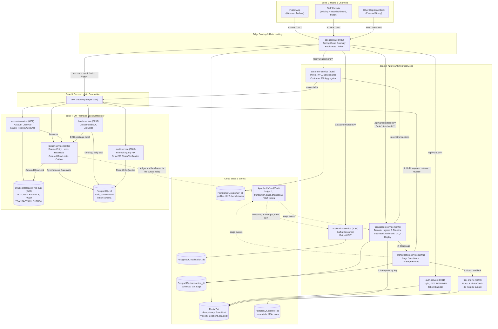
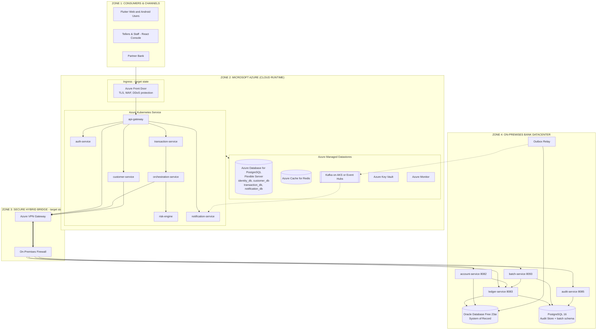

# Zero-Conflict 8-Developer Master Implementation Plan (Days 1–9)

## CooBS Hybrid-Cloud Cooperative Banking Platform

**Document Version:** 2.2
**Target Group:** Group 2 (Developers 1 through 8)
**API contract:** [`contracts/api/FUTURE_INTEGRATED_API_CONTRACT.md`](../contracts/api/FUTURE_INTEGRATED_API_CONTRACT.md)
**Per-developer file-level work:** [`PER_DEV_TECHNICAL_WORK_PACKAGES.md`](PER_DEV_TECHNICAL_WORK_PACKAGES.md)
**Target Deployment:** Azure Kubernetes Service (AKS) + On-Premises Sovereign Core Ledger

### What changed from version 1.0

| Area                        | Version 1.0                                        | Version 2.0                                                                                                                                                            |
| --------------------------- | -------------------------------------------------- | ---------------------------------------------------------------------------------------------------------------------------------------------------------------------- |
| Frontend                    | React/Flutter,`/frontend/src/**`                   | Flutter for web and Android in`/app`; the React dashboard in `/frontend` is frozen and kept as the staff console and demo fallback                                     |
| Dev 5                       | Database, DevOps and EOD                           | Database, EOD batch and audit seal                                                                                                                                     |
| Dev 8                       | QA, Postman, fixtures                              | DevOps and cloud. There is no QA role: each owner tests their own area and Dev 1 runs the E2E checklist                                                                |
| `account-service` owner     | Dev 3                                              | Dev 2                                                                                                                                                                  |
| `ledger-service` owner      | Nobody                                             | Dev 3                                                                                                                                                                  |
| Holds                       | In`account-service`, as a `hold_balance` column    | In`ledger-service`, as a `HOLD` table, because the hold must share the balance row lock                                                                                |
| Inter-bank                  | Separate`interbank-gateway` on 8093                | Package inside`transaction-service`                                                                                                                                    |
| Batch                       | `eod-batch-runner`, no port                        | `batch-service` on 8093                                                                                                                                                |
| Saga state                  | `orchestration_db`                                 | Schema`saga` in `transaction_db`                                                                                                                                       |
| Transfer path               | `/api/v1/transfers`                                | `/api/v1/transactions/transfers`                                                                                                                                       |
| GL check                    | Assets = Liabilities + Equity                      | Total debits = total credits                                                                                                                                           |
| EOD variance                | Trigger rollback                                   | Halt before the seal and alert; fix by compensating reversal                                                                                                           |
| Customer data               | Modular monolith in account-service | `customer-service` owns profile, demographic records, KYC submissions & reviews |
| `batch-service`             | AKS                                                | On-premises beside the ledger; only trigger and progress events cross the bridge (**2.1**)                                                                             |
| Ledger events               | Published straight to Kafka                        | Written to an Oracle`OUTBOX` table and relayed, so a tunnel outage loses nothing (**2.1**)                                                                             |
| `account-service` placement | AKS                                                | Beside Oracle on-premises, because its tables stay in Oracle                                                                                                           |
| API gateway                 | Front Door, then API Management, then the cluster  | Front Door, then the Spring Cloud Gateway.**No API Management:** it would duplicate routing, rate limiting and token checks the gateway already does (**version 2.2**) |
| Schema changes              | Alter existing tables and migrate data             | Schemas and data are disposable: every database is rebuilt from the seed source, nothing is migrated in place (**2.2**)                                                |
| Stack facts                 | Spring Boot 3.4, Oracle XE, HMAC-SHA512, Kafka 3.9 | Spring Boot 4.1.1, Oracle Database Free 23ai, HS384 tokens as issued today, Kafka image unpinned (`latest`)                                                            |
| Cost claim                  | $96 of free credit                                 | Removed; must be re-estimated by Dev 8 on Day 1                                                                                                                        |

---

# Table of Contents

1. [The Mandatory First Step: Architecture Diagrams](#1-the-mandatory-first-step-architecture-diagrams)
2. [The 3 Golden Rules of Zero-Conflict Git Collaboration](#2-the-3-golden-rules-of-zero-conflict-git-collaboration)
3. [8-Developer Ownership &amp; Collision Boundary Matrix](#3-8-developer-ownership--collision-boundary-matrix)
4. [Day-by-Day Plan for Each Developer (Days 1 to 9)](#4-day-by-day-plan-for-each-developer-days-1-to-9)
5. [Specification of Newly Added Features &amp; Concessions](#5-specification-of-newly-added-features--concessions)
6. [Azure Hybrid Cloud Alignment Checklist](#6-azure-hybrid-cloud-alignment-checklist)
7. [Decisions Still Open](#7-decisions-still-open)

---

# 1. The Mandatory First Step: Architecture Diagrams

### 1.1 Diagram 1: System & Component Data Flow View (Logical View)

**Placement rule:** the cloud holds what is needed to sign in, route, decide and display. On-premises holds the customer's legal record and the money.



---

### 1.2 Diagram 2: Hybrid-Cloud Infrastructure View (Deployment View)

Front Door and the VPN Gateway are target-state components. For the nine-day demo the Spring Cloud Gateway is the ingress, and the on-premises zone is a separate network segment unless Dev 8 confirms otherwise on Day 1. There is one API gateway: Azure API Management is not used, because the Spring Cloud Gateway already does routing, CORS, rate limiting and correlation IDs.



---

# 2. The 3 Golden Rules of Zero-Conflict Git Collaboration

### Rule 1: Strict Directory & Service Ownership

- Each directory has **one primary owner** (section 3).
- Nobody commits into another owner's directory except through a pull request that owner approves. In Azure Repos a branch policy enforces this: automatically included reviewers by path, one rule per owner.

### Rule 2: Single Editor for Shared Files

| Shared files                                                                                                                                                                                | Single editor |
| ------------------------------------------------------------------------------------------------------------------------------------------------------------------------------------------- | ------------- |
| `docker-compose.yml`, `.env.example`, every `Dockerfile`, `backend/pom.xml`, `azure-pipelines.yml`, `.azuredevops/**`, `infra/**`, `monitoring/**`, `scripts/**`, gateway `application.yml` | **Dev 8**     |
| `database/**`                                                                                                                                                                               | **Dev 5**     |
| `contracts/**`, `README.md`                                                                                                                                                                 | **Dev 1**     |
| `app/pubspec.yaml`, `app/lib/core/**`, platform folders                                                                                                                                     | **Dev 6**     |
| `app/assets/fixtures/**`                                                                                                                                                                    | **Dev 7**     |

Anyone who needs a port, environment variable, route, table or package requests it from the single editor: file, exact lines, reason.

### Rule 3: Frontend Unblocked via Fixtures

- **Dev 1** exports every contract example to a JSON file on Day 2. **Dev 7** curates them in `app/assets/fixtures/`.
- **Dev 6 and Dev 7** build all screens against fixtures on Days 2 and 3, using a build flag (`USE_FIXTURES=true`).
- Switching a feature to live data is a one-line change; the fixture path stays as the demo fallback.

### Testing without a QA role

- Each owner writes unit tests and a Postman folder under `postman/<service>/`.
- Dev 6 and Dev 7 write widget tests for their own folders.
- Dev 5 owns seed and reset data.
- Dev 8 makes the tests a CI merge gate.
- Dev 1 runs the cross-service E2E checklist on Days 5 and 7.

---

# 3. 8-Developer Ownership & Collision Boundary Matrix

| Role  | Primary responsibilities                      | Exclusive directories                                                                                                                 | Conflict guard                                  |
| ----- | --------------------------------------------- | ------------------------------------------------------------------------------------------------------------------------------------- | ----------------------------------------------- |
| Dev 1 | Lead, contracts, orchestration, E2E checklist | `/backend/orchestration-service`, `/contracts`, `/postman/e2e`, `/docs`                                                               | Sole contract editor                            |
| Dev 2 | Identity, customer and account                | `/backend/auth-service`, `/backend/customer-service`, `/backend/account-service`                                                      | Owns identity, customer and account entities    |
| Dev 3 | Transactions, holds, events, DLQ              | `/backend/transaction-service` (except `interbank/`), `/backend/ledger-service` (except `reversal/`), `/backend/notification-service` | Owns the balance path                           |
| Dev 4 | Risk, reversals, inter-bank                   | `/backend/risk-engine`, `ledger-service/**/reversal/`, `transaction-service/**/interbank/`                                            | Works inside Dev 3's services by package only   |
| Dev 5 | Database, EOD batch, audit seal               | `/database`, `/backend/batch-service`, `/backend/audit-service`                                                | Sole schema editor                              |
| Dev 6 | Flutter foundation and stepper                | `/app/lib/core`, `/app/pubspec.yaml`, `/app/lib/features/monitoring`                                                                  | Sole editor of Flutter core; frozen after Day 2 |
| Dev 7 | Flutter feature screens and KYC UI            | `/app/lib/features/{customer360,accounts,transfer,batch,kyc}`, `/app/assets/fixtures`                                                 | Feature folders only                            |
| Dev 8 | DevOps and cloud                              | `/infra`, Dockerfiles, Compose, `azure-pipelines.yml`, `/.azuredevops`, `/monitoring`, `/scripts`, `/backend/api-gateway`             | Sole editor of root and pipeline config         |

**Who holds each role**

| Role | Name | Role | Name |
| --- | --- | --- | --- |
| Dev 1 | Carl | Dev 5 | April |
| Dev 2 | Hans | Dev 6 | Neo |
| Dev 3 | Wayne | Dev 7 | Gabo |
| Dev 4 | Ysa | Dev 8 | Jared |

Carl also supports Dev 8: he takes on and reviews DevOps and cloud work, with Jared as its lead.

The React dashboard in `/frontend` is **frozen**; Dev 1 handles any defect in it. `auth-service` is no longer frozen: Dev 2 moves it onto `identity_db`. Its registration endpoint stays disabled, because members are seeded.

**Load note:** Dev 2 carries `customer-service` and `auth-service` (and prepares the `account-service` extraction). `customer-service` is the sole owner of member profiles and KYC; if Day 3 shows slippage, `account-service` adjustments move to Dev 3.

---

# 4. Day-by-Day Plan for Each Developer (Days 1 to 9)

### Day 1: Architecture, Diagrams & Contracts _(Zero Feature Code)_

- **Focus:** Whole-team agreement on scope, boundaries and interfaces.
- **Deliverables:**
  - **Dev 1:** Lead the workshop. Approve Diagrams 1 and 2. Start the decision log. Draft v1 OpenAPI and Kafka event examples in `/contracts`.
  - **Dev 2:** Define the identity/customer/account boundary: what is a login (`identity_db`), what is a customer profile & KYC record (`customer_db`), and what are accounts (`account-service`). Define `/api/v1/customers/**`. Specify the seeded KYC format (`VERIFIED`, `TIER_3_FULL`).
  - **Dev 3:** Define `/api/v1/transactions/transfers` DTOs, transaction statuses, idempotency, and the hold model (`RESERVED`, `POSTED`, `CANCELLED`).
  - **Dev 4:** Specify the risk request and decision (score 0.00–1.00, thresholds in section 5.6). Specify the inter-bank webhook payload.
  - **Dev 5:** Design the ERD: cloud `identity_db`, `customer_db`, `transaction_db` (schemas `txn`, `saga`), `notification_db`; on-premises Oracle core tables, audit store and `batch` schema. Define Redis key use. Define the single seed source that feeds every store.
  - **Dev 6:** Sketch the Flutter structure for web and Android, routing map and fixture approach.
  - **Dev 7:** Map screens and journeys; wireframe Customer 360, transfer, EOD deck and the KYC flow. (Dev 6 wireframes the stepper, which Dev 6 builds.)
  - **Dev 8:** Design the deployment topology (local Compose and Azure), repository layout, branching and CI. Confirm the Azure subscription and budget. Assign ports 8080–8093.
- **Exit Gate:** Both diagrams approved; open decisions in section 7 recorded; owners and acceptance criteria agreed.

---

### Day 2: Contract Freeze, Service Skeletons & Fixtures

- **Deliverables:**
  - **Dev 1:** **Freeze v1 contracts** and tag `contracts-v1`. Export examples as fixtures. Scaffold the saga state machine.
  - **Dev 2:** Scaffold `customer-service` (8089) APIs and DTOs. Map `auth-service` entities to `identity_db` (`app_user`, `role`).
  - **Dev 3:** Scaffold `transaction-service` (8090): API, event schema, validation shell.
  - **Dev 4:** Scaffold `risk-engine` (8092) with deterministic mock scoring.
  - **Dev 5:** Create schemas and constraints, as init scripts under `database/`, for all four cloud databases and the on-premises `batch` schema, including the `HOLD` and `OUTBOX` tables and internal GL accounts. Rebuild the Oracle schema without `USER`, `ROLE` and the credential columns on `CUSTOMER`; no in-place migration is needed. Move `notification-service` off `ddl-auto=update`. Hand connection settings to Dev 8.
  - **Dev 6:** Flutter shell, routing, theme, API client with fixture mode. **Freeze core by agreement.**
  - **Dev 7:** Isolated screens on JSON fixtures.
  - **Dev 8:** Scaffold all five new services in one commit (directory, `pom.xml`, Dockerfile, Compose block, CI entry, gateway route). Add the Flutter web origin to gateway CORS.
- **Exit Gate:** All eleven services build in CI and boot with a passing health check; the Flutter app runs on fixtures for web and Android.

---

### Day 3: Independent Vertical Slices & Unit Tests

- **Deliverables:**
  - **Dev 1:** Saga transitions and the eleven stage events with correlation IDs, against stubbed clients in tests until H3 and H5 are live.
  - **Dev 2:** `auth-service` logs in seeded customers and staff from `identity_db`, with no Oracle connection; `Customer` and `Kyc` entities removed from it. Channel profile and KYC endpoints implemented in `customer-service`; `account-service` scoped strictly to accounts; unit tests.
  - **Dev 3:** Transfer validation, persistence, timeline API, event stub; place-hold endpoint in the ledger; `notification-service` repointed to `notification_db`; unit tests.
  - **Dev 4:** Approve and reject rules, daily limit by tier; unit tests; latency test.
  - **Dev 5:** Seed scripts generated from one source for every store: logins in `identity_db`, channel profiles and KYC records in `customer_db`, accounts, loan accounts and GL accounts in Oracle, standing instructions in the `batch` schema. Same `user_id` and `customer_id` values everywhere. Indexes and Redis setup.
  - **Dev 6:** Login, token storage, the 11-stage stepper and 3-stage customer view on fixture timelines; core widget tests.
  - **Dev 7:** Customer 360, account and transfer screens on fixtures.
  - **Dev 8:** Containerize every service, second PostgreSQL container, `.DLT` topics, Compose profiles, CI image builds.
- **Exit Gate:** Unit tests green; each slice reviewable by pull request; the four existing Postman suites still pass.

---

### Day 4: Connect Services (First Integrated Happy Path)

- **Deliverables:**
  - **Dev 1:** Wire the saga to the real `risk-engine` and ledger hold and capture.
  - **Dev 2:** Flip the gateway customer route to `customer-service`; start the Customer 360 endpoint, querying accounts from `account-service` and recent transactions from `transaction-service`.
  - **Dev 3:** `transaction-service` hands off to the saga; capture and release in the ledger.
  - **Dev 4:** Risk endpoint live.
  - **Dev 5:** Fix query and schema issues; verify integrity constraints; scaffold `batch-service`.
  - **Dev 6:** Connect the client to live endpoints with fixture fallback; stepper on the live timeline.
  - **Dev 7:** Wire customer and account screens; loading, empty and error states.
  - **Dev 8:** Deploy the shared dev environment from CI; routing, environment variables, logging.
- **Exit Gate:** First live transfer succeeds through gateway → transaction → orchestration → risk → ledger.

---

### Day 5: Integration Checkpoint 1 & Contract Lock

- **Deliverables:**
  - **Dev 1:** Lead the checkpoint, run the E2E checklist, assign defects, **lock v1 contracts**.
  - **Dev 2:** Customer 360 on live accounts and balances; loan and current account types.
  - **Dev 3:** Verify lifecycle, persisted state and events; `notification.dispatched.v1`.
  - **Dev 4:** Verify the decline path stops before any hold; reversal of a posted transfer.
  - **Dev 5:** Verify data consistency across Oracle, `customer_db` and `transaction_db`.
  - **Dev 6:** Vertical slice on the Flutter web build.
  - **Dev 7:** Transfer screen and spending chart on web and mobile layouts.
  - **Dev 8:** Stabilize the deployment and pipeline; check logs and connectivity.
- **Exit Gate:** Happy path, fraud decline and insufficient funds all verified; risk check under 40 ms at p95.

---

### Day 6: Advanced Features (Holds, Reversals, DLQ & EOD Batch)

- **Deliverables:**
  - **Dev 1:** Compensation in the saga: release on failed capture, reversal after posting; retries and timeouts.
  - **Dev 2:** Beneficiaries, score fields, validation and role checks.
  - **Dev 3:** Hold edge cases; duplicate-request protection; exponential backoff and `.DLT` publishing; admin replay endpoint; outbox table write and relay in the ledger.
  - **Dev 4:** Hold-aware reversal; inter-bank inbound webhook; behaviour during a ledger outage.
  - **Dev 5:** **EOD pipeline**, all six steps: interest accrual, service fees, standing instructions, loan amortization, GL reconciliation, daily audit seal.
  - **Dev 6:** Stepper failure and reversal states; shared error and auth handling.
  - **Dev 7:** **EOD control deck** with step-by-step progress; mock KYC presentation flow.
  - **Dev 8:** Key Vault, TLS, network rules, monitoring view, autoscaling settings, rollback procedure.
- **Exit Gate:** Advanced features functional; EOD trigger runs all six steps in 5 to 8 seconds.

---

### Day 7: Integration Checkpoint 2 & System Hardening

- **Deliverables:**
  - **Whole team:** End-to-end smoke test across all eleven services.
  - **Dev 1:** Run the E2E checklist; prioritize release defects; confirm scope.
  - **Dev 2:** Remove `User`, `Role` and unused customer entities from `account-service` and `ledger-service`; confirm no on-premises service reads a password hash.
  - **Dev 3:** Verify DLQ replay; restrict the gateway's ledger route to staff roles. It is not retired, because the React staff console calls it.
  - **Dev 4:** Inter-bank loopback test; verify the audit chain after a reversal.
  - **Dev 5:** Data integrity under failure; reset-ready demo dataset.
  - **Dev 6 & Dev 7:** Full journey on web and Android: login → Customer 360 → transfer with stepper → EOD batch.
  - **Dev 8:** Redeploy, health checks, alerts, recovery drill, load test including the JMeter double-spend test.
- **Exit Gate:** Feature-complete demo candidate; zero P1 or P2 defects open.

---

### Day 8: Feature Freeze, Data Reset & Timed Rehearsal

- **ALL DEVS:** **Hard feature freeze.** P1 and P2 fixes only, each reviewed by Dev 1.
- **Dev 5:** Final schema and seed check; demo data reset script; database backup.
- **Dev 8:** Tag and deploy the release; freeze the pipeline; prepare the fallback local stack.
- **Dev 1 & Dev 6:** Timed rehearsal of the presentation and live demo.
- **Dev 7:** Slides, backup screenshots and screen recording.
- **Exit Gate:** Release candidate frozen and rehearsed; clean reset works on two laptops.

---

### Day 9: Presentation & Live Defense Day

- **Dev 1:** Open and close; explain design decisions; lead Q&A.
- **Dev 2:** The identity split, Customer 360 and the account decomposition.
- **Dev 3:** Transaction lifecycle, holds, and event evidence.
- **Dev 4:** Risk engine and inter-bank gateway; label mocked vs live clearly.
- **Dev 5:** Data design, EOD batch, GL reconciliation and the audit seal.
- **Dev 6:** The cross-platform Flutter approach and the stepper.
- **Dev 7:** Drive the customer-to-transaction UI demo.
- **Dev 8:** Operate deployment and monitoring; explain CI/CD and the cloud design; technical fallback.

---

# 5. Specification of Newly Added Features & Concessions

### 5.1 Amount Holds / Fund Reservations

- **Owner:** `ledger-service`. The hold must be placed under the same `BALANCE` row lock as postings.
- **Database representation:** one row per hold, so a specific hold can be captured or released.

  ```sql
  CREATE TABLE HOLD (
      hold_id      NUMBER(19) GENERATED ALWAYS AS IDENTITY PRIMARY KEY,
      account_id   NUMBER(19) NOT NULL REFERENCES ACCOUNT(account_id),
      reference_no VARCHAR2(36) NOT NULL UNIQUE,
      amount       NUMBER(18, 4) NOT NULL CHECK (amount > 0),
      status       VARCHAR2(20) DEFAULT 'RESERVED' NOT NULL,
      created_at   TIMESTAMP DEFAULT CURRENT_TIMESTAMP NOT NULL,
      resolved_at  TIMESTAMP
  );
  ```

  Placing a hold reduces `available_balance`; releasing restores it; capturing writes the double entry.

- **Hold states:** `RESERVED` → `POSTED` (captured) or `CANCELLED` (released).

### 5.2 Transaction Reversals

- Records are never updated or deleted, so the append-only audit trigger still holds.
- Reversing `TX-1001` creates new entries: `REVERSAL_CREDIT` for the sender and `REVERSAL_DEBIT` for the recipient, each referencing the original.
- A transfer can be reversed only once.

### 5.3 On-Demand EOD Batch Engine

- `batch-service` runs **on-premises** beside the ledger, so its many postings never cross the bridge. Its step log lives in the `batch` schema of the on-premises PostgreSQL.
- Triggered by `POST /api/v1/batch/eod/trigger` (admin only). Runs in 5 to 8 seconds and writes one progress row per step.
  1. **Interest accrual** on savings balances.
  2. **Service fees.**
  3. **Standing instructions.**
  4. **Loan amortization.**
  5. **GL reconciliation:** total debits equal total credits.
  6. **Daily audit seal:** a closing hash appended to the audit store.
- Every posting goes through `ledger-service` and has two legs, using seeded internal GL accounts (cash, interest expense, fee income, loan receivable, inter-bank settlement).
- If step 5 finds a variance, the pipeline **halts before the seal** and alerts an admin. Earlier steps are corrected by compensating reversal, never by rollback.

### 5.4 Real-Time Transaction Monitoring Dashboard

- **Customer view:** Initiated → Processing → Posted (or Failed).
- **Staff view, eleven stages:**
  `[1. Initiated]` → `[2. Validated]` → `[3. Authenticated]` → `[4. Fraud Check]` → `[5. Limit Check]` → `[6. Funds Check]` → `[7. Authorized]` → `[8. Posted]` → `[9. Ledger Update]` → `[10. Notification]` → `[11. Reconciliation]`
- `transaction-service` publishes stages 1 to 3. `orchestration-service` publishes stages 4 to 11: it reports 4 and 5 from the `risk-engine` response and 6 and 8 from the ledger's hold and capture responses, and decides 7 itself. Neither `risk-engine` nor `ledger-service` publishes a stage event. Stages 9 to 11 complete by event after the customer sees Posted.
- The client polls `GET /api/v1/transactions/{id}/timeline` once a second.

### 5.5 Customer 360 Dashboard

1. Member profile and verified KYC badge (`TIER_3_FULL`).
2. Credit score gauge (300–850) and risk gauge (0.00–1.00).
3. Account cards: savings, current and loan.
4. Spending breakdown by category. This needs a `category` field on the transfer contract.
5. Active beneficiaries.

### 5.6 Risk Decision Thresholds

| Score            | Decision  | Reason code       |
| ---------------- | --------- | ----------------- |
| Below 0.60       | `APPROVE` | —                 |
| 0.60 to 0.85     | `DECLINE` | `REVIEW_REQUIRED` |
| Above 0.85       | `DECLINE` | `HIGH_RISK`       |
| Over daily limit | `DECLINE` | `LIMIT_EXCEEDED`  |

The middle band is a decline because no manual review queue is in scope. A timeout (150 ms) fails closed with `RISK_UNAVAILABLE`. These match section 9 of the API contract, which is the source.

### 5.7 Dead-Letter Queue & Retry

- Exponential backoff, three attempts, then `<topic>.DLT`.
- Replaces the existing handler in `notification-service`, which retries at a fixed one second and then drops the record.
- `notification-service` runs in the cloud on its own `notification_db`; its table leaves `audit_store`.
- Admin replay endpoint in `transaction-service`.

### 5.8 Identity, Member Profile and KYC Master

| Data                                                                                       | Store         | Owner              | Zone        |
| ------------------------------------------------------------------------------------------ | ------------- | ------------------ | ----------- |
| Username, password hash, status, `customer_id` link                                        | `identity_db` | `auth-service`     | Cloud       |
| Sessions, refresh tokens, token blacklist                                                  | Redis         | `auth-service`     | Cloud       |
| Display name, preferences, beneficiaries, KYC tier and status, risk and credit scores      | `customer_db` | `customer-service` | Cloud       |
| Legal name, address, mobile number, civil status, occupation, KYC records and updates      | `customer_db` / Oracle `KYC` | `customer-service` | Cloud / Hybrid |

- `customer-service` is the sole owner of all `/api/v1/customers/**` endpoints, including member demographic records, KYC submissions, and KYC review workflows.
- `account-service` is strictly scoped to deposit account lifecycles (`ACCOUNT`), account closure requests, and legal/administrative flags.
- Oracle `CUSTOMER` keeps `customer_id` and `kyc_status`; its `username`, `password_hash` and `email` columns move to `identity_db`.
- Oracle no longer has `USER` or `ROLE`. Columns such as `approved_by` store the `user_id` from `identity_db` as a plain number.
- Schemas and data are disposable: Dev 5 rebuilds every database from the init scripts and seed source under `database/`. Services carry no migration files and run with `ddl-auto=validate`.
- All stores are seeded from one source so `user_id` and `customer_id` match everywhere.
- A breach of the cloud side yields password hashes and display names, not identity records or balances.

### 5.9 Ledger Outbox

- The ledger writes each event to an Oracle `OUTBOX` row in the same transaction as the posting.
- A relay publishes unsent rows to Kafka and marks them published.
- If the tunnel is down, postings still commit and events are delivered when it returns. First item to cut if Day 6 runs late; the fallback is the current direct publish.

### 5.10 Concessions

- No registration or KYC engine: members are seeded as verified.
- No scheduler: EOD runs on demand.
- No clearing network: inter-bank is one authenticated webhook, with loopback as the demo path.

---

# 6. Azure Hybrid Cloud Alignment Checklist

- [ ] **Stateless compute:** saga state lives in `transaction_db`, locks and counters in Redis, so AKS pods can scale.
- [ ] **Database portability:** `identity_db`, `customer_db`, `transaction_db` and `notification_db` map to Azure Database for PostgreSQL Flexible Server; no cross-database queries.
- [ ] **Login without the tunnel:** `auth-service` and its data are in the cloud, so sign-in does not depend on the VPN.
- [ ] **Sovereign account data:** `account-service` and the ledger stay on-premises with Oracle; `customer-service` manages member profiles and KYC.
- [ ] **Sovereign ledger:** `ledger-service`, Oracle and the audit store stay on-premises. Only `orchestration-service` (from the cloud) and `account-service` and `batch-service` (local) call the ledger.
- [ ] **No cloud service connects to Oracle.**
- [ ] **Configuration by environment variable only;** secrets move to Key Vault.
- [ ] **Every outbound call has a timeout,** so a VPN outage leaves transactions at a visible stage.
- [ ] **Events survive a tunnel outage** through the ledger outbox.
- [ ] **Cost:** re-estimate before claiming a figure. The version 1.0 figure of $96 did not account for the AKS nodes, VPN Gateway and Front Door together.
---

# 7. Decisions Still Open

Each of these is stated as open somewhere in the planning set. Record the outcome here when it is made, and move it to the settled decisions in [`README.md`](README.md).

| # | Decision | Owner | Needed by | Source |
| --- | --- | --- | --- | --- |
| 1 | Kafka on AKS or Azure Event Hubs | Jared | Day 4 | Section 1.2 |
| 2 | Azure cost estimate, replacing the removed $96 figure | Jared | Day 4 | Section 6 |
| 3 | Whether a Microsoft-hosted parallel job is available, or a self-hosted agent is needed | Jared | Before build validation is switched on | Branch policy plan, section 7 |
| 4 | Squash-only merges on `dev`, or rebase allowed as well | Carl | Before branch policies are applied | Branch policy plan, section 9 |
| 5 | Which imported branches to delete | Jared, with each branch's author | Day 3 | Branch policy plan, section 9 |
| 6 | Whether `batch.eod.step.completed.v1` is published through the ledger outbox or by `batch-service` itself | April and Wayne | Day 4 (handshake H11) | Work packages, Dev 5 |
| 7 | Whether to build the optional email MFA through Resend | Whole team; Hans builds it | After Checkpoint 1 | Service scope, section 0.3 |
| 8 | Whether `account-service` changes move from Hans to Wayne | Carl | End of Day 3, only if Dev 2's work is slipping | Section 3, load note |
